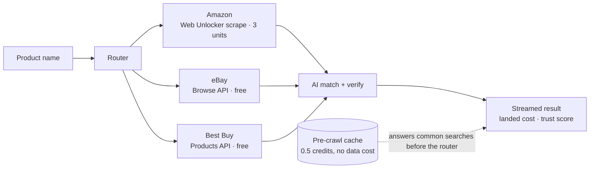

# Before You Buy — Product Requirements Document (PRD)

| Field | Value |
|---|---|
| Version | 4.0 (in-repo edition 4.0.1) |
| Source | *Before You Buy — PRD v4.0*, Oct 3, 2026, @Zean |
| Status | Approved for build, subject to Gate 0 |
| Owner | Zean & Dagger |
| Related | [02-ARCHITECTURE](02-ARCHITECTURE.md) · [03-TECHNICAL-REQUIREMENTS](03-TECHNICAL-REQUIREMENTS.md) · [06-IMPLEMENTATION-PLAN](06-IMPLEMENTATION-PLAN.md) · [08-REVIEW-ITEMS](08-REVIEW-ITEMS.md) |

> **How to read this file.** This is the in-repo copy of PRD v4.0. Requirement IDs (`CW-*`, `AR-*`) are stable and are referenced by every other document, by milestones, and by tests. Text marked **Editor's note** was added when the PRD was converted for the repo; it flags facts that changed after the PRD was written or gaps that need a decision. Editor's notes never change scope on their own — open items live in [08-REVIEW-ITEMS](08-REVIEW-ITEMS.md).

---

## 1. Summary

Before You Buy tells a shopper whether a listing can be trusted, not only whether it is cheap. A shopper searches a product by name (or pastes a retailer URL); the site compares Amazon, eBay and Best Buy on **landed cost** (price + shipping + estimated tax), shows **review-authenticity signals**, **90-day price history**, condition, warranty and returns, and lets them set a **price-drop alert**.

v4 keeps the v3 matching engine and changes the three things that decide whether the product works: where the data comes from, what it costs per search, and what the site actually claims. Cost per search falls from **$0.0105 to $0.0045**, gross margin moves from negative to **86–91%**, and the consumer-critical features move out of v4/v5 into launch scope.

---

## 2. What changed from v3

Ten changes. The first three decide whether the business works; the rest decide whether consumers use it.

| # | Change | Reason |
|---|---|---|
| 1 | eBay and Best Buy move to official APIs; scraping is Amazon-only | eBay Browse API and Best Buy Products API are free, legal and stable. Cuts cost per search by 57% and removes selector drift on two of three platforms |
| 2 | Pricing rebuilt from cost up | v3 tiers lost money at any real utilisation: Pro was $99/mo against $525 of BrightData cost at full quota |
| 3 | Phase 1 uses Web Unlocker as a request API, not Puppeteer | v3 §5.1 step 5 described Puppeteer over WebSocket, which is Browser API ($8/GB), not Web Unlocker ($1.50/1K requests) |
| 4 | Landed cost replaces listed price as the compared number | A listed-price comparison is wrong at checkout once shipping and tax differ. v3 treated this as an acceptable caveat (R3); for consumers it breaks the core promise |
| 5 | Results stream in; no blocking 45-second wait | Consumers abandon at roughly 8 seconds. SSE moves from v5 into scope |
| 6 | Price history and price-drop alerts move from v4 into scope | Alerts are the only retention mechanism in the product; history answers "is this a good price" rather than only "who is cheapest" |
| 7 | Review authenticity becomes the headline differentiator | Price comparison alone does not beat Google Shopping. Review verification is a gap no platform fills and the only feature that needs the AI layer |
| 8 | Free tier gets the full product at low volume | v3's free tier was Amazon-only, so it compared Amazon against nothing and could not demonstrate the product |
| 9 | 100% accuracy claims removed | v3 NFR-5 promised 100% price accuracy while §11 targeted a 5% verification failure rate. Both cannot hold, and the claim is a liability |
| 10 | Terms-of-service exposure documented | v3 §12.3 covered CCPA only. The actual legal risk in a scraping business is retailer ToS, which went unmentioned |

---

## 3. Positioning

**Before You Buy tells you whether a listing can be trusted, not only whether it is cheap.**

Price comparison alone does not win. A shopper typing a product name already has Google Shopping in the address bar, returning six retailers instantly on a site they never had to learn. Matching that is not a reason to switch.

The gap worth owning is the one the platforms cannot fill, because the problem sits on their own shelves:

- **Are the reviews real?** A 4.6-star filter surfaces review-farmed listings next to honest ones on every marketplace. Fakespot shut down in 2025 and nothing replaced it.
- **Is the discount real?** $89 marked down from $140 means nothing if the $140 was never charged. Price history answers this.
- **Is this the same unit under eight names?** White-label products relisted by multiple sellers at different prices are invisible to a price sort.

These three questions need the AI matching layer already built in v3. Price sorting does not. **The AI is justified by trust verification, not by comparison.**

### 3.1 What the site claims

The product shows the **top three options with its reasoning visible, not a single verdict**. One hidden best answer from an affiliate-funded site reads as advertising, and shoppers have learned to discount it. Showing the working converts better and is harder to fake.

**Affiliate relationships are disclosed on every result.** Options that earn nothing are shown when they are genuinely better, which is what makes the earning ones credible.

### 3.2 Primary segments (in priority order)

1. **Resellers and arbitrage buyers.** Check 50+ products daily, tie the output directly to their margin, highest willingness to pay. This is the revenue.
2. **Considered-purchase consumers.** Research-mode shoppers on items above roughly $200. Low frequency per user, but they generate the affiliate sales that unlock Amazon API access.
3. **Developers.** The API, once the consumer product has proven the matching works.

v3 ordered these in reverse.

---

## 4. Data architecture

Only Amazon is scraped; eBay and Best Buy come from free official APIs. **3 billable units per search, down from 7.**

eBay's Browse API and Best Buy's Products API return structured, authoritative pricing for free, so neither platform needs scraping or a verification pass. Amazon is the only path that consumes BrightData credits, and it keeps the full v3 treatment: **Web Unlocker for discovery, the LLM for matching, Web Scraper API for independent price verification.** This is what takes a search from 7 billable units to 3, and it removes selector drift, anti-bot risk and terms-of-service exposure on two of the three platforms.

---

## 5. Consumer web requirements

The website ships first and the API follows. Search is by **product name**, not URL, which is a harder matching problem than v3 solved: with no source product to anchor against, the engine selects from an open field rather than finding a known item's equivalent.

| ID | Requirement | Priority |
|---|---|---|
| CW-1 | Name-based search with autocomplete; URL paste also accepted | P0 |
| CW-2 | Source result renders within 2 seconds; comparisons stream in individually via SSE | P0 |
| CW-3 | Landed cost shown as the compared number: item price + shipping + estimated sales tax, with the breakdown expandable | P0 |
| CW-4 | Condition stated prominently on every result (new, used, refurbished) with warranty and return window | P0 |
| CW-5 | Top 3 results with reasoning shown, never a single verdict | P0 |
| CW-6 | Review authenticity score per listing, with the signals that produced it | P0 |
| CW-7 | 90-day price history per product, showing whether the current price is genuinely low | P0 |
| CW-8 | Price-drop alerts by email; the only point at which an email address is requested | P0 |
| CW-9 | Mobile-first layout; most shopping sessions are phone sessions | P0 |
| CW-10 | No signup before first result | P0 |
| CW-11 | Deep links to the exact item and variant, never a homepage or dead listing | P0 |
| CW-12 | Plain-language status: "checked 3 minutes ago", not `scrapedAt` timestamps | P0 |
| CW-13 | Permanent shareable URL per comparison | P1 |
| CW-14 | Affiliate disclosure on every result page | P0 |
| CW-15 | Pre-crawled cache of popular products so most searches never trigger a live scrape | P0 |

### 5.1 On landed cost (CW-3)

CW-3 is the single most important change in this document. v3 compared listed prices and disclosed the limitation in R3. For a developer API that is acceptable. For a consumer it means the site can confidently name a winner that is not the winner once $15 delivery and a different state tax rate land at checkout. **A comparison that is wrong at checkout is worse than no comparison**, because the user only discovers it after trusting the result.

Shipping and tax cannot always be determined before checkout. **Where they cannot, the result shows the range and says so**, rather than silently comparing an incomplete number.

### 5.2 On caching (CW-15)

CW-15 is what makes the economics work. A live three-platform search costs money every time; a cache hit costs nothing. Pre-crawling the top several thousand products by search volume means the common case is instant and free, and live scraping is reserved for the long tail.

> **Editor's note.** Freshness of cached data is bounded by each retailer's terms (eBay: listings no more than 6 hours older than eBay's own; Best Buy: cache no more than 72 hours; Amazon Associates program content: 24 hours). See [02-ARCHITECTURE §8](02-ARCHITECTURE.md#8-provider-adapters-and-retailer-policy) and LEGAL-02/03/04 in [08-REVIEW-ITEMS](08-REVIEW-ITEMS.md).

---

## 6. API requirements

Most of v3 §5 carries over unchanged. The matching requirements (FR-M1 to FR-M7), the confidence model, and the variant-aware pipeline in R7 are sound and stay as written. What follows is only what changes.

> **Editor's note.** The v3 PRD (§5, FR-M1–FR-M7, the confidence model, R7, and risk register R1–R7) is **not in this repository**. Until it is added as `docs/reference/prd-v3.md`, [03-TECHNICAL-REQUIREMENTS §7](03-TECHNICAL-REQUIREMENTS.md#7-matching-tr-match) defines a working matching spec. Tracked as GAP-01 in [08-REVIEW-ITEMS](08-REVIEW-ITEMS.md).

| ID | Change from v3 | Note |
|---|---|---|
| AR-1 | `POST /api/search` accepts `{ "query": "product name" }` alongside the existing `{ "url": ... }` | Name search needs a distinct matching prompt: selecting from an open field, not matching a known item |
| AR-2 | eBay and Best Buy candidates come from their official APIs | Removes Phase 1 scraping for two platforms |
| AR-3 | Phase 1 for Amazon uses Web Unlocker as a request API, returning HTML for parsing | Not Puppeteer over WebSocket, which is a different BrightData product at different pricing |
| AR-4 | Phase 2 verification applies to Amazon only | eBay and Best Buy prices arrive from their APIs already structured and authoritative |
| AR-5 | SSE endpoint `GET /api/search/stream` returns results as each platform resolves | Required by CW-2; was a v5 roadmap item |
| AR-6 | Response carries `landedPrice` alongside `listedPrice`, plus `shippingCost`, `estimatedTax` and `landedPriceComplete` | Replaces `priceType: 'listed'` as the primary figure |
| AR-7 | Response carries `reviewAuthenticity` with a score and the contributing signals | New; the core differentiator |
| AR-8 | Response carries `priceHistory90d` with min, max, median and current percentile | New; answers "is this actually a good price" |
| AR-9 | Metering is in credits, not calls | See §9. A cache hit and a live three-platform search cost very different amounts |
| AR-10 | Quota exhaustion bills overage rather than returning 402 | A hard stop breaks a customer's production app and causes churn |

> **Editor's note — paths.** The architecture versions the public API under `/v1`. In the codebase, the PRD's `POST /api/search` is `POST /v1/search` and `GET /api/search/stream` is `GET /v1/search/stream`. The consumer website uses first-party equivalents under `/web/*`. See DEC-014 in [09-CHANGE-MANAGEMENT](09-CHANGE-MANAGEMENT.md).

### 6.1 Response time

v3 targeted p95 under 45 seconds for a blocking call. That target stays for the synchronous API, but it is no longer the user-facing number.

| Path | Target |
|---|---|
| Cache hit | under 400 ms |
| First result streamed (source product) | under 2 s |
| All comparisons streamed | under 12 s p95 |
| Synchronous `/api/search` (developer path) | under 45 s p95 |

### 6.2 Dependency risk

v3 §R6 argued that Phase 1 and Phase 2 provide independent verification because they use different BrightData infrastructure. They are still one vendor, one commercial relationship and one legal target. If BrightData has an outage, drops Amazon coverage, or is enjoined, both phases fail together.

Moving two platforms to official APIs reduces this materially. **A second unblocking provider should be integrated behind a common interface before launch** so the Amazon path can fail over.

---

## 7. Unit economics

Cost per search falls from $0.0105 to $0.0045 — a 57% reduction — by using official APIs where they exist.

BrightData pay-as-you-go rates: Web Unlocker $1.50 per 1,000 successful requests, Web Scraper API $1.50 per 1,000 delivered records. Both carry 5,000 free credits per month from a shared pool.

| Operation | v3 | v4 |
|---|---|---|
| Source product fetch | 1 Web Scraper record | 1 Web Scraper record (Amazon only) |
| Platform search | 3 Web Unlocker requests | 1 Web Unlocker request (Amazon); eBay and Best Buy free via official API |
| Price verification | 3 Web Scraper records | 1 Web Scraper record (Amazon only) |
| **Billable units per search** | **7** | **3** |
| **Cost per search** | **$0.0105** | **$0.0045** |

The LLM (Gemini 2.0 Flash at time of writing) adds roughly $0.0002 per search across query generation and matching, which is immaterial at these volumes but should be re-costed if the model changes.

> **Editor's note.** This model does not include fetching review content for review-authenticity scoring (CW-6) on Amazon, which may need extra Web Unlocker requests per listing. Tracked as GAP-04.

### 7.1 What the free credits cover

5,000 free BrightData credits per month ÷ 3 units per search ≈ **1,650 free searches a month**. That covers the entire MVP build, internal testing, and the first roughly 50 free-tier users at 100 searches each — at zero data cost.

### 7.2 Where v3 broke

| v3 tier | Price | Included | Cost at full quota | Margin |
|---|---|---|---|---|
| Starter | $29 | 5,000 | $52.50 | −81% |
| Pro | $99 | 50,000 | $525.00 | −430% |

Pro was profitable only below roughly 19% utilisation. The v3 month-6 target of 500,000 calls against $10,000 MRR implied a BrightData bill of $5,250 before hosting, the LLM or salaries.

### 7.3 Cache effect

At **70% cache hit rate** — achievable with CW-15 pre-crawling — the blended cost per search falls to about **$0.0014**. All pricing below is calculated at the uncached $0.0045 figure, so cache performance is upside, not a dependency.

---

## 8. Pricing

Three paid tiers at 86–91% gross margin, priced from cost rather than from round numbers.

| | Free | Starter | Growth | Scale |
|---|---|---|---|---|
| Price per month | $0 | $49 | $199 | $799 |
| Searches included | 100 | 1,000 | 5,000 | 25,000 |
| Effective per search | — | $0.049 | $0.040 | $0.032 |
| Data cost at full quota | $0.45 | $4.50 | $22.50 | $112.50 |
| Gross margin | — | 91% | 89% | 86% |
| Rate limit | 5/min | 60/min | 300/min | 1,000/min |
| Overage per search | n/a | $0.06 | $0.05 | $0.04 |
| Review authenticity | Yes | Yes | Yes | Yes |
| Price history and alerts | 3 tracked | 25 tracked | Unlimited | Unlimited |
| API access | No | Yes | Yes | Yes |
| Support | Community | Email | Email | Priority |

**Enterprise** is quoted custom from **$2,000 per month**, aimed at the reseller segment running continuous margin checks.

### 8.1 Why these numbers

- **The $0.04 anchor.** A developer replicating this with Rainforest API needs roughly 7 credits per comparison at about $0.0066 per credit, so around $0.046 — before building and maintaining their own matching layer. Pricing at $0.040 means Before You Buy is cheaper than the do-it-yourself path, which is the entire commercial argument.
- **5× volume for 4× price.** Each upgrade lowers the customer's per-search rate. Equal steps would make upgrading feel like a penalty.
- **The free tier is the full product.** 100 searches with every feature costs about $0.45 per user per month. v3's crippled free tier could not demonstrate a comparison at all, which made its 8% conversion target unreachable.
- **$29 is too cheap to signal reliability.** Developer buyers read a $29 API with an SLA as a side project. $49 is the floor.

---

## 9. Credit metering

Searches are metered as credits, because a cache hit and a live multi-platform search cost very different amounts.

| Event | Credits |
|---|---|
| Cache hit | 0.5 |
| Live search, base | 3 |
| Each additional platform beyond the first | 2 |
| Forced refresh (`cache=false`) | 3 |
| Price-drop alert check | 0 (batched on our schedule) |

Customers are emailed at **80% of quota**, which is the highest-leverage upgrade trigger available.

> **Editor's note.** §8 states quotas in *searches* while §9 meters *credits*, and the PRD does not state how many credits a default three-platform live search costs (a literal reading gives 3 + 2 + 2 = 7). The code treats every number in this table and the plan quotas as configuration. Decision tracked as DECIDE-01.

---

## 10. Accuracy, limitations and legal

The v3 risk register (R1 to R7) is retained in full and remains the strongest part of the document. Three changes and one addition.

### 10.1 Removed: the 100% claims

v3 NFR-5 promised "verified price = live listing price, 100% of returned results" while §11 targeted a price verification failure rate under 5%. These contradict each other, and R3 already explains honestly why 100% is unachievable. Both claims are replaced:

| Metric | v3 | v4 |
|---|---|---|
| Price accuracy | 100% | Verified price matches listing price in ≥ 98% of returned results, sampled weekly |
| Landed cost | not measured | Within $2 of checkout total in ≥ 90% of sampled purchases |

**No guarantee is offered on a number controlled by a third party.**

### 10.2 Revised: R3 becomes a requirement, not a caveat

v3 classified listed-vs-checkout price as a Known Limitation. In v4 it is CW-3, a P0 requirement. Where shipping or tax genuinely cannot be determined pre-checkout, the result shows a range and says which component is uncertain.

### 10.3 Reduced: R5 selector drift

Selector drift now applies to Amazon only. eBay and Best Buy arrive through versioned official APIs with deprecation notices. The 30-minute health check and anomaly detection from v3 are retained for the Amazon adapter.

### 10.4 Added: terms-of-service exposure

v3 §12.3 addressed CCPA only. CCPA is not the material legal risk in this business.

| Risk | Exposure | Mitigation |
|---|---|---|
| Amazon ToS prohibits automated access | Account termination, cease and desist, potential CFAA claim | Scrape only public listing pages, no authentication, no circumvention of access controls, respect rate limits. Migrate to Amazon's official API once affiliate sales qualify the account |
| Amazon API access is conditional | Access requires qualifying sales (see note) | The consumer site is the mechanism that generates and sustains these sales. This is a reason to launch consumer-first |
| eBay and Best Buy API terms | Suspension of API key | Operate within published rate limits and attribution requirements |
| Affiliate disclosure | FTC enforcement | Disclosure on every result page (CW-14) |

**Legal review of the Amazon scraping path should happen before the site accepts its first paying customer, not after.**

> **Editor's note — Amazon API.** The PRD refers to PA-API (3 qualifying sales in 180 days; since November 2025, at least 10 qualifying orders per 30 days to retain). Amazon deprecated PA-API 5.0 on April 30, 2026 (retired May 15, 2026); its successor is the **Amazon Creators API** (OAuth 2.0 client credentials), which requires at least 10 qualifying referred sales in the last 30 days. Separately, the Associates Program Policies allow showing Amazon prices and availability only when Amazon serves the link that displays them or when the data comes from the Creators API / PA-API, and they restrict using Program Content to develop or improve ML models. Both points interact with scraped Amazon prices shown next to affiliate links and with the AI layer. Tracked as LEGAL-01 and LEGAL-02; these must be resolved before launch, not only before the first paying customer.

### 10.5 Competitors previously listed as partners

v3 §12.2 named Honey, Rakuten and Slickdeals as distribution partners. Honey is owned by PayPal, Capital One Shopping is owned by Capital One, and all three build this capability in-house. **They are competitors**, and the browser-extension form factor they use is the one that fits consumer shopping behaviour best.

---

## 11. Roadmap

Resequenced around one principle: **anything a consumer needs to trust or return to the site ships in v4.0.** v3 scheduled alerts and price history for v4 and streaming and the extension for v5, which left the launch version with no retention mechanism and a 45-second wait.

| Phase | Scope |
|---|---|
| **v4.0 — Launch** | Consumer website, name-based search, landed cost, SSE streaming, review authenticity scoring, 90-day price history, price-drop alerts, mobile-first UI, pre-crawl cache, Amazon + eBay + Best Buy, affiliate monetisation |
| **v4.5 — Monetise** | Paid tiers live, credit metering, usage dashboard, public API with name and URL search, overage billing |
| **v5.0 — Extension** | Browser extension surfacing results on the retailer's own page. The form factor that matches how people actually shop, and the one Honey and Capital One Shopping chose |
| **v5.5 — Reseller tooling** | Bulk search, CSV upload, margin calculator against supplier cost, saved watchlists, webhooks |
| **v6.0 — Scale** | Additional retailers, international markets, white-label API |

The extension is v5.0 rather than v4.0 only because the website is needed first to generate the Amazon affiliate sales that unlock official Amazon API access. If that constraint can be satisfied another way, the extension should move forward.

### 11.1 Dropped from scope

- **Gemini 2.0 Flash as a named mandatory dependency.** The model should sit behind an interface. Hard-coding a specific version into a requirements document guarantees the document is stale within two quarters, and 2.0 Flash is already a generation behind.
- **US-only as a permanent constraint.** It stays for v4.0, but the operating entity is Australian and Amazon AU is materially less saturated. Worth revisiting at v6.0 rather than treating as a fixed boundary.

---

## 12. Success metrics and validation gates

The largest untested assumption in v3 was demand. The document specified an engine in detail and assumed customers. These gates are ordered so the cheapest risk is retired first.

### 12.1 Gate 0 — before building (2 weeks, near-zero cost)

Landing page stating the positioning claim, a live demo on three real products, and an email capture. Posted to Show HN and r/SideProject, plus 30 direct messages to reseller-tool and extension developers.

| Signal | Proceed | Reconsider |
|---|---|---|
| Email signups | 100+ | under 30 |
| Unprompted "when does it ship" replies | 10+ | under 3 |
| Pre-orders at $49 for 3 months, refundable | 10+ | 0 |

Ten people paying before anything exists is worth more than any further specification work. If nobody pre-pays, that is the answer and it cost a fortnight.

### 12.2 Gate 1 — product quality

| Metric | Target | Note |
|---|---|---|
| Match accuracy | > 92% | Carried from v3 |
| Landed cost within $2 of checkout | > 90% | New; the core promise |
| Review authenticity precision | > 85% | Measured against manually labelled listings |
| First result rendered | under 2 s | CW-2 |
| Cache hit rate | > 70% | Drives blended cost to $0.0014 |
| Dead or wrong-variant links | < 1% | The fastest way to lose trust permanently |

### 12.3 Gate 2 — business

| Metric | Month 3 | Month 6 |
|---|---|---|
| Monthly recurring revenue | $1,500 | $8,000 |
| Paying customers | 20 | 60 |
| Affiliate revenue | $300 | $1,500 |
| Amazon API qualified | 3 sales / 180 days | 10+ orders / 30 days sustained |
| Blended gross margin | > 80% | > 85% |
| Monthly churn | < 7% | < 4% |

Targets are below v3's. v3 projected $10,000 MRR and 100 customers by month 6 on a model that lost money per call; these assume slower growth at real margin.

### 12.4 The one metric that decides it

**Returning users.** A price comparison used once is a utility nobody remembers. Price-drop alerts (CW-8) are the only mechanism in this document that creates a reason to come back. **If 30-day return rate sits below 15% by month 3, the positioning is wrong regardless of what the other numbers say.** (Measurement definition: [03-TECHNICAL-REQUIREMENTS §17](03-TECHNICAL-REQUIREMENTS.md#17-analytics-and-the-return-rate-metric-tr-anl).)

---

## 13. Open questions

| ID | Question | Tracked as |
|---|---|---|
| OQ-1 | Which Amazon affiliate categories carry workable commission rates? Electronics and computers are among the lowest, and all three launch platforms are electronics-weighted. | DECIDE-10 |
| OQ-2 | What is the actual search-to-purchase conversion rate? At 1% the affiliate model works; at 0.3% it is near breakeven before hosting. | DECIDE-11 |
| OQ-3 | Does name-based matching hold up on vague queries ("wireless earbuds") as well as on exact models? The v3 engine was built for the exact-model case. | DECIDE-12 |

---

## 14. Glossary

| Term | Meaning |
|---|---|
| Landed cost / landed price | Item price + shipping + estimated sales tax for the shopper's ZIP. The compared number (CW-3) |
| Listing | One retailer offer: an Amazon ASIN, an eBay item (or variation), or a Best Buy SKU |
| Product | The canonical item a shopper means (brand + model + variant), to which listings are matched |
| Source result | For a URL search, the pasted listing; for a name search, the resolved canonical product. Must render within 2 s (CW-2) |
| Phase 1 / Phase 2 (Amazon) | Phase 1: discovery via Web Unlocker HTML. Phase 2: independent price verification via Web Scraper API |
| Cache hit | A search answered entirely from cached or pre-crawled data inside each retailer's freshness window |
| Credit | The metering unit for searches (§9) |
| Review authenticity | A per-listing score with the signals that produced it (CW-6, AR-7) |
| Gate 0 / 1 / 2 | Validation checkpoints for demand, product quality and business (§12) |
