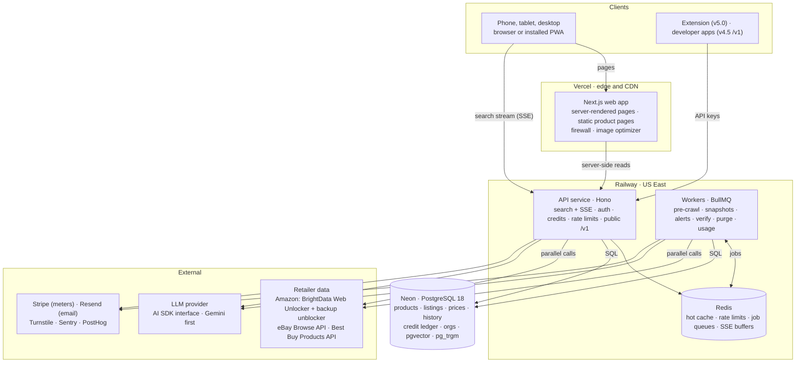
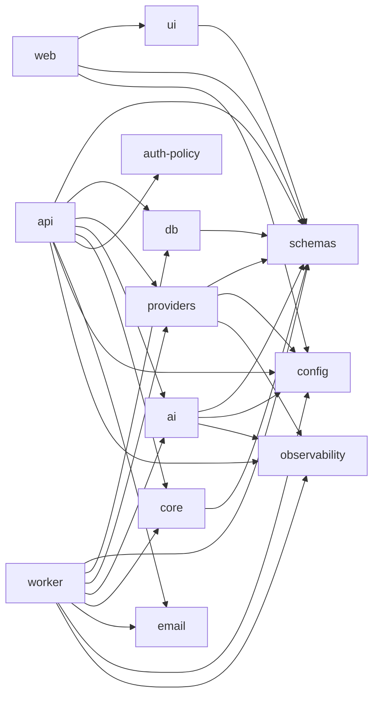
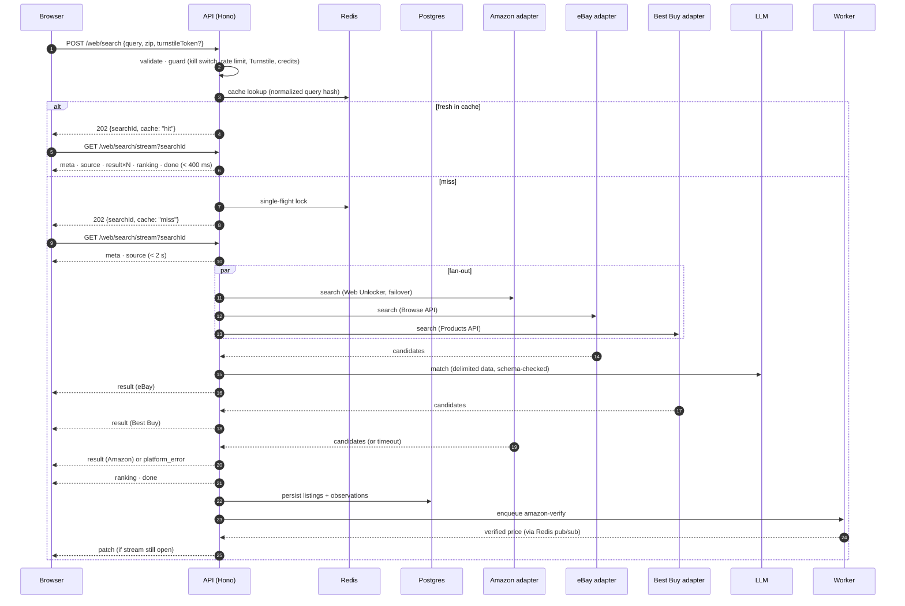
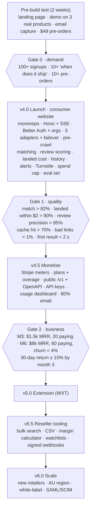

# Before You Buy — Architecture & Stack

| Field | Value |
|---|---|
| Version | 1.0 (in-repo edition of *Before You Buy — Architecture & Stack*, Oct 4, 2026) |
| Owner | Zean & Dagger |
| Status | Approved |
| Related | [01-PRD](01-PRD.md) · [03-TECHNICAL-REQUIREMENTS](03-TECHNICAL-REQUIREMENTS.md) · [04-BACKEND-SCHEMA](04-BACKEND-SCHEMA.md) · [05-SECURITY](05-SECURITY.md) · [07-UI-UX-DESIGN](07-UI-UX-DESIGN.md) |

> This document says **what the system is made of and why**. The exact contracts (endpoints, events, algorithms, budgets) live in [03-TECHNICAL-REQUIREMENTS](03-TECHNICAL-REQUIREMENTS.md); tables and keys live in [04-BACKEND-SCHEMA](04-BACKEND-SCHEMA.md). Decisions added during repo setup are logged as `DEC-*` in [09-CHANGE-MANAGEMENT](09-CHANGE-MANAGEMENT.md).

---

## 1. Recommendation at a glance

Build Before You Buy in **TypeScript end to end**. Use a **Next.js** web app on **Vercel**, a **Hono** API and job workers in containers on **Railway**, and one **PostgreSQL 18** database on **Neon** with **Redis** beside it. One codebase serves phones, tablets and desktops. Long streaming searches stay clear of serverless time limits. Organizations and API keys exist before the B2B move.

| Layer | Choice | Why it fits this PRD |
|---|---|---|
| Language | TypeScript everywhere | One language for web, API, workers and the v5.0 extension; validation schemas written once |
| Repo | pnpm workspaces + Turborepo monorepo | Apps share packages: schemas, database, provider adapters, UI |
| Web app | Next.js 16 (React 19.2) — pin **≥ 16.3.8** | Server-rendered pages, little JavaScript on phones, CDN-cached product pages that also win search traffic |
| UI kit | shadcn/ui on Tailwind CSS v4, Base UI primitives | Open-source components you own; restyle later by changing design tokens |
| API | Hono on Node.js LTS | Small and fast, built-in SSE helper, OpenAPI docs generated from the same schemas |
| Validation | Zod 4 | One schema checks the form, the API, provider data and LLM output |
| Database | PostgreSQL 18 on Neon, via Drizzle ORM | Relational data, price history, vector matching (pgvector) and autocomplete (pg_trgm) in one engine |
| Cache, limits, jobs | Redis + BullMQ | Fast cache hits, per-plan rate limits, background jobs |
| Auth | Better Auth | Runs in your own database: magic links, passkeys, organizations, API keys, SSO later |
| AI | Vercel AI SDK, Gemini as first provider | The model sits behind an interface, as the PRD asks |
| Billing | Stripe Billing with usage meters | Credits, overage and plan tiers from AR-9 and AR-10 |
| Email | Resend + React Email | Price-drop alerts and the 80% quota warning |
| Bot defence | Cloudflare Turnstile + Vercel firewall | Stops bots spending BrightData credits on free searches |
| Monitoring | Sentry, OpenTelemetry, PostHog | Errors, traces, and the 30-day return rate the PRD says decides the product |

---

## 2. Principles

Four principles hold it together. Every pull request should be checkable against them.

1. **One schema, everywhere.** A Zod schema written once validates the browser form, the API, the worker, the extension, and generates the public API docs.
2. **Long work on containers, pages on the CDN.** SSE streams and 45-second developer calls run on always-on containers; product pages load instantly from the edge.
3. **B2B is configuration, not a rewrite.** Every user belongs to an organization from day one, and credits are an append-only ledger.
4. **Postgres first.** No separate vector, search or time-series database until real volume demands one.

Five engineering rules follow from the PRD and are enforced in review (also listed in [CLAUDE.md](../CLAUDE.md)):

5. **Retailer terms are code.** Every provider declares a policy block (display age, retention, AI use, attribution); nothing reads or stores retailer data without going through it.
6. **Never fetch a user's URL.** URLs are parsed into retailer IDs and rebuilt server-side from an allowlist.
7. **Untrusted data passes a schema before use.** Retailer HTML, API responses and LLM output are all untrusted.
8. **Money is integer cents.** No floating point anywhere money is summed or compared.
9. **Ranking is affiliate-blind.** Commission is never an input to which options are shown or in what order (PRD §3.1).

---

## 3. What the PRD demands of the architecture

Thirteen PRD requirements decide the stack. Everything else is a normal web app. The two that shape hosting most are SSE streaming and abuse protection on free live searches, because every uncached search costs real money.

| Requirement | PRD ref | What it forces in the stack |
|---|---|---|
| Cache hit under 400 ms, first result under 2 s | CW-2, §6.1 | Redis hot cache in the same region as the API; pre-crawled products served from a CDN |
| Comparisons stream in as each platform resolves | CW-2, AR-5 | A long-lived SSE endpoint, which runs best on always-on containers rather than short serverless functions |
| Synchronous developer path, 45 s p95 | §6.1 | Long requests live on containers, not edge functions |
| 90-day price history with percentile | CW-7, AR-8 | A time-series table partitioned by month, filled by a scheduled snapshot job |
| Price-drop alerts, checked on our schedule | CW-8, §9 | Background job queue, scheduler and transactional email |
| Landed cost: price + shipping + tax | CW-3, AR-6 | ZIP-aware sales-tax data and per-retailer shipping rules; show a range when unknown |
| No signup before first result | CW-10 | Anonymous sessions plus bot protection, so bots cannot burn BrightData credits |
| Credits, overage, per-tier rate limits | AR-9, AR-10, §8 | Append-only credit ledger, metered billing, Redis rate limiter keyed by plan |
| Second unblocking provider with failover | §6.2 | One provider-adapter interface with a circuit breaker per provider |
| AI model behind an interface | §11.1 | A provider-agnostic LLM SDK; no model name hard-coded |
| URL paste accepted | CW-1 | Strict retailer-domain allowlist to block server-side request forgery (SSRF) |
| Mobile-first on phone, tablet and desktop | CW-9 | Server-rendered React, a small JavaScript budget, installable PWA |
| Public API and B2B later | v4.5, v6.0 | Organizations, roles and API keys in the data model from day one |

---

## 4. Alternatives considered

Each pick wins on today's needs and can be swapped later without rewriting the product. The last column says when to look again.

| Decision | Pick | Also considered | Why the pick wins now | Revisit when |
|---|---|---|---|---|
| Language | TypeScript | Python (FastAPI) | The web app and extension need TypeScript anyway; Python would add a second schema system (Pydantic + Zod) and toolchain | Review scoring moves to a custom-trained model: add one small Python service for it |
| Web framework | Next.js 16 | React Router v7, TanStack Start, SvelteKit, Astro | Largest ecosystem and hiring pool; Server Components cut phone JavaScript; static product pages for SEO | Vendor lock-in worries: deploy the same app to Cloudflare via OpenNext |
| API layer | Hono service | Next.js route handlers only, NestJS, Fastify, tRPC | Public API needs versioning, its own rate limits and long requests; Hono is lighter than NestJS and runs on Node, Bun or Workers; tRPC is internal-only | Never needs splitting further before v6.0 |
| ORM | Drizzle | Prisma | Stays close to SQL, which matters for partitions, pgvector and trigram queries | Team strongly prefers Prisma's schema file: both work |
| Database host | Neon | Supabase, Railway Postgres, AWS RDS | Branch per preview deploy, point-in-time restore, autoscaling; Supabase bundles auth and storage we won't use | Steady high load makes a fixed-size instance cheaper: move to RDS or a dedicated server |
| Price history | Postgres monthly partitions | TimescaleDB | Launch volume is millions of rows, not billions; one less system | Observations pass roughly 500 million rows |
| Autocomplete | Postgres pg_trgm + full-text | Meilisearch, Typesense | Catalog starts at thousands of products; no extra service | Catalog passes about a million products or typo tolerance falls short |
| Job queue | BullMQ | Inngest, Trigger.dev, pg-boss | Free, mature, uses the Redis we already run | Workflows grow long and multi-step: Trigger.dev or Inngest |
| Auth | Better Auth | Clerk, Auth.js, Supabase Auth | User data stays in your database; organizations, API keys and SAML SSO are plugins; no per-user fee | Enterprise buyers require a certified identity vendor |
| Hosting | Vercel + Railway + Neon | All-Cloudflare, all-AWS, one VPS | Fastest to ship with little DevOps; each part can move on its own | Monthly bill passes about $1,000: move workers to Hetzner or AWS |
| Payments | Stripe Billing | Paddle (merchant of record) | Native usage meters for credits and overage | Sales-tax registration across US states becomes a burden: Paddle collects and remits for you (DECIDE-07) |

---

## 5. System architecture

Browsers load pages from Vercel and open the search stream straight to the API. The API and workers share Redis for cache and jobs; both read and write Neon Postgres and call the outside services. The extension and developer apps use the same API with keys.



### 5.1 Components and responsibilities

| Component | Runs on | Owns | Never does |
|---|---|---|---|
| `apps/web` (Next.js) | Vercel | Pages, product pages (ISR), PWA shell, SEO, UI state, Turnstile widget, ZIP chip | Talk to retailers, the LLM or Stripe directly; hold secrets other than its own public keys; write to the database |
| `apps/api` (Hono) | Railway (always-on container) | Search orchestration, SSE, auth endpoints (Better Auth), credits, rate limits, webhooks, `/web/*` and `/v1/*` routes | Long batch work (queue it); render HTML |
| `apps/worker` (BullMQ) | Railway (container, separate service) | Pre-crawl, snapshots, alert checks, Amazon verify, health checks, retention purge, usage reporting, outbox dispatch, partition maintenance | Serve HTTP (except a health endpoint) |
| Postgres (Neon) | Neon, US East | System of record | Hold anything that can't be rebuilt — this *is* the source of truth |
| Redis | Railway | Rebuildable state only: cache, counters, queues, SSE buffers, circuit-breaker state | Hold data that must survive a flush |

### 5.2 Origins and cookies

| Origin | Serves | Notes |
|---|---|---|
| `https://www.<domain>` | `apps/web` | Domain name is DECIDE-09 |
| `https://api.<domain>` | `apps/api` | Same registrable domain as the web app, so `SameSite=Lax` session cookies flow to the API |

- Better Auth is mounted on the API at `/api/auth/*` with cross-subdomain cookies scoped to `.<domain>`.
- **Cookie-authenticated routes (`/web/*`, `/api/auth/*`) accept requests only from the first-party web origin** (exact-match CORS allowlist + `Origin` check on writes).
- **API-key routes (`/v1/*`) never read cookies** and may allow cross-origin requests.
- The browser opens `EventSource(..., { withCredentials: true })` directly to the API, so SSE never passes through a serverless function.

### 5.3 How the web app gets data

Server components in `apps/web` read data **through the API** (internal fetch with a service token for ISR/product pages; the user's cookies for personalised pages). The API is the single owner of business logic and database writes (DEC-024). The worker is the only other writer.

---

## 6. Repository layout and package boundaries

```
before-you-buy/
├── CLAUDE.md                 # entry point for Claude Code
├── docs/                     # this documentation set
├── apps/
│   ├── web/                  # Next.js site and product pages
│   ├── api/                  # Hono API: search, SSE, auth, /web, public /v1
│   ├── worker/               # BullMQ jobs: pre-crawl, snapshots, alerts, verify, purge
│   └── extension/            # WXT browser extension (v5.0) — not created before M22
├── packages/
│   ├── schemas/              # Zod schemas shared by every app (contracts live here)
│   ├── db/                   # Drizzle schema, migrations, repositories (org-scoped)
│   ├── providers/            # Amazon, eBay, Best Buy adapters + policy blocks
│   ├── ai/                   # LLM interface, prompts, evaluation set
│   ├── core/                 # domain logic: landed cost, ranking, trust scoring, credits, history math
│   ├── auth-policy/          # roles, scopes, can() checks
│   ├── email/                # React Email templates + send helpers
│   ├── config/               # env validation, plan table, credit prices, feature flags, kill switches
│   ├── observability/        # logger, OTel setup, Sentry helpers, PII scrubbing
│   └── ui/                   # shadcn components and design tokens
├── tooling/                  # shared tsconfig, eslint, prettier presets
├── infra/                    # docker-compose for local dev, Railway/Vercel config, k6 scripts
└── .github/workflows/        # CI
```

> `packages/core`, `packages/email`, `packages/config`, `packages/observability`, `tooling/` and `infra/` are additions to the original layout. They keep domain logic testable without HTTP, and keep configuration in one validated place.

### 6.1 Dependency rules



- Apps depend on packages; **packages never import from apps**.
- `packages/core` is pure: no network, no database, no clock (time is passed in). This is where landed cost, ranking, trust scoring, credit pricing and percentile math live, so they are unit-tested exhaustively.
- `packages/schemas` depends on nothing but Zod.
- `apps/web` must not import `db`, `providers`, `ai` or anything holding server secrets (enforced by an ESLint import rule).

---

## 7. Search pipeline

A search either answers from cache in one round trip, or fans out to the three retailers in parallel and streams each result as it lands. **A slow or failed retailer never blocks the other two.**

1. **Validate and normalize.** The query passes a Zod schema: trimmed, at most 200 characters. A pasted URL is accepted only if its host is Amazon, eBay or Best Buy. The server extracts the ASIN, item ID or SKU and rebuilds a clean URL; **it never fetches the user's URL.**
2. **Guard.** Check kill switches and the rate limit (anonymous: per IP and per session; signed in: per plan). Anonymous users must pass a Turnstile check before an uncached search. Check credits.
3. **Cache.** Look in Redis, then in the pre-crawled Postgres tables. If the data is within each retailer's freshness window, stream everything and finish: under 400 ms, 0.5 credits.
4. **Single-flight.** If an identical uncached search is already running, attach to its stream instead of starting another fan-out (saves money under load).
5. **Fan out.** Call all providers at once, each with its own timeout, circuit breaker and rate limiter. Best Buy allows 5 calls per second; eBay allows 5,000 calls per day by default.
6. **Match.** Deterministic identifiers first (GTIN/UPC/MPN), then pgvector narrows candidates, then the LLM picks matches using the name-search prompt from AR-1. Fewer candidates means fewer tokens.
7. **Enrich.** Add landed cost (shipping rules + ZIP-based sales tax), condition and warranty, review-authenticity score and 90-day price stats. Rank the top 3 with reasoning.
8. **Stream.** Send SSE events: `meta`, `source`, one `result` per platform, a `platform_error` per failed platform (never fatal), `ranking`, then `done`. The client draws each card as it arrives. A heartbeat every 15 seconds keeps mobile connections open, and `Last-Event-ID` resumes after a dropped connection.
9. **Persist and verify.** Save observations, then queue Amazon's phase-2 price check on a worker. If the stream is still open, the verified price patches the card (`patch` event); if not, it updates the cache.

> The event name `platform_error` replaces the original `error` because a custom SSE event called `error` collides with `EventSource`'s built-in connection-error event (DEC-015). Full event contract: [03-TECHNICAL-REQUIREMENTS §6](03-TECHNICAL-REQUIREMENTS.md#6-search-orchestration-caching-and-sse-tr-srch).



### 7.1 Five cache layers

Browser → CDN → Redis → Postgres → live retailer call. Each layer answers before the next is asked.

| Layer | What it holds | Lifetime |
|---|---|---|
| Browser | Static assets; TanStack Query cache for autocomplete | Session |
| CDN (Vercel) | Product pages (ISR), static assets | Revalidated when prices change |
| Redis | Search results by normalized-query hash; autocomplete; listings by retailer ID | Bounded by each provider's `maxDisplayAgeSec` |
| Postgres | Products, listings, latest observations (pre-crawled) | Bounded by provider `maxRetainSec`; purged nightly |
| Live | Retailer APIs / Web Unlocker | — |

Cached entries hold **listed prices and shipping options, not landed cost**. Landed cost is computed per request from the shopper's ZIP, so one cache entry serves every ZIP.

---

## 8. Provider adapters and retailer policy

Every retailer plugs in through one interface. **Its policy block is where retailer terms become code.**

```ts
interface ProviderAdapter {
  id: 'amazon' | 'ebay' | 'bestbuy';
  policy: {
    maxDisplayAgeSec: number;   // e.g. eBay listings: 6 h
    maxRetainSec: number;       // e.g. Best Buy: 72 h
    aiUseAllowed: boolean;      // may this data go to the LLM?
    historyAllowed: boolean;    // may observations feed price history? (added; see LEGAL-03/04)
    attribution?: string;       // e.g. Best Buy logo required
  };
  search(q: NormalizedQuery, ctx: Ctx): Promise<Candidate[]>;
  getListings(refs: ListingRef[], ctx: Ctx): Promise<Listing[]>;
}
```

- `ctx` carries the abort signal (timeout), the request's trace context, the shopper ZIP (for shipping lookups) and a cost meter.
- The Amazon adapter has **two transports** behind it — BrightData Web Unlocker and a second unblocking provider (DECIDE-04) — with automatic failover. That is the PRD's dependency-risk fix.
- Each provider has its own circuit breaker, timeout and rate limiter (Redis token bucket).
- Every value an adapter returns has passed a Zod schema. Parse failures are logged with the raw payload hash (not the payload) and dropped.
- Policy values are configuration in `packages/config`, not literals scattered through code. If legal review changes a rule, one value changes.

Initial policy defaults (pending legal review — LEGAL-02/03/04):

| Provider | `maxDisplayAgeSec` | `maxRetainSec` | `aiUseAllowed` | `historyAllowed` | Attribution |
|---|---|---|---|---|---|
| Amazon (scraped) | 6 h (DECIDE-13; ≤ 24 h per LEGAL-02) | 120 days (90-day window + margin) | true | true | Timestamp + Associates disclaimer next to prices |
| eBay (Browse API) | 6 h (terms) | 24 h for non-listing content; listings per legal review | **false until LEGAL-03 clears** | **false until LEGAL-03 clears** | eBay attribution per API terms |
| Best Buy (Products API) | 24 h | 72 h (terms) | **false until LEGAL-04 clears** | **false until LEGAL-04 clears** | Best Buy logo where its data appears |

> Consequence: until legal review says otherwise, price history (CW-7) may be **Amazon-only**, and AI matching on eBay and Best Buy data must rely on deterministic identifiers (GTIN/UPC/MPN, brand + model) rather than the LLM. The architecture absorbs either outcome by flipping configuration.

---

## 9. Background jobs

| Job (queue) | When it runs | What it does |
|---|---|---|
| `precrawl` | Continuously, most-searched first | Refreshes popular products inside each retailer's freshness window (CW-15); budgets eBay's daily calls using batched lookups |
| `snapshot` | On each refresh of a tracked product | Writes observations and daily stats for price history |
| `alert-check` | After each snapshot | Compares against alert targets and queues the email; costs 0 credits |
| `amazon-verify` | After each live Amazon result | Phase-2 price verification via Web Scraper API (AR-4) |
| `amazon-health` | Every 30 minutes | Detects selector drift and anomalies (R5, kept from v3) |
| `retention-purge` | Nightly | Deletes data past each provider's retention limit |
| `usage-report` | Every few minutes (v4.5) | Sends new credit-ledger entries to Stripe meters |
| `outbox-dispatch` | Continuously | Delivers emails, webhooks and billing events written to `outbox_events` |
| `partition-maintenance` | Daily | Creates the next three monthly partitions; detaches/drops expired ones |
| `embedding-backfill` | On demand | (Re)computes product embeddings when the embedding model changes |

All jobs are idempotent (safe to retry), carry a job ID derived from their input, and emit OTel spans.

---

## 10. Data architecture (summary)

One PostgreSQL 18 database holds every record at launch. Redis holds only what can be rebuilt from Postgres: cached results, rate-limit counters and job queues.

| Table | Holds |
|---|---|
| `organizations`, `members`, `invitations` | Tenants and roles; every signup gets a personal organization |
| `users`, `sessions`, `accounts`, `verifications`, `passkeys` | Better Auth's own tables; email is the only personal data collected |
| `api_keys` | Hashed key, visible prefix, scopes, org |
| `products` | Canonical product: brand, model, GTIN, variant attributes, embedding |
| `listings` | One row per retailer listing: platform, external ID, condition, seller, warranty, returns, deep link |
| `price_observations` | Listing, time, listed price, shipping, stock, source — partitioned by month |
| `price_stats_daily` | Daily min, median and max per product |
| `review_signals` | Authenticity score, the signals behind it, model version |
| `searches` | Normalized query, actor, cache status, credits, latency |
| `comparisons` | Shareable comparison slugs (CW-13) |
| `credit_ledger` | Signed credit changes with reason and idempotency key — append-only |
| `alerts` | Product, target price or % drop, last notified |
| `outbox_events` | Emails, webhooks and billing events to send — same transaction as the change |
| `audit_log` | Organization actions |

Four rules keep the data model future-proof:

- **Time-sortable IDs.** Primary keys use PostgreSQL 18's native `uuidv7()`. IDs sort by creation time and cannot be guessed. Shareable comparison URLs (CW-13) use a separate short random slug.
- **Money as integers.** Store cents plus a currency code, never floating point. Credits are stored as integer **millicredits** (a 0.5-credit cache hit is 500).
- **Provider policy on every price.** Each stored price records its source and a `retain_until`, so a nightly job can enforce each retailer's retention rules.
- **Migrations in code.** Drizzle migrations run in CI against a Neon branch before production.

Full definitions: [04-BACKEND-SCHEMA](04-BACKEND-SCHEMA.md).

---

## 11. Security architecture (summary)

Target **OWASP ASVS Level 2** from the first release. The biggest risk here is **financial**, not data theft: free signup-less search (CW-10) lets a bot spend the BrightData budget unless every live search is guarded.

| Area | Control | Where |
|---|---|---|
| Input validation | Zod strict schemas at every trust boundary | `packages/schemas` |
| Untrusted outside data | Retailer HTML, API responses, LLM output schema-checked; failures dropped | `packages/providers`, `packages/ai` |
| Sign-in | Magic link + passkeys (consumers); password + 2FA (business, v4.5); SAML/SCIM (Enterprise) | Better Auth |
| Authorization | Org roles + key scopes; one `can(actor, action, resource)` check per handler; default deny | `packages/auth-policy` |
| Tenant isolation | `org_id` scoping in repositories; Postgres RLS on B2B tables | `packages/db` |
| Abuse and cost | Turnstile, per-plan rate limits, daily spend cap → cache-only mode, kill switches | Edge + Redis |
| SSRF / injection | Retailer allowlist; parameterized SQL; scraped text rendered as text | API, web |
| Prompt injection | Delimited data, no tools, schema-checked output | `packages/ai` |
| Transport | HTTPS only, HSTS, nonce CSP, `frame-ancestors 'none'` | Next.js proxy, Hono |
| Supply chain | Renovate (48 h critical patch target), CodeQL, secret scanning, pnpm `minimumReleaseAge` | GitHub |

The patch target matters in practice: Next.js shipped an out-of-band fix for a critical upstream React Server Components issue on September 22, 2026, then a security release on September 30 (16.3.8).

Full controls, threat model and checklists: [05-SECURITY](05-SECURITY.md).

---

## 12. Speed on phone, tablet and desktop

Pages render on the server, ship little JavaScript, and serve popular products straight from the CDN. Only a live search waits on retailers, and it streams. One responsive codebase covers every screen; there is no separate mobile app until the data says one is needed.

| Budget | Target | Enforced by |
|---|---|---|
| Cache-hit API response | under 400 ms (PRD) | Load test in CI |
| First streamed result | under 2 s (CW-2) | Synthetic check every 5 minutes |
| All comparisons streamed | under 12 s p95 (PRD) | Server timing histogram + alert |
| Largest Contentful Paint, mid-range phone on 4G | ≤ 2.5 s | Lighthouse CI on every pull request |
| Interaction to Next Paint | ≤ 200 ms | Real-user monitoring |
| Cumulative Layout Shift | ≤ 0.1 | Lighthouse CI; skeleton cards keep their final size |
| Initial JavaScript per route | ≤ 150 KB gzipped | Bundle-size check in CI |

- **Static product pages.** Each pre-crawled product gets a server-rendered page, cached on the CDN and revalidated when its prices change. They load instantly and double as search landing pages ("is this a good price for …").
- **Streaming results page.** The page shell renders on the server; only the results list is a client component listening to SSE.
- **One region.** API, Redis and database sit in the same US East region (US-only at v4.0), so a cache hit is a few milliseconds inside the data center.
- **Mobile-first layout.** Tailwind breakpoints plus container queries; 44-pixel touch targets; tested at iPhone SE width, iPad portrait and landscape, and desktop.
- **Installable PWA.** Home-screen install on phone and iPad, an offline shell, and later web push as a second alert channel.
- **Assets.** Next.js image optimization (AVIF/WebP, sized per screen); one self-hosted variable font; icons as tree-shaken SVG (Lucide).

---

## 13. Frontend and design system (summary)

- **shadcn/ui on Tailwind CSS v4**, with **Base UI** primitives (shadcn's default for new projects since July 2026; Radix remains supported). Components are copied into `packages/ui`, so the later custom design is a token and component edit, not a rewrite.
- **Design tokens** (color, radius, spacing, type) live as CSS variables in Tailwind v4's `@theme`.
- **Accessibility:** WCAG 2.2 AA.
- **Forms:** React Hook Form + Zod resolver, using the same schemas as the API.
- **Client data:** TanStack Query for fetches; native `EventSource` for the search stream.
- **Charts:** shadcn chart components (Recharts) for the 90-day view.
- **Icons:** Lucide.
- **Extension (v5.0):** WXT, reusing `packages/ui` and `packages/schemas`.

Full specification: [07-UI-UX-DESIGN](07-UI-UX-DESIGN.md).

---

## 14. B2B readiness

The move to B2B should be a pricing and sales change, not a database migration. Two things must exist at v4.0 for that to hold: **organizations** and **the credit ledger**. The rest attaches to them later.

| Capability | Ships in | How it works |
|---|---|---|
| Organizations and roles | v4.0 | Every signup gets a personal organization; credits, alerts and keys belong to the organization, not the user |
| Credit ledger | v4.0 (internal), v4.5 (billed) | Append-only entries with idempotency keys; prices per event from `packages/config` (PRD §9) |
| Metered billing and overage | v4.5 | Ledger totals sent to Stripe usage meters; overage billed instead of a 402 stop (AR-10); email at 80% of quota |
| Public API | v4.5 | Versioned `/v1`, OpenAPI docs generated from the Zod schemas, API keys, per-plan rate limits, usage dashboard |
| Signed webhooks | v5.5 | Outbox events delivered with HMAC signatures, retries and a delivery log |
| Bulk search and CSV upload | v5.5 | Uploads to object storage, processed as a queued batch with progress over SSE |
| Enterprise controls | Enterprise tier (from $2,000/mo) | SAML SSO, SCIM provisioning, audit-log export, IP allowlist, SLA |
| White-label API and new regions | v6.0 | Per-tenant branding and domains; region set in config, so an AU deployment is a new environment, not a fork |

---

## 15. Environments, deployment and CI/CD

| Environment | Web | API / worker | Database | Redis | Purpose |
|---|---|---|---|---|---|
| `local` | `next dev` | `tsx watch` | Docker `pgvector/pgvector:pg18` | Docker `redis:7` | Development; providers mocked by default (MSW + recorded fixtures) |
| `preview` | Vercel preview per PR | Railway PR environment (optional, API changes only) | Neon branch per PR | Railway ephemeral | Review and E2E tests |
| `production` | Vercel production | Railway production (2 services) | Neon main branch with PITR | Railway | Live |

- **Migrations** run as Railway's pre-deploy step for the API, and in CI against a Neon branch on every PR. Migrations are **expand/contract**: a release never removes a column the previous release still reads.
- **CI** (GitHub Actions): install → lint → typecheck → unit tests → build → integration tests (Neon branch) → E2E (Playwright against preview) → Lighthouse CI → bundle-size check. CodeQL and secret scanning run on every PR. The AI evaluation suite runs on PRs that touch `packages/ai`, `packages/providers` or `packages/core` using recorded fixtures, and nightly against live data with a spend budget.
- **Releases** are trunk-based: `main` is always deployable; each milestone merges behind feature flags where it is not ready for users.

Details: [03-TECHNICAL-REQUIREMENTS §26–28](03-TECHNICAL-REQUIREMENTS.md#26-testing-and-quality-strategy).

---

## 16. Observability

| Signal | Tool | Key uses |
|---|---|---|
| Errors | Sentry (web, API, worker) | Release-tagged errors; source maps |
| Traces and metrics | OpenTelemetry → OTLP backend | Search span tree per platform; time-to-first-result; provider latency, error rate, circuit-breaker state; LLM tokens and cost per search; BrightData spend per day |
| Product analytics | PostHog | Funnels, 30-day return rate, outbound clicks, alert engagement, feature flags |
| Logs | Structured JSON (pino) | Request ID on every line; emails, keys and IPs scrubbed |
| Synthetic checks | Scheduled job + uptime monitor | First streamed result < 2 s every 5 minutes |

---

## 17. Hosting and cost

Infrastructure costs about **$60 a month at launch** and roughly **$170–270 by month 6**. That is 2–3% of the PRD's $8,000 month-6 MRR target, before BrightData data costs. Prices below are list prices checked October 2026; usage figures are estimates.

| Service | Plan and pricing basis | Launch / month | Month 6 / month |
|---|---|---|---|
| Vercel (web app) | Pro: $20 per seat including $20 usage credit, 100 GB transfer, firewall | $20 | $40–60 |
| Railway (API, workers, Redis) | Pro: $20 minimum including $20 usage; about $20 per vCPU-month and $10 per GB-month of RAM | $20 | $60–100 |
| Neon (Postgres) | Launch: $0.106 per compute-hour, $0.35 per GB-month storage, scales to zero | $20–25 | $50–90 |
| Resend (email) | Free: 3,000 a month, 100 a day; Pro $20 for 50,000 | $0 | $20 |
| Turnstile, Sentry, PostHog | Free tiers at this scale | $0 | $0 |
| **Total infrastructure** | | **about $60–65** | **about $170–270** |

Data cost stays as the PRD models it. BrightData Web Unlocker is $1.50 per 1,000 successful requests with 5,000 free a month, so an uncached search costs $0.0045 and about $0.0014 blended at a 70% cache hit rate.

**Why hybrid rather than all-serverless:** SSE streams and 45-second developer calls are cheapest and simplest on always-on containers, while the website gains most from Vercel's CDN. If the bill passes about $1,000 a month, the containers move to Hetzner or AWS unchanged.

---

## 18. Build order

Build in order of risk: demand, then quality, then revenue. Each phase starts once the gate above it passes. **Don't build the engine before Gate 0.** The pre-build test uses only the landing page, a database table and Stripe Checkout, all from this stack, so nothing is thrown away if demand is proven. The evaluation set built in v4.0 is what measures Gate 1, so quality is tested in CI, not judged by eye.



The milestone-level plan is [06-IMPLEMENTATION-PLAN](06-IMPLEMENTATION-PLAN.md).

---

## 19. Risks and open decisions

The largest new risk is not technical. The eBay and Best Buy API terms may limit two P0 features, 90-day price history (CW-7) and AI matching on their data, and the Amazon Associates policies constrain how scraped Amazon prices may be shown next to affiliate links. This needs the same legal review the PRD already plans for Amazon. *Not legal advice; quotes come from the terms pages read October 2026.*

| Risk | What the terms or limits say | How the architecture absorbs it |
|---|---|---|
| eBay data freshness and use | Listings shown must be no more than 6 hours older than eBay's own, and other content 24 hours. eBay content may not be used "to suggest or model prices for items listed on eBay." Data from "Restricted APIs" may not go into non-eBay AI without written consent. | Policy block sets display age, retention, `aiUseAllowed` and `historyAllowed`; the nightly purge enforces it. If legal says no, eBay history turns off in config. |
| Best Buy caching and pricing analysis | Content may be cached "on a temporary basis not to exceed seventy-two (72) hours." No use "for the benefit of any third party (such as other retailers)" to analyze Best Buy pricing. Best Buy logo required where its data appears. | 72-hour retention in the policy block; attribution rendered from the adapter. Price history may end up Amazon-only unless Best Buy grants permission. |
| Amazon Associates price display | Prices and availability may be shown only if Amazon serves the link displaying them or the data comes from the Creators API / PA-API; timestamp + disclaimer required; 24 h caching; comparison formats must show lowest new and used price. PA-API 5.0 was retired in May 2026 (Creators API replaces it). | Amazon price rendering carries timestamp + disclaimer; `maxDisplayAgeSec` ≤ 24 h; LEGAL-01/02 decide whether scraped prices may sit next to affiliate links before launch. |
| eBay call quota | 5,000 Browse API calls a day by default; more requires eBay's Application Growth Check. | Apply before launch (DECIDE-08); batch refreshes; serve repeats from cache. |
| Best Buy rate limit | 5 calls per second, 50,000 per day; over the limit returns 403. | Per-provider limiter in Redis; pre-crawl spreads calls across the day. |
| Single scraping vendor (PRD) | BrightData outage or exit stops Amazon. | Second unblocking provider behind the same Amazon adapter, with failover. |
| Free-search abuse | Bots can spend real money on signup-less live searches. | Turnstile, rate limits, single-flight, and a daily spend cap that switches to cache-only mode. |

| Open decision | Recommendation | Needed by | Tracked |
|---|---|---|---|
| One language for the whole stack | TypeScript, unless the team is much stronger in Python | Before the repo is set up | DECIDE-16 |
| Stripe or Paddle | Ask your accountant about US sales-tax registration for the Australian entity; Stripe if you will register yourselves | v4.5; Stripe Checkout is enough for Gate 0 pre-orders | DECIDE-07 |
| Sales-tax data for landed cost | A ZIP-level rate dataset or tax API, picked on accuracy against "within $2 of checkout" | Before CW-3 is built (M8) | DECIDE-05 |
| Getting the shopper's ZIP without signup | Guess from IP region, show it with a "change" link, store it in a cookie | v4.0 design | DECIDE-06 |
| Scope of legal review | Amazon path (already in the PRD) plus the eBay, Best Buy and Associates terms above | Before launch (M17) | LEGAL-01…04 |

---

## 20. Sources

- Before You Buy PRD v4.0 (Oct 3, 2026)
- [Next.js blog: 16.3.6 and 16.3.8 security releases](https://nextjs.org/blog)
- [eBay API call limits](https://developer.ebay.com/develop/get-started/api-call-limits)
- [eBay API License Agreement](https://developer.ebay.com/join/api-license-agreement)
- [Best Buy API terms and conditions](https://developer.bestbuy.com/legal)
- [Amazon Associates Program Policies](https://affiliate-program.amazon.com/help/operating/policies)
- [Amazon Creators API — PA-API 5.0 deprecation](https://affiliate-program.amazon.com/creatorsapi/docs/en-us/paapiv5-deprecation)
- [Better Auth](https://better-auth.com/)
- [shadcn/ui changelog: Base UI as the default, July 2026](https://ui.shadcn.com/docs/changelog/2026-07-base-ui-default)
- [PostgreSQL 18.0 release notes](https://www.postgresql.org/docs/release/18.0/)
- [Vercel pricing](https://vercel.com/pricing) · [Railway pricing](https://railway.com/pricing) · [Neon pricing](https://neon.com/pricing) · [Resend pricing](https://resend.com/pricing)
- [BrightData Web Unlocker pricing](https://brightdata.com/pricing/web-unlocker)
