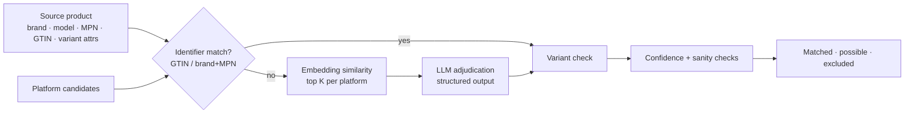

# Before You Buy — Technical Requirements Document (TRD)

| Field | Value |
|---|---|
| Version | 1.0 |
| Status | Approved for build; items marked **(pending X)** depend on an open item in [08-REVIEW-ITEMS](08-REVIEW-ITEMS.md) |
| Inputs | [01-PRD](01-PRD.md) v4.0 · [02-ARCHITECTURE](02-ARCHITECTURE.md) |
| Related | [04-BACKEND-SCHEMA](04-BACKEND-SCHEMA.md) · [05-SECURITY](05-SECURITY.md) · [06-IMPLEMENTATION-PLAN](06-IMPLEMENTATION-PLAN.md) · [07-UI-UX-DESIGN](07-UI-UX-DESIGN.md) |

---

## 1. Purpose and conventions

This document turns the PRD into buildable, testable engineering requirements. Each requirement has an ID `TR-<AREA>-<NN>`, traces to PRD IDs, and is verified by the test type named in its row.

- **MUST / SHOULD / MAY** follow RFC 2119.
- **Verify** column: `U` unit, `I` integration (real Postgres/Redis), `C` contract (recorded provider fixtures), `E` end-to-end (Playwright), `L` load, `M` manual/QA, `EV` evaluation suite.
- Numbers that are product or business choices (credit prices, quotas, thresholds, freshness windows) live in `packages/config` and are **never hard-coded** in logic.
- Where this document and the PRD disagree, the PRD wins and this document is updated (see [09-CHANGE-MANAGEMENT](09-CHANGE-MANAGEMENT.md)).

### 1.1 Requirement areas

| Prefix | Area | Section | Phase |
|---|---|---|---|
| TR-INT | Search intake and normalization | §5 | v4.0 |
| TR-SRCH | Orchestration, caching, SSE | §6 | v4.0 |
| TR-MATCH | Matching | §7 | v4.0 |
| TR-PROV | Provider adapters | §8 | v4.0 |
| TR-LC | Landed cost | §9 | v4.0 |
| TR-COND | Condition, warranty, returns | §10 | v4.0 |
| TR-TRUST | Review authenticity | §11 | v4.0 |
| TR-HIST | Price history | §12 | v4.0 |
| TR-RANK | Ranking and reasoning | §13 | v4.0 |
| TR-ALRT | Alerts and email | §14 | v4.0 |
| TR-CACHE | Pre-crawl cache | §15 | v4.0 |
| TR-CRED | Credits, quotas, rate limits, spend cap | §16 | v4.0 internal / v4.5 billed |
| TR-ANL | Analytics and return rate | §17 | v4.0 |
| TR-AUTH | Auth and accounts | §18 | v4.0 / v4.5 |
| TR-BILL | Billing | §19 | v4.5 |
| TR-API | Public API | §20 | v4.5 |
| TR-AFF | Affiliate links and disclosure | §21 | v4.0 |
| TR-WEB | Product pages and shareable comparisons | §22 | v4.0 |
| TR-OBS | Observability | §25 | v4.0 |

---

## 2. Platform baseline (versions)

Pin exact versions in `package.json` and the lockfile; this table is the floor.

| Component | Version floor | Notes |
|---|---|---|
| Node.js | Active LTS (24.x at time of writing) | Same major in every app; `.nvmrc` + `engines` |
| pnpm | 10.x | `minimumReleaseAge` set (see [05-SECURITY](05-SECURITY.md)) |
| TypeScript | 5.9+ | `strict: true`, `noUncheckedIndexedAccess: true`, `exactOptionalPropertyTypes: true` |
| Next.js | **16.3.8+** | Security release Sep 30, 2026 |
| React | 19.2+ | |
| Tailwind CSS | 4.x | Tokens in `@theme` |
| shadcn/ui | latest, Base UI primitives | Components vendored in `packages/ui` |
| Hono | 4.x | `hono/streaming` SSE helper; `@hono/zod-openapi` from v4.5 |
| Zod | 4.x | Strict objects at trust boundaries |
| PostgreSQL | 18 | `uuidv7()`, extensions `vector`, `pg_trgm` |
| Drizzle ORM / Kit | latest stable (1.0 line) | Custom SQL migrations for partitions/RLS |
| Redis | 7.x | |
| BullMQ | 5.x | |
| Better Auth | latest 1.x | Plugins: magic link, passkey, organization, (v4.5) two-factor |
| Vercel AI SDK | latest major | Provider packages per LLM vendor |
| Stripe API | Pinned API version in client config | |
| Resend + React Email | latest | |

---

## 3. Service responsibilities

| Service | MUST | MUST NOT |
|---|---|---|
| `apps/web` | Render pages (RSC by default); host the Turnstile widget; hold ZIP cookie; open SSE directly to API; read data via the API | Import `packages/db`, `providers`, `ai`, or server secrets; call retailers or the LLM |
| `apps/api` | Validate, authorize, meter, orchestrate searches, stream SSE, persist, enqueue jobs, serve `/web/*`, `/v1/*`, `/api/auth/*`, webhooks, `/go/*` | Run work longer than one request (queue it); trust any input without a schema |
| `apps/worker` | Run all queues in [02-ARCHITECTURE §9](02-ARCHITECTURE.md#9-background-jobs); be idempotent | Serve public HTTP |

---

## 4. Shared conventions

| ID | Requirement | Verify |
|---|---|---|
| TR-CONV-01 | All IDs are `uuidv7` strings (DB default). Public share slugs are 10-char base62 random strings. | U |
| TR-CONV-02 | Money is `{ amountCents: int, currency: 'USD' }` or `{ minCents, maxCents, currency }`. No floats in money paths. Rounding is half-up to the cent, applied per component before summing. | U |
| TR-CONV-03 | Credits are integer **millicredits** in storage and logic (0.5 credit = 500). Presented to users as credits with one decimal. | U |
| TR-CONV-04 | Timestamps are UTC ISO-8601 in APIs, `timestamptz` in Postgres. The UI renders relative time ("checked 3 minutes ago", CW-12). | U |
| TR-CONV-05 | Every trust boundary uses a Zod **strict** schema from `packages/schemas` (unknown keys rejected, max lengths, enums, numeric bounds). | U |
| TR-CONV-06 | Errors use RFC 9457 `application/problem+json`: `{ type, title, status, detail, code, requestId, errors? }`. `code` is a stable machine string (e.g. `RATE_LIMITED`). | I |
| TR-CONV-07 | Every request gets a `requestId` (ULID/uuidv7) returned in `X-Request-Id` and attached to logs and traces. | I |
| TR-CONV-08 | Platform identifiers are the enum `'amazon' \| 'ebay' \| 'bestbuy'`; adding a retailer extends the enum and the adapter registry only. | U |
| TR-CONV-09 | Feature flags and kill switches are read through `packages/config` (`flags.isOn(name, ctx)`), never via ad-hoc env checks. | U |

---

## 5. Search intake and normalization (TR-INT)

Traces: CW-1, AR-1, [02-ARCHITECTURE §7 step 1](02-ARCHITECTURE.md#7-search-pipeline).

### 5.1 Request schema

```ts
// packages/schemas/src/search.ts
export const Platform = z.enum(['amazon', 'ebay', 'bestbuy']);

export const SearchRequest = z.strictObject({
  query: z.string().trim().min(2).max(200).optional(),
  url: z.string().trim().max(2048).optional(),
  productId: z.uuid().optional(),               // set when the user picks an autocomplete suggestion
  zip: z.string().regex(/^\d{5}$/).optional(),   // falls back to the ZIP cookie / IP guess
  platforms: z.array(Platform).min(1).max(3).optional(),   // default: all enabled platforms
  condition: z.enum(['new', 'any']).default('new'),
  cache: z.boolean().default(true),              // false = forced refresh (PRD §9)
  turnstileToken: z.string().max(4096).optional(), // web, anonymous, uncached only
}).refine(r => [r.query, r.url, r.productId].filter(Boolean).length === 1,
  { message: 'Provide exactly one of query, url or productId' });
```

### 5.2 Requirements

| ID | Requirement | Verify |
|---|---|---|
| TR-INT-01 | Exactly one of `query`, `url`, `productId` is accepted. | U |
| TR-INT-02 | URL hosts are matched against an exact allowlist: `amazon.com`, `www.amazon.com`, `m.amazon.com`, `ebay.com`, `www.ebay.com`, `m.ebay.com`, `bestbuy.com`, `www.bestbuy.com`. Scheme must be `https` or `http`. Userinfo, ports and IP-literal hosts are rejected. | U |
| TR-INT-03 | Retailer IDs are extracted by pattern, never by fetching: Amazon ASIN (`[A-Z0-9]{10}`) from `/dp/`, `/gp/product/`, `/gp/aw/d/`, `/exec/obidos/ASIN/`; eBay item ID (`\d{9,15}`) from `/itm/…` plus optional variation `var=`; Best Buy SKU (`\d{6,8}`) from `skuId=` or the path. Every supported pattern has a fixture test. | U |
| TR-INT-04 | Short links (`amzn.to`, `a.co`, `ebay.us`, etc.) are rejected with code `URL_SHORTLINK_UNSUPPORTED` and a message asking for the full product link — resolving them would require fetching the user's URL. | U |
| TR-INT-05 | The server rebuilds a canonical URL from the ID (`https://www.amazon.com/dp/{ASIN}`, `https://www.ebay.com/itm/{id}`, `https://www.bestbuy.com/site/{sku}.p?skuId={sku}`); all original query params are discarded. | U |
| TR-INT-06 | Query normalization: Unicode NFKC → lowercase → collapse whitespace → strip characters except letters, digits, space and `- / . + "` → trim. Model-number tokens (letters+digits, e.g. `wh-1000xm5`) are preserved verbatim. | U |
| TR-INT-07 | The cache key is `sha256(normalizedQuery | sorted(platforms) | condition)`. ZIP is **not** part of the key (landed cost is computed per request). | U |
| TR-INT-08 | Query classification returns `exact_model` (contains a model-number token or a catalog exact match) or `vague` (category words only). Used by §7 to choose resolution vs disambiguation. | U, EV |
| TR-INT-09 | ZIP resolution order: request `zip` → `byb_zip` cookie → IP geolocation header from the edge → none. The resolved ZIP and its source (`user`, `cookie`, `ip`, `none`) are returned in the `meta` event. **(pending DECIDE-06)** | U |

### 5.3 Autocomplete

| ID | Requirement | Verify |
|---|---|---|
| TR-INT-10 | `GET /web/autocomplete?q=` returns ≤ 8 products from the catalog using `pg_trgm` similarity on title + brand/model, with full-text rank as tie-breaker. Min query length 2. | I |
| TR-INT-11 | p95 latency ≤ 100 ms server-side; responses cached in Redis for 10 minutes per normalized prefix and `Cache-Control: public, max-age=60` at the CDN. | L |
| TR-INT-12 | Autocomplete never triggers a live retailer call and costs 0 credits. | I |

---

## 6. Search orchestration, caching and SSE (TR-SRCH)

Traces: CW-2, CW-12, CW-15, AR-5, PRD §6.1.

### 6.1 Flow

1. `POST /web/search` (cookie/anonymous) or `POST /v1/search` (API key) validates, guards and registers a search, returning `202 { searchId, streamUrl, cache: 'hit' | 'miss' | 'partial' }`.
2. The client opens `GET /web/search/stream?searchId=…` (or `/v1/search/stream`) with `EventSource`.
3. For `POST /v1/search` **without** `Prefer: respond-async`, the API waits for completion and returns the full result body synchronously (developer path, 45 s p95).

### 6.2 Requirements

| ID | Requirement | Verify |
|---|---|---|
| TR-SRCH-01 | Guards run in this order: kill switches → rate limit → Turnstile (anonymous + uncached only) → quota/credits → spend cap. A failing guard returns problem+json with codes `SERVICE_DEGRADED`, `RATE_LIMITED`, `CHALLENGE_REQUIRED`, `QUOTA_EXHAUSTED`. | I |
| TR-SRCH-02 | Cache lookup order: Redis (search result by key) → Postgres (listings + latest observations for the resolved product, per platform). A platform's data counts as fresh only if `now − observedAt ≤ policy.maxDisplayAgeSec`. All platforms fresh ⇒ `hit`; some fresh ⇒ `partial` (only stale platforms go live); none ⇒ `miss`. | I |
| TR-SRCH-03 | Cache hit path completes (all events incl. `done`) in **< 400 ms p95** server-side. | L |
| TR-SRCH-04 | **Single-flight:** an uncached search acquires `lock:search:{key}` (TTL 60 s). Concurrent identical searches subscribe to the in-flight search's event buffer instead of fanning out. They are charged as cache hits. | I |
| TR-SRCH-05 | Fan-out calls every requested, enabled, non-tripped provider in parallel. Per-provider timeouts (config): eBay 4 s, Best Buy 4 s, Amazon 10 s (incl. failover). A provider failure emits `platform_error` and never fails the search. | I, C |
| TR-SRCH-06 | The first meaningful event (`source` or `disambiguation`) is emitted **< 2 s p95** after the stream opens (CW-2). | L, synthetic |
| TR-SRCH-07 | All platform results are emitted **< 12 s p95**. | L |
| TR-SRCH-08 | Heartbeat comment (`: ping`) every 15 s. Server closes the stream after `done` or after 60 s hard limit. | I |
| TR-SRCH-09 | Every event has a monotonically increasing `id`. Events are buffered in a Redis Stream `sse:{searchId}` (TTL 10 min). A reconnect with `Last-Event-ID` replays events after that id. | I |
| TR-SRCH-10 | After results are emitted, the API persists listings and observations in one transaction and enqueues `amazon-verify` for live Amazon results. Verification results published on Redis pub/sub `search:{searchId}` are forwarded as `patch` events while the stream is open; otherwise they update the cache only. | I |
| TR-SRCH-11 | The search record (`searches` row) captures: normalized query, type, resolved product, actor (user/org/anon/api key), channel, cache status, platforms requested/returned/failed, credits charged, `firstEventMs`, `totalMs`. | I |
| TR-SRCH-12 | Synchronous `/v1/search` p95 ≤ 45 s; hard timeout 60 s returns what is available with `complete: false`. | L |
| TR-SRCH-13 | In **cache-only mode** (spend cap or kill switch), uncached paid-provider platforms return `platform_error { code: 'CACHE_ONLY_MODE' }`; free official-API platforms continue live within their quotas. | I |

### 6.3 SSE event contract

All `data` payloads are JSON validated by schemas in `packages/schemas/src/sse.ts`. The client must ignore unknown event types (forward compatibility).

| Event | When | `data` |
|---|---|---|
| `meta` | First event | `{ searchId, query: { raw, normalized, type }, cache, zip: { value, source }, platforms: Platform[], condition, startedAt }` |
| `source` | Product resolved (name search) or source listing parsed (URL search) | `{ product: ProductSummary, sourceListing?: ResultListing, resolution: 'autocomplete' \| 'catalog' \| 'live' \| 'url' }` |
| `disambiguation` | Query is vague or ambiguous (§7.2) | `{ options: ProductSummary[] (≤ 6), reason: 'vague' \| 'ambiguous' }` — the search ends after `done`; picking an option starts a new search with `productId` |
| `result` | Each platform resolves | `{ platform, listings: ResultListing[] (≤ 5, best first), checkedAt }` |
| `platform_error` | A platform fails or is skipped | `{ platform, code: 'TIMEOUT' \| 'UNAVAILABLE' \| 'RATE_LIMITED' \| 'CACHE_ONLY_MODE' \| 'NO_MATCH' \| 'DISABLED', message, retryable }` |
| `ranking` | All platforms settled | `Ranking` (§13) |
| `history` | Price stats available | `PriceHistory90d` (§12) |
| `patch` | Amazon verification or late enrichment | `{ listingId, fields: Partial<ResultListing> }` |
| `done` | Last event | `{ searchId, complete: boolean, creditsCharged: number, durationMs, shareable: boolean }` |

> The custom event is `platform_error`, not `error`, because `EventSource` reserves `error` for connection failures (DEC-015).

### 6.4 Core response types

```ts
type Money = { amountCents: number; currency: 'USD' };
type MoneyRange = { minCents: number; maxCents: number; currency: 'USD' };

type ResultListing = {
  listingId: string;
  platform: Platform;
  title: string;                         // plain text, never HTML
  imageUrl?: string;                     // policy-permitted source only (LEGAL-16)
  outboundUrl: string;                   // always /go/{token}, never the raw retailer URL (§21)
  condition: 'new' | 'refurbished' | 'used' | 'open_box';
  conditionDetail?: string;              // "Renewed", "Excellent – Refurbished", …
  seller: { name: string; isRetailer: boolean; rating?: number; ratingCount?: number };
  warranty: { months: number | null; provider: 'manufacturer' | 'retailer' | 'seller' | 'unknown'; text?: string };
  returns: { windowDays: number | null; freeReturns?: boolean; text?: string };
  inStock: boolean;
  match: { confidence: number; variant: 'exact' | 'different' | 'unknown'; method: 'gtin' | 'mpn' | 'llm' | 'url' };
  listedPrice: Money;                    // AR-6
  shippingCost: Money | MoneyRange | null; // null = unknown
  estimatedTax: Money | MoneyRange;
  landedPrice: MoneyRange;               // min === max when complete
  landedPriceComplete: boolean;          // AR-6
  uncertainComponents: Array<'shipping' | 'tax'>;
  priceVerification: { status: 'verified' | 'pending' | 'unverified' | 'not_required'; verifiedAt?: string };
  reviewAuthenticity: ReviewAuthenticity; // AR-7, §11
  checkedAt: string;                     // CW-12
  attribution?: { text: string; logo?: 'bestbuy' | 'ebay' };
  affiliate: { isAffiliate: boolean; program?: 'amazon_associates' | 'ebay_partner_network' | 'bestbuy_affiliate' };
  disclaimers?: string[];                // e.g. Amazon price/time disclaimer (LEGAL-02)
};
```

---

## 7. Matching (TR-MATCH)

Traces: AR-1, PRD §3 (same unit under eight names), Gate 1 match accuracy > 92%.

> **(pending GAP-01)** The v3 matching requirements FR-M1–FR-M7, the confidence model and the R7 variant-aware pipeline are not in the repo. This section is the working spec. When v3 §5 is added, reconcile and record the change in [09-CHANGE-MANAGEMENT](09-CHANGE-MANAGEMENT.md). The evaluation suite is the arbiter either way.

### 7.1 Pipeline



| ID | Requirement | Verify |
|---|---|---|
| TR-MATCH-01 | **Deterministic first.** GTIN equality (normalized to GTIN-14) ⇒ same product, confidence 0.99, method `gtin`. Brand + MPN equality ⇒ confidence 0.95, method `mpn`. Variant still checked (§7.3). | U, EV |
| TR-MATCH-02 | **Retrieval.** Remaining candidates are ranked by cosine similarity between the source embedding and candidate-title embeddings; keep top **K = 8** per platform with similarity ≥ 0.75 (config). | I, EV |
| TR-MATCH-03 | **LLM adjudication** only for candidates not settled by TR-MATCH-01, only for platforms whose policy has `aiUseAllowed: true`. Output schema per candidate: `{ candidateId, sameProduct: 'yes' \| 'no' \| 'unsure', variant: 'exact' \| 'different' \| 'unknown', differingAttributes: string[], confidence: number (0–1), evidence: string (≤ 200 chars) }`. Temperature 0. Output that fails the schema is discarded (candidate treated as `unsure`). | U, EV |
| TR-MATCH-04 | **Sanity checks** lower confidence by config amounts: accessory/compatibility phrases ("for", "case", "compatible with", "replacement", "cover"); price < 35% or > 250% of the median candidate price; bundle indicators; "for parts" conditions (always excluded). | U, EV |
| TR-MATCH-05 | **Thresholds** (config): show as match when confidence ≥ 0.80 and variant `exact`; show as *possible match — check details* when 0.60–0.80 or variant `unknown`; exclude when < 0.60, `sameProduct: 'no'`, or variant `different` (listed under "Other options we checked" with the reason). | U |
| TR-MATCH-06 | Prompts are versioned files in `packages/ai/prompts/` (`match-name.v1.md`, `match-url.v1.md`, `resolve-query.v1.md`). The version is stored with each match decision. | U |
| TR-MATCH-07 | Platforms with `aiUseAllowed: false` are matched by identifiers + embeddings + rules only; ambiguous candidates are shown as *possible match* rather than sent to the LLM. **(pending LEGAL-03/04)** | U |
| TR-MATCH-08 | The LLM is called through `packages/ai` only (`ai.match(...)`, `ai.resolveQuery(...)`, `ai.embed(...)`). Model IDs come from config (`AI_MODEL_MATCH`, `AI_MODEL_EMBED`). No model name appears in application code. | U |
| TR-MATCH-09 | Per-search LLM token usage and cost are recorded as span attributes and summed per day; alert if cost per search exceeds 3× the PRD estimate ($0.0002). | I |

### 7.2 Name search: resolving what the shopper means (AR-1, OQ-3)

| ID | Requirement | Verify |
|---|---|---|
| TR-MATCH-10 | If `productId` is supplied (autocomplete pick), resolution is skipped. | I |
| TR-MATCH-11 | Otherwise resolve against the catalog (trigram + full-text + vector). Accept the top product when its score ≥ 0.85 and leads the runner-up by ≥ 0.10 (config). | I, EV |
| TR-MATCH-12 | If unresolved and the query is `exact_model`, run free-platform searches (eBay, Best Buy) first and the Amazon search in parallel; the LLM (`resolve-query` prompt) selects the most likely intended product from the open field and the result is upserted into `products`. | I, EV |
| TR-MATCH-13 | If the query is `vague` or resolution is ambiguous, emit `disambiguation` with ≤ 6 product options (popular catalog products in the inferred category first) and end the search charging **0 credits**. **(pending DECIDE-12)** | E, EV |

### 7.3 Variant awareness

| ID | Requirement | Verify |
|---|---|---|
| TR-MATCH-14 | Variant attributes are normalized to a fixed vocabulary: `color`, `storage`, `memory`, `size`, `capacity`, `connectivity`, `carrier`, `region`, `generation`, `bundle`. | U |
| TR-MATCH-15 | A listing is shown as the same item only when every variant attribute present on both sides agrees. Unknown attributes yield `variant: 'unknown'`, never `exact`. | U, EV |
| TR-MATCH-16 | Deep links point at the exact variant (Amazon child ASIN, eBay variation, Best Buy SKU) (CW-11). | C, M |

### 7.4 Evaluation suite (Gate 1)

| ID | Requirement | Verify |
|---|---|---|
| TR-MATCH-17 | `packages/ai/evals/` holds a labelled set: **≥ 300 queries** at v4.0 launch, covering exact models, vague queries, multi-variant products, accessory traps, refurbished/used, white-label duplicates. Each case: query, expected product, and per-candidate labels. | EV |
| TR-MATCH-18 | **Match accuracy** = shown-as-match results that are the correct product *and* variant ÷ all shown-as-match results. Target > 92%. Also report recall and wrong-variant rate (< 1% with dead links). | EV |
| TR-MATCH-19 | CI runs the suite on recorded candidates for PRs touching `packages/ai`, `providers` or `core`; a drop of > 1 point vs `main` fails the build. A nightly live run (budget-capped) tracks drift. | EV |

---

## 8. Provider adapters (TR-PROV)

Traces: AR-2, AR-3, AR-4, PRD §6.2, §10.3.

| ID | Requirement | Verify |
|---|---|---|
| TR-PROV-01 | Every provider implements `ProviderAdapter` ([02-ARCHITECTURE §8](02-ARCHITECTURE.md#8-provider-adapters-and-retailer-policy)) and is registered in `packages/providers/src/registry.ts`. | U |
| TR-PROV-02 | Each adapter has a Redis token-bucket limiter, a circuit breaker (open after 5 consecutive failures or > 50% errors over 20 calls in 60 s; half-open after 30 s; config), and a timeout via `AbortSignal`. | U, I |
| TR-PROV-03 | All provider responses are parsed with Zod schemas. Parse failures are logged with a payload hash and counted (`provider.parse_failures`). | U, C |
| TR-PROV-04 | Contract tests run every adapter against recorded fixtures (`packages/providers/fixtures/`). Fixtures are refreshed by a script, reviewed in PRs, and never contain secrets. | C |
| TR-PROV-05 | Every observation records `source` (transport) and `retain_until` computed from policy. | U |

### 8.1 eBay (Browse API)

| ID | Requirement | Verify |
|---|---|---|
| TR-PROV-10 | OAuth client-credentials token cached in Redis until 60 s before expiry. | I |
| TR-PROV-11 | Search uses marketplace `EBAY_US`, fixed-price only (exclude auctions), excludes "for parts or not working" conditions, and passes the shopper's ZIP as the end-user contextual location so shipping cost is ZIP-aware. *(Exact parameter names verified against eBay docs in M4.)* | C |
| TR-PROV-12 | Pre-crawl uses batched item lookups where available. A daily call budget (default 5,000; config) is enforced in Redis: pre-crawl may use at most 70% of it; live searches get the remainder. | I |
| TR-PROV-13 | Displayed eBay listing data is never older than 6 hours (`maxDisplayAgeSec`). Required eBay attribution is rendered. | I, E |

### 8.2 Best Buy (Products API)

| ID | Requirement | Verify |
|---|---|---|
| TR-PROV-20 | Rate limit 5 req/s and 50,000/day enforced in Redis; a 403 response trips the breaker for 60 s. | I |
| TR-PROV-21 | Requested fields are explicit (`show=` list) to keep payloads small: SKU, name, manufacturer, model number, UPC, prices, shipping, condition, availability, review average/count, URLs, images, warranty fields. *(Field names verified in M4.)* | C |
| TR-PROV-22 | Best Buy content is not retained beyond 72 hours; Best Buy logo attribution is shown wherever its data appears. | I, E |

### 8.3 Amazon (Web Unlocker + backup, Web Scraper API verify)

| ID | Requirement | Verify |
|---|---|---|
| TR-PROV-30 | Phase 1 uses BrightData **Web Unlocker as a request API** returning HTML (AR-3). Only public pages; no login, no cart, no CAPTCHA solving outside what the unblocking provider does by contract. | C |
| TR-PROV-31 | The adapter has two transports — `brightdata` and `backup` (**pending DECIDE-04**) — behind one interface. Failover triggers on timeout, 5xx, block page detection or open breaker. Transport used is recorded per observation. | I |
| TR-PROV-32 | HTML parsers are pure functions `(html) => ParsedPage` with Zod-validated output, covered by fixtures for: search results, product page (new), Renewed, multi-variant, out-of-stock, "currently unavailable", block/robot page. | U, C |
| TR-PROV-33 | Phase 2 verification (AR-4) runs on a worker via the Web Scraper API for live Amazon results shown to users; mismatch > 1% or > $1 flags the listing `unverified` and patches the card. Verified-matches-listing rate is sampled weekly (target ≥ 98%, PRD §10.1). | I, M |
| TR-PROV-34 | **Health check every 30 minutes** (R5): fetch a fixed set of 10 known ASINs; alert when parse success < 90%, field-null rate jumps > 3×, or price deltas exceed anomaly thresholds. | I |
| TR-PROV-35 | Every billable request increments `spend:amazon:{YYYY-MM-DD}` in Redis by its unit cost (config: $0.0015 per Web Unlocker request / Web Scraper record). | U, I |
| TR-PROV-36 | Amazon prices are displayed with a timestamp and the Associates disclaimer text from config; `maxDisplayAgeSec` ≤ 24 h. **(pending LEGAL-01/02 — may change how Amazon prices are shown at all)** | E |

---

## 9. Landed cost (TR-LC)

Traces: CW-3, AR-6, PRD §5.1, §10.1–10.2, Gate 1 (> 90% within $2).

```
landedPrice = listedPrice + shippingCost + estimatedTax
```

| ID | Requirement | Verify |
|---|---|---|
| TR-LC-01 | Landed cost is computed per request in `packages/core/landed-cost.ts` as a pure function of `(listing, zip, taxTable, shippingRules, now)`. | U |
| TR-LC-02 | **Shipping:** use the provider's ZIP-aware shipping cost when present (cheapest standard option). Else apply `shipping_rules` for the platform (e.g. free-shipping thresholds). Else return a range `[0, rule.maxStandardShipping]` and add `'shipping'` to `uncertainComponents`. Store pickup is never assumed. | U |
| TR-LC-03 | **Tax:** rate = combined sales-tax rate for the ZIP from `tax_rates` (parts per million, so 8.875% is exact). If a ZIP maps to several jurisdictions, use the min–max range. Taxable base = listed price (+ shipping where `tax_rates.shipping_taxable` is true; unknown ⇒ range). **(pending DECIDE-05 for the data source)** | U |
| TR-LC-04 | Without a ZIP, tax is the state min–max range for the IP-derived state, or the national min–max if no state; the UI asks for a ZIP. | U |
| TR-LC-05 | `landedPriceComplete = uncertainComponents.length === 0`. When incomplete, ranking uses `landedPrice.maxCents` (conservative) and the UI shows the range and names the uncertain component (PRD §10.2). | U, E |
| TR-LC-06 | All arithmetic in integer cents; rounding half-up per component. Property-based tests cover rounding and range math. | U |
| TR-LC-07 | **Accuracy QA:** a weekly manual sample of ≥ 30 listings across platforms is taken to the final checkout page with a test address; `|checkout − landed| ≤ $2` rate is recorded in `qa_landed_cost_samples`. Target > 90%. | M |

---

## 10. Condition, warranty and returns (TR-COND)

Traces: CW-4.

| ID | Requirement | Verify |
|---|---|---|
| TR-COND-01 | Each provider maps its condition codes to `new \| refurbished \| used \| open_box` with the original label kept in `conditionDetail`. Mapping tables live in `packages/providers/<platform>/condition.ts`. | U |
| TR-COND-02 | "For parts or not working" and equivalent conditions are excluded at the adapter. | U |
| TR-COND-03 | Warranty and return window are parsed from the API/listing; when absent, the retailer's standard policy from config is used and labelled "standard {retailer} policy" (values verified in M8). Unknown stays `null` and is shown as "Not stated". | U, C |
| TR-COND-04 | Ranking compares like with like: default scope is `new`; other conditions appear only when `condition: 'any'` or in the "cheaper if you accept refurbished/used" callout (§13). | U |

---

## 11. Review authenticity (TR-TRUST)

Traces: CW-6, AR-7, PRD §3 ("Are the reviews real?"), Gate 1 precision > 85%.

### 11.1 Output

```ts
type ReviewAuthenticity = {
  score: number | null;          // 0–100, higher = more consistent with genuine reviews; null when insufficient
  band: 'consistent' | 'some_concerns' | 'strong_concerns' | 'insufficient_data';
  signals: Array<{
    code: TrustSignalCode;
    label: string;               // plain language, e.g. "Unusual burst of 5-star reviews in March"
    effect: 'raises' | 'lowers' | 'neutral';
    weight: number;              // contribution to the score
  }>;
  reviewCount: number | null;
  averageRating: number | null;
  analyzedAt: string;
  modelVersion: string;          // e.g. "trust-v1.2"
};
```

### 11.2 Signals (v1)

| Code | Signal | Source | Platforms |
|---|---|---|---|
| `RATING_SHAPE` | Rating distribution is J-shaped/bimodal (high 5★ + 1★, hollow middle) beyond category norm | Rating histogram | Amazon, Best Buy |
| `VELOCITY_BURST` | Review-count bursts inconsistent with listing age | Review dates sample | Amazon, Best Buy |
| `VERIFIED_SHARE` | Low share of verified purchases | Review badges | Amazon |
| `TEXT_DUPLICATION` | Near-duplicate review text (embedding similarity) | Review text sample | Amazon, Best Buy |
| `INCENTIVE_LANGUAGE` | Incentivized/free-product language | Review text (LLM classifier) | Amazon, Best Buy |
| `VARIANT_MERGING` | Reviews describing a different product (review hijacking via merged variations) | Review text vs product | Amazon |
| `CROSS_PLATFORM_DIVERGENCE` | Same product rated very differently across platforms | Matched listings | All (needs matching) |
| `SELLER_PROFILE` | Seller feedback score/percentage, account signals | eBay seller fields | eBay |
| `RATING_TEXT_MISMATCH` | Star ratings disagree with review sentiment | Review text | Amazon, Best Buy |

| ID | Requirement | Verify |
|---|---|---|
| TR-TRUST-01 | Scoring is a versioned, deterministic function in `packages/core/trust/` combining signal values with weights from config; LLM is used only to extract text-level signals (`INCENTIVE_LANGUAGE`, `VARIANT_MERGING`, `RATING_TEXT_MISMATCH`). | U, EV |
| TR-TRUST-02 | `insufficient_data` when reviews < 20 or fewer than 3 signals computable; `score` is then `null`. | U |
| TR-TRUST-03 | Every score stores its signals, inputs summary and `modelVersion` in `review_signals` (the "why" CW-6 requires). | I |
| TR-TRUST-04 | Scores are cached per listing for 7 days (config) and recomputed on pre-crawl when review count changes by > 10%. | I |
| TR-TRUST-05 | **Wording rules:** never say "fake", "fraud" or name a seller as dishonest. Bands are labelled *Reviews look consistent*, *Some concerns*, *Strong concerns*, *Not enough data*. Signals describe observed patterns, not intent. **(pending LEGAL-06)** | E, M |
| TR-TRUST-06 | Review text sampling for Amazon is capped (e.g. ≤ 2 extra requests per listing per 7 days, config) and counted in spend. **(pending GAP-04: not in PRD cost model)** | I |
| TR-TRUST-07 | **Precision** = listings labelled `strong_concerns` that human labellers also mark as suspicious ÷ all `strong_concerns` listings, on a labelled set of ≥ 200 listings. Target > 85% (Gate 1). | EV |
| TR-TRUST-08 | Data from platforms with `aiUseAllowed: false` is scored without LLM-derived signals. | U |

---

## 12. Price history (TR-HIST)

Traces: CW-7, AR-8.

```ts
type PriceHistory90d = {
  basis: 'listed_new';               // listed price, condition = new (shipping excluded: ZIP-dependent)
  platforms: Platform[];             // contributing platforms (policy.historyAllowed)
  minCents: number; maxCents: number; medianCents: number; currentCents: number;
  currentPercentile: number;         // 0–100, share of days whose daily minimum was BELOW the current price
  daysWithData: number;
  insufficientData: boolean;         // daysWithData < 14
  series?: Array<{ day: string; minCents: number; platform?: Platform }>; // product page / detail calls only
};
```

| ID | Requirement | Verify |
|---|---|---|
| TR-HIST-01 | Every refresh writes `price_observations` (partitioned by month). Only providers with `policy.historyAllowed` contribute to stats. **(pending LEGAL-03/04 — may be Amazon-only)** | I |
| TR-HIST-02 | `price_stats_daily` is upserted per `(product_id, condition, day)` on each snapshot (min/max incrementally; median recomputed by a nightly job for the previous day). | I |
| TR-HIST-03 | `currentPercentile = round(100 × count(days where daily_min < current) / daysWithData)` over the last 90 days. Copy: ≤ 10 → "Near its 90-day low"; ≥ 75 → "Higher than usual"; else "Typical price". | U |
| TR-HIST-04 | Stats read is a single indexed query on `price_stats_daily` (≤ 90 rows); p95 ≤ 20 ms. | L |
| TR-HIST-05 | "Was" or reference-price claims from retailers are never repeated as fact; the site's own claim is only what the history shows. **(LEGAL-07)** | M |

---

## 13. Ranking and reasoning (TR-RANK)

Traces: CW-5, PRD §3.1 (top three, reasoning visible, affiliate-blind).

| ID | Requirement | Verify |
|---|---|---|
| TR-RANK-01 | Eligible set: matched listings (§7 thresholds), in stock, in condition scope, not `strong_concerns` (those are shown separately with the reason). | U |
| TR-RANK-02 | Primary key: landed price (max of range). Tie-breakers within 2% / $3 (config): review band, return window, warranty, seller rating, verified price. | U |
| TR-RANK-03 | **Affiliate-blind:** the ranking function's input type contains no affiliate or commission fields. A unit test asserts that toggling `affiliate.isAffiliate` on any listing never changes the order. | U |
| TR-RANK-04 | Output is the top 3 (or fewer) with labels and **deterministic, template-generated reasons** built from facts (e.g. "$12 cheaper delivered to 10001 than the next option", "30-day returns vs 15", "Reviews look consistent"). No free-form LLM text in reasons (DEC-023). | U |
| TR-RANK-05 | When a non-new option is ≥ 15% cheaper than the best new option, emit a `cheaperAlternative` callout with its condition and warranty. | U |
| TR-RANK-06 | The response never collapses to a single verdict; the UI always shows up to three with reasoning (CW-5). | E |

```ts
type Ranking = {
  conditionScope: 'new' | 'any';
  top: Array<{ listingId: string; rank: 1 | 2 | 3; label: string; reasons: Array<{ code: string; text: string }> }>;
  cheaperAlternative?: { listingId: string; savingCents: number; reasons: Array<{ code: string; text: string }> };
  excluded: Array<{ listingId: string; reason: 'variant_mismatch' | 'low_confidence' | 'out_of_stock' | 'strong_review_concerns' }>;
};
```

---

## 14. Alerts and email (TR-ALRT)

Traces: CW-8, PRD §8 (3 / 25 / unlimited tracked), §12.4.

| ID | Requirement | Verify |
|---|---|---|
| TR-ALRT-01 | Creating an alert is the only point an email is requested (CW-8). Anonymous flow: enter email → magic link "Confirm your price alert" → on confirmation a user and personal org are created and the alert activates. Signed-in users create alerts in one tap. **(pending DECIDE-03)** | E |
| TR-ALRT-02 | Alert types: target landed price (for the alert's ZIP) or % drop from the price at creation. Scope: product + condition (default new) + platforms (default all). | U |
| TR-ALRT-03 | Plan limits on active alerts from config (Free 3, Starter 25, Growth/Scale unlimited). Exceeding returns `ALERT_LIMIT_REACHED`. | I |
| TR-ALRT-04 | `alert-check` runs after each snapshot of a product with active alerts and costs 0 credits. It triggers when the best eligible landed price ≤ target, and either never notified or ≥ 1% / $1 below the last notified price. Max one email per alert per 24 h. | U, I |
| TR-ALRT-05 | Products with active alerts are refreshed at least every 12 h (config), and this refresh spend is tracked as `spend.alerts`. | I |
| TR-ALRT-06 | Emails are sent via the outbox (`outbox_events`) → Resend, with React Email templates in `packages/email`. Each includes the price, platform, landed breakdown, "checked X ago", a link to a fresh comparison, and **one-click unsubscribe** (`List-Unsubscribe` + `List-Unsubscribe-Post`), pause and delete links. | I, E |
| TR-ALRT-07 | Bounces/complaints from the Resend webhook add the address to `email_suppressions`; suppressed addresses receive nothing. | I |
| TR-ALRT-08 | Alerts expire after 180 days (config) with a "still want this?" email 7 days before. | I |

---

## 15. Pre-crawl cache (TR-CACHE)

Traces: CW-15, PRD §5.2, §7.3, Gate 1 cache hit > 70%.

| ID | Requirement | Verify |
|---|---|---|
| TR-CACHE-01 | `crawl_targets` holds `(product_id, platform, priority, next_due_at)`. Priority = f(search volume over 30 days, active alerts, product-page traffic, seed list). | I |
| TR-CACHE-02 | The scheduler enqueues targets whose `next_due_at ≤ now`, ordered by priority, within per-provider budgets (eBay share of daily quota, Best Buy rate, Amazon daily spend share). | I |
| TR-CACHE-03 | `next_due_at` = last success + 0.8 × `policy.maxDisplayAgeSec` (so cached data is always servable), backed off exponentially on failures. | U |
| TR-CACHE-04 | The seed list (≥ 500 products at launch, growing to several thousand) is versioned in `packages/db/seed/precrawl-seed.json`. | M |
| TR-CACHE-05 | Cache hit rate (hit + partial-weighted) is a first-class metric with a daily dashboard; target > 70%. | I |
| TR-CACHE-06 | Successful refreshes call the web app's on-demand revalidation for the product page (tag `product:{id}`). | I |

---

## 16. Credits, quotas, rate limits and spend cap (TR-CRED)

Traces: AR-9, AR-10, PRD §8, §9.

### 16.1 Credit prices (config defaults, in millicredits)

| Event | PRD credits | Config key | Default |
|---|---|---|---|
| Cache hit | 0.5 | `credits.cacheHit` | 500 |
| Live search, base (first platform) | 3 | `credits.liveBase` | 3000 |
| Each additional live platform | 2 | `credits.livePerExtraPlatform` | 2000 |
| Forced refresh (`cache=false`) | 3 | `credits.forcedRefresh` | 3000 (added to the live cost) |
| Alert check | 0 | `credits.alertCheck` | 0 |
| Disambiguation-only search | — | `credits.disambiguation` | 0 |

**(pending DECIDE-01)** — whether a default three-platform live search is 3 or 7 credits, and how plan quotas convert from "searches" to credits. Defaults above follow the literal PRD reading (3 + 2 + 2 = 7) with quota = `searchesIncluded × 7` credits.

| ID | Requirement | Verify |
|---|---|---|
| TR-CRED-01 | Charges are computed by `packages/core/credits.ts` from `(cacheStatus, platformsServedLive, forcedRefresh)`. Platforms that **errored** are not charged; partial cache hits charge cache-hit for cached platforms and live prices for live ones. | U |
| TR-CRED-02 | Charges are written to `credit_ledger` once per search with idempotency key `search:{searchId}`. Anonymous searches are not ledgered (counted in `searches` only). | I |
| TR-CRED-03 | Each org gets a periodic grant entry (`grant_plan`) at period start. Balance for the period = sum of entries in the period. A Redis counter mirrors usage for fast checks and is reconciled hourly from Postgres. | I |
| TR-CRED-04 | Free tier: when quota is exhausted, searches continue **cache-only** with an upgrade prompt; no overage. Paid tiers (v4.5): never return 402; usage beyond quota is billed as overage (AR-10). | I |
| TR-CRED-05 | At 80% of period quota, exactly one `quota.80` email per org per period is enqueued (idempotency key `quota80:{orgId}:{period}`). | I |

### 16.2 Rate limits

| Actor | Limit (per minute) | Key |
|---|---|---|
| Anonymous | 5 searches, plus a daily live-search cap (default 10) **(pending DECIDE-02)** | IP hash + anon ID (both must pass) |
| Free | 5 | org |
| Starter | 60 | org (API keys share the org bucket; per-key sub-limit optional) |
| Growth | 300 | org |
| Scale | 1,000 | org |

| ID | Requirement | Verify |
|---|---|---|
| TR-CRED-10 | Sliding-window limiter in Redis; responses carry `RateLimit-Limit`, `RateLimit-Remaining`, `RateLimit-Reset`; 429 includes `Retry-After`. | I |
| TR-CRED-11 | Autocomplete has its own generous limit (60/min anonymous) and never shares the search bucket. | I |

### 16.3 Spend cap and cache-only mode

| ID | Requirement | Verify |
|---|---|---|
| TR-CRED-20 | `DAILY_SPEND_CAP_CENTS` (config) caps paid-provider spend per UTC day. Ops alerts at 50%, 80%, 100%. **(value pending DECIDE-18)** | I |
| TR-CRED-21 | At 100%, the system enters **cache-only mode** for paid providers (TR-SRCH-13) until the next day or manual override; a site banner explains results may be older. | I, E |
| TR-CRED-22 | Kill switches (Redis-backed, checked per request, cached ≤ 5 s): `search.live`, `provider.amazon`, `provider.ebay`, `provider.bestbuy`, `search.anonymous`, `auth.signup`, `alerts.send`. | I |

---

## 17. Analytics and the return-rate metric (TR-ANL)

Traces: PRD §12.4 (30-day return rate ≥ 15% by month 3), Gate 2.

| ID | Requirement | Verify |
|---|---|---|
| TR-ANL-01 | PostHog is initialised with a first-party proxy path, no autocapture of input values, and persistent anonymous ID linked to the user on sign-in. | E |
| TR-ANL-02 | Events (snake_case, typed in `packages/schemas/src/analytics.ts`): `search_submitted`, `search_first_event` (`ms`), `search_completed` (`cache`, `platforms`, `ms`), `disambiguation_shown`, `disambiguation_picked`, `landed_breakdown_opened`, `trust_signals_opened`, `price_history_viewed`, `outbound_click` (`platform`, `rank`, `isAffiliate`), `alert_started`, `alert_confirmed`, `alert_email_sent`, `alert_email_clicked`, `share_created`, `share_opened`, `zip_changed`, `signup_completed`, `pricing_viewed`, `checkout_started`, `subscription_started`. | U, E |
| TR-ANL-03 | **30-day return rate** = of people (anonymous ID or user) whose first search falls in cohort week W, the share with at least one *return session* (a search, product-page view or alert-email click) on days 1–30 after the first search. Reported weekly; dashboard in PostHog. | M |
| TR-ANL-04 | **Search-to-purchase conversion** (OQ-2) = affiliate-reported orders ÷ searches with ≥ 1 result, by platform and week (affiliate reports imported manually at v4.0). | M |
| TR-ANL-05 | No email, IP or raw query text tied to a user is sent to PostHog; queries are sent normalized and truncated to 100 chars. | U |

---

## 18. Auth and accounts (TR-AUTH)

Traces: CW-8, CW-10, architecture §11, [05-SECURITY](05-SECURITY.md).

| ID | Requirement | Verify |
|---|---|---|
| TR-AUTH-01 | Better Auth mounted on the API at `/api/auth/*`, database adapter = Drizzle, cross-subdomain cookies on `.<domain>`. | I |
| TR-AUTH-02 | v4.0 sign-in methods: **magic link** (15-minute, single-use) and **passkeys**. Google sign-in optional behind a flag. No passwords for consumers. | E |
| TR-AUTH-03 | On user creation a **personal organization** is created with the user as `owner`, plan `free`, and an initial credit grant — in the same transaction. | I |
| TR-AUTH-04 | Anonymous visitors get a signed `byb_anon` cookie (random 128-bit ID, 1 year). On sign-in, anonymous searches from the last 30 days are linked to the user (for history and analytics continuity). | I |
| TR-AUTH-05 | Magic-link requests are rate-limited per email (3 / 15 min) and per IP (10 / 15 min) and protected by Turnstile. | I |
| TR-AUTH-06 | Self-serve account deletion: revoke sessions and keys immediately, delete alerts, anonymize searches, delete the personal org's non-financial data; hard-delete the user within 30 days. Financial ledger rows are retained but de-linked. | I, E |
| TR-AUTH-07 | v4.5: business sign-in with password + TOTP 2FA (Better Auth two-factor plugin); invitations to orgs; role management (owner, admin, member, billing). | E |

---

## 19. Billing (TR-BILL) — v4.5

Traces: AR-9, AR-10, PRD §8, §9. **(pending DECIDE-07: Stripe vs Paddle)**

| ID | Requirement | Verify |
|---|---|---|
| TR-BILL-01 | Each paid plan = a licensed monthly price + a **metered** price on a Stripe Billing Meter (`byb_credits`) with graduated tiers: first `quota` credits at $0, then overage per credit derived from the PRD per-search overage. | I |
| TR-BILL-02 | Org ↔ Stripe customer 1:1. Subscriptions are created via Stripe Checkout; changes/cancellation via the Customer Portal. | E |
| TR-BILL-03 | Webhooks (`/webhooks/stripe`) verify signatures, store event IDs for idempotency (`stripe_events`), and handle: `checkout.session.completed`, `customer.subscription.created/updated/deleted`, `invoice.paid`, `invoice.payment_failed`. | I |
| TR-BILL-04 | `usage-report` sends ledger debits not yet reported as meter events (batched, idempotent via the ledger entry ID), marking `reported_at`. | I |
| TR-BILL-05 | Plan changes take effect immediately for limits; quota is prorated by Stripe; the ledger receives a `grant_plan_adjustment`. | I |
| TR-BILL-06 | Failed payment: 7-day grace with banner and emails, then downgrade to Free limits (no data deleted). | I |
| TR-BILL-07 | Gate 0 pre-orders use one-off Stripe Checkout (no subscription) and store `preorders` rows; refunds are handled in the Stripe dashboard. **(pending DECIDE-15)** | M |

---

## 20. Public API (TR-API) — v4.5

Traces: AR-1, AR-5…AR-10, PRD §11 v4.5.

| ID | Requirement | Verify |
|---|---|---|
| TR-API-01 | Base path `/v1`. Auth: `Authorization: Bearer byb_live_…`. Keys are org-owned, scoped (`search:read`, `history:read`, `alerts:write`, `usage:read`), revocable. | I |
| TR-API-02 | OpenAPI 3.1 generated from the Zod route definitions (`@hono/zod-openapi`), served at `/v1/openapi.json` and rendered on the docs page. | I |
| TR-API-03 | `POST /v1/search` is synchronous by default (≤ 45 s p95) and async with `Prefer: respond-async` (returns `202` + `streamUrl`). `GET /v1/search/stream` serves SSE identical to §6.3. | I |
| TR-API-04 | `Idempotency-Key` header supported on POST; responses are replayed for 24 h. | I |
| TR-API-05 | Responses include `X-Credits-Charged` and `X-Credits-Remaining`; rate-limit headers per §16.2. | I |
| TR-API-06 | Breaking changes require `/v2`; deprecations announce via `Deprecation` and `Sunset` headers with ≥ 90 days' notice. | M |
| TR-API-07 | `/v1/*` never reads cookies and allows CORS from any origin (keys must not be used client-side; docs say so). | I |

---

## 21. Affiliate links and disclosure (TR-AFF)

Traces: CW-11, CW-14, PRD §3.1, §10.4.

| ID | Requirement | Verify |
|---|---|---|
| TR-AFF-01 | Outbound links go through `GET /go/{token}`. Token = base64url(`{ l: listingId, s?: searchId, r?: rank, t: issuedAt }`) + HMAC-SHA-256 (`LINK_SIGNING_SECRET`). Valid for 365 days. Invalid tokens 404. | U, I |
| TR-AFF-02 | The redirect target is **built server-side from the listing record** (canonical deep link + affiliate parameters for that platform) — never from token or query input, so there is no open redirect. | U, I |
| TR-AFF-03 | Link builders per platform in `packages/providers/<platform>/affiliate.ts` (Amazon Associates tag, eBay Partner Network parameters, Best Buy affiliate network link). Exact formats verified at M16 against each program's docs. | U |
| TR-AFF-04 | Each click logs `{ listingId, platform, rank, isAffiliate, anonId/userId, searchId, ts }` (no IP). | I |
| TR-AFF-05 | Outbound anchors use `rel="sponsored noopener"` and open in the same tab on mobile, new tab on desktop. | E |
| TR-AFF-06 | Every results page, product page, comparison page and alert email shows the affiliate disclosure (CW-14); each affiliate result carries a visible marker. Copy lives in config, reviewed under LEGAL-05. | E |
| TR-AFF-07 | Dead-link check: the pre-crawl marks listings that 404/are unavailable; they are never offered as outbound targets. Dead + wrong-variant links < 1% (Gate 1). | I, M |

---

## 22. Product pages and shareable comparisons (TR-WEB)

Traces: CW-13, architecture §12 (static product pages).

| ID | Requirement | Verify |
|---|---|---|
| TR-WEB-01 | Product pages `/p/{productSlug}` are server-rendered with ISR, tagged `product:{id}`, and revalidated on price change (TR-CACHE-06). They show the latest policy-compliant comparison, 90-day history and trust signals. | E |
| TR-WEB-02 | `POST /web/comparisons { searchId }` creates a permanent share slug; `/c/{slug}` re-renders the comparison from **current** data (refreshing per cache rules), showing "first compared on {date}". Stored prices are never re-displayed beyond policy age (DEC-030). | I, E |
| TR-WEB-03 | `sitemap.xml` lists product pages; `robots.txt` disallows `/c/`, `/go/`, `/web/`. | E |
| TR-WEB-04 | Results pages are `noindex`; product pages are indexable. | E |

---

## 23. API surface (v4.0 + v4.5)

| Method | Path | Auth | Phase | Purpose |
|---|---|---|---|---|
| GET | `/healthz`, `/readyz` | none | v4.0 | Liveness / readiness (DB + Redis) |
| ALL | `/api/auth/*` | cookie | v4.0 | Better Auth |
| GET | `/web/autocomplete` | anon/cookie | v4.0 | Suggestions (§5.3) |
| POST | `/web/search` | anon/cookie (+Turnstile) | v4.0 | Register search (§6) |
| GET | `/web/search/stream` | anon/cookie | v4.0 | SSE (§6.3) |
| GET | `/web/products/{id}` | anon/cookie/service | v4.0 | Product + latest comparison + history |
| GET | `/web/products/{id}/history` | anon/cookie/service | v4.0 | 90-day series |
| POST | `/web/comparisons` | anon/cookie | v4.0 | Create share slug |
| GET | `/web/comparisons/{slug}` | anon/cookie/service | v4.0 | Resolve share |
| GET/POST/PATCH/DELETE | `/web/alerts[/{id}]` | cookie | v4.0 | Manage alerts |
| POST | `/web/alerts/start` | anon (+Turnstile) | v4.0 | Email capture → magic link |
| GET | `/web/me` | cookie | v4.0 | Session, org, plan, usage |
| DELETE | `/web/me` | cookie | v4.0 | Account deletion |
| GET/POST | `/web/unsubscribe` | token | v4.0 | One-click unsubscribe |
| POST | `/web/waitlist` | anon (+Turnstile) | M1.9 (Gate 0 carry-over) | Waitlist sign-up + double opt-in |
| GET | `/go/{token}` | none | v4.0 | Affiliate redirect |
| POST | `/webhooks/resend` | signature | v4.0 | Bounces/complaints |
| POST | `/webhooks/stripe` | signature | Gate 0 / v4.5 | Pre-orders / billing |
| GET/POST/DELETE | `/web/api-keys[/{id}]` | cookie (owner/admin) | v4.5 | Key management |
| GET | `/web/usage` | cookie | v4.5 | Usage dashboard data |
| POST | `/web/billing/checkout`, `/web/billing/portal` | cookie (owner/billing) | v4.5 | Stripe sessions |
| POST | `/v1/search` | API key | v4.5 | Sync / async search |
| GET | `/v1/search/stream` | API key | v4.5 | SSE |
| GET | `/v1/searches/{id}` | API key | v4.5 | Fetch a past result |
| GET | `/v1/products/{id}`, `/v1/products/{id}/history` | API key | v4.5 | Product + history |
| GET | `/v1/usage` | API key | v4.5 | Credits used/remaining |
| GET | `/v1/openapi.json` | none | v4.5 | Spec |

---

## 24. Non-functional requirements

| ID | Category | Requirement |
|---|---|---|
| NFR-01 | Performance | Budgets in [02-ARCHITECTURE §12](02-ARCHITECTURE.md#12-speed-on-phone-tablet-and-desktop) are CI-enforced. |
| NFR-02 | Availability | v4.0 target 99.5% monthly for search (no customer SLA). Enterprise SLA defined at sale. |
| NFR-03 | Degradation | Any single provider down ⇒ search still works on the others; Redis down ⇒ API serves from Postgres with rate limiting failing **closed** for anonymous live searches; LLM down ⇒ deterministic matching only, uncertain candidates shown as *possible match*. |
| NFR-04 | Recovery | RPO ≤ 5 min (Neon PITR); RTO ≤ 4 h. Restore drill before launch (M17). |
| NFR-05 | Capacity | One API instance handles ≥ 300 concurrent SSE connections and ≥ 50 concurrent live searches; horizontal scale by instance count. |
| NFR-06 | Browser support | Last 2 versions of Chrome, Edge, Firefox, Safari; iOS Safari 16.4+; Samsung Internet latest. |
| NFR-07 | Accessibility | WCAG 2.2 AA; axe checks in E2E; manual screen-reader pass per milestone touching UI. |
| NFR-08 | Localization | en-US and USD at v4.0. User-facing strings centralized per app; currency and region from config (AU at v6.0). |
| NFR-09 | Privacy | Email is the only personal data collected; IPs stored only as salted daily-rotating hashes; see [05-SECURITY §9](05-SECURITY.md#9-privacy-and-data-protection). |
| NFR-10 | Accuracy claims | No UI or marketing copy claims 100% accuracy (PRD §10.1). |

---

## 25. Observability (TR-OBS)

| ID | Requirement |
|---|---|
| TR-OBS-01 | Structured JSON logs (pino) with `requestId`, `traceId`, `orgId?`, `searchId?`. Redaction list: emails, API keys, tokens, cookies, IPs, `Authorization`. |
| TR-OBS-02 | OTel traces span: HTTP request → search → per-provider call → match → enrich → persist. Span attributes include platform, cache status, transport, tokens, cost. |
| TR-OBS-03 | Metrics: `search.first_event_ms`, `search.total_ms`, `search.cache_status`, `provider.latency_ms`, `provider.errors`, `provider.breaker_state`, `provider.parse_failures`, `spend.daily_cents{provider}`, `llm.tokens`, `llm.cost_cents`, `credits.charged`, `alerts.sent`, `sse.open_connections`, `queue.depth{queue}`, `queue.failed{queue}`. |
| TR-OBS-04 | Alerts (pager/email): first-event p95 > 2 s for 15 min; provider error rate > 20% for 10 min; spend 80%/100%; Amazon health check failing; queue failures > 1% for 30 min; webhook failures. |
| TR-OBS-05 | Sentry on web, API, worker with release tagging and source maps; PII scrubbing rules match TR-OBS-01. |

---

## 26. Testing and quality strategy

| Layer | Tooling | Scope | Gate |
|---|---|---|---|
| Unit | Vitest | `packages/core`, schemas, parsers, policy, credits, ranking, landed cost (property-based with fast-check) | Every PR |
| Integration | Vitest + real Postgres 18 (Docker / Neon branch) + Redis | Repositories, RLS, ledger, rate limiter, search orchestration with mocked providers (MSW) | Every PR |
| Contract | Vitest + recorded fixtures | Provider adapters | Every PR |
| Evaluation | Custom runner in `packages/ai/evals` | Matching accuracy, trust precision, resolution | PRs touching ai/providers/core; nightly live |
| E2E | Playwright (+ axe) | Search flow (cache hit + streamed), disambiguation, alerts, sign-in, share, mobile viewport | Every PR against preview |
| Performance | Lighthouse CI, bundle-size check, k6 | Web budgets; cache-hit < 400 ms; SSE first event | Every PR (web); weekly + pre-release (k6) |
| Security | CodeQL, secret scanning, dependency audit, authz route tests | See [05-SECURITY §14](05-SECURITY.md#14-security-testing) | Every PR |
| Manual QA | Checklists | Landed-cost checkout sampling; review labelling; screen reader | Weekly / per milestone |

Coverage floor: 90% lines for `packages/core`, 80% for `packages/providers` parsers; no global floor for apps (behavior is covered by integration/E2E).

---

## 27. CI/CD

| Stage | Runs | Blocks merge |
|---|---|---|
| `install` | pnpm install with frozen lockfile, Turborepo remote cache | Yes |
| `lint` | ESLint (incl. import-boundary rules), Prettier check | Yes |
| `typecheck` | `tsc -b` across workspace | Yes |
| `test:unit` | Vitest | Yes |
| `build` | Turborepo build | Yes |
| `db:migrate:check` | Apply migrations to a fresh Neon branch; drift check vs Drizzle schema | Yes |
| `test:integration` | Against the Neon branch + Redis service container | Yes |
| `test:e2e` | Playwright against the Vercel preview | Yes |
| `perf` | Lighthouse CI + bundle size | Yes (web changes) |
| `evals` | Fixture-based eval suite | Yes (ai/providers/core changes) |
| `security` | CodeQL, secret scanning | Yes |
| Deploy | Vercel (web) on merge to `main`; Railway (api, worker) on merge with migrations as pre-deploy | — |

---

## 28. Configuration and environment variables

All variables are validated at boot by a Zod schema in `packages/config/env.ts`; the process exits on invalid config. **Nothing secret uses the `NEXT_PUBLIC_` prefix.**

| Variable | Used by | Secret | Notes |
|---|---|---|---|
| `APP_ENV` | all | no | `local` \| `preview` \| `production` |
| `WEB_ORIGIN`, `API_ORIGIN`, `COOKIE_DOMAIN` | api, web | no | CORS allowlist, cookies |
| `DATABASE_URL` / `DATABASE_URL_UNPOOLED` | api, worker | yes | Pooled for app, direct for migrations |
| `REDIS_URL` | api, worker | yes | |
| `BETTER_AUTH_SECRET` | api | yes | |
| `INTERNAL_SERVICE_TOKEN` | web, api | yes | Web → API server-side reads |
| `TURNSTILE_SECRET_KEY` / `NEXT_PUBLIC_TURNSTILE_SITE_KEY` | api / web | yes / no | |
| `BRIGHTDATA_API_TOKEN`, `BRIGHTDATA_UNLOCKER_ZONE`, `BRIGHTDATA_SCRAPER_DATASET_ID` | api, worker | yes | |
| `BACKUP_UNBLOCKER_PROVIDER`, `BACKUP_UNBLOCKER_API_KEY` | api, worker | yes | DECIDE-04 |
| `EBAY_CLIENT_ID`, `EBAY_CLIENT_SECRET`, `EBAY_MARKETPLACE_ID` | api, worker | yes | |
| `BESTBUY_API_KEY` | api, worker | yes | |
| `AMAZON_ASSOCIATE_TAG`, `EBAY_EPN_CAMPAIGN_ID`, `BESTBUY_AFFILIATE_ID` | api | no* | *Not secret but server-only |
| `AI_PROVIDER`, `AI_MODEL_MATCH`, `AI_MODEL_TEXT`, `AI_MODEL_EMBED`, `AI_EMBED_DIMENSIONS` | api, worker | no | DECIDE-14 |
| `GOOGLE_GENERATIVE_AI_API_KEY` | api, worker | yes | Paid tier (LEGAL-13) |
| `RESEND_API_KEY`, `RESEND_WEBHOOK_SECRET`, `EMAIL_FROM` | api, worker | yes | |
| `STRIPE_SECRET_KEY`, `STRIPE_WEBHOOK_SECRET` / `NEXT_PUBLIC_STRIPE_PUBLISHABLE_KEY` | api / web | yes / no | |
| `STRIPE_PRICE_*` | api | no | Plan and meter price IDs |
| `LINK_SIGNING_SECRET`, `API_KEY_PEPPER`, `IP_HASH_SALT_SEED` | api | yes | Rotatable (see 05-SECURITY) |
| `DAILY_SPEND_CAP_CENTS` | api, worker | no | DECIDE-18 |
| `SENTRY_DSN` / `NEXT_PUBLIC_SENTRY_DSN` | all / web | no | |
| `OTEL_EXPORTER_OTLP_ENDPOINT`, `OTEL_EXPORTER_OTLP_HEADERS` | api, worker | yes | |
| `NEXT_PUBLIC_POSTHOG_KEY`, `NEXT_PUBLIC_POSTHOG_HOST`, `POSTHOG_API_KEY` | web / api | no / yes | |
| `REVALIDATE_SECRET` | web, api, worker | yes | On-demand ISR |

A committed `.env.example` lists every variable with a dummy value and a comment.

---

## 29. Coding standards

- **TypeScript strict**, ESM only, no `any` (use `unknown` + schema). No default exports except where a framework requires them (Next.js pages/layouts).
- **Naming:** files `kebab-case.ts`; React components `PascalCase.tsx`; DB tables/columns `snake_case`; TS identifiers `camelCase`; env vars `SCREAMING_SNAKE_CASE`.
- **Errors:** throw typed `AppError(code, status, detail)` in services; one Hono error handler maps to problem+json. Never leak stack traces or provider payloads to clients.
- **Validation at edges, types inside:** parse once at the boundary; internal functions take typed values.
- **Pure core:** business rules in `packages/core` take `now` and config as parameters; no I/O.
- **Database access** only through repositories in `packages/db` that require an `OrgScope` (or explicit `SystemScope` for workers) parameter.
- **Comments** explain *why*, and cite requirement IDs (`// CW-3: show range when tax unknown`).
- **Commits:** Conventional Commits (`feat(search): …`, `fix(providers): …`), referencing milestone task IDs (`M7.3`).
- **Lint/format:** ESLint flat config + Prettier (DEC-028).
