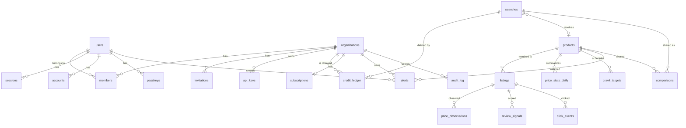

# Before You Buy — Backend Schema Documentation

| Field | Value |
|---|---|
| Version | 1.1 |
| Database | PostgreSQL 18 on Neon · Drizzle ORM · extensions `vector`, `pg_trgm`, `citext` |
| Cache/queues | Redis 7 · BullMQ |
| Related | [02-ARCHITECTURE §10](02-ARCHITECTURE.md#10-data-architecture-summary) · [03-TECHNICAL-REQUIREMENTS](03-TECHNICAL-REQUIREMENTS.md) · [05-SECURITY](05-SECURITY.md) |

> **Source of truth.** Once M2 lands, the Drizzle schema in `packages/db/src/schema/` and the migrations in `packages/db/migrations/` are authoritative. This document describes intent and must be updated in the same PR as any schema change (see [09-CHANGE-MANAGEMENT](09-CHANGE-MANAGEMENT.md)). The SQL below is the target DDL that Drizzle definitions and custom migrations must produce.

---

## 1. Rules that apply to every table

| # | Rule | Why |
|---|---|---|
| 1 | Primary keys are `uuid DEFAULT uuidv7()` (native in PG 18). | Time-sortable, unguessable IDs |
| 2 | Money is `integer` cents + `currency char(3)`; never `numeric`/`float` for money. | Exact landed-cost sums; AUD later |
| 3 | Credits are `bigint` **millicredits** (`_mc` suffix). | 0.5-credit cache hits stay integers |
| 4 | Every customer-owned row has `organization_id` (NOT NULL unless the actor can be anonymous). | B2B is configuration, not a migration |
| 5 | Every stored retailer datum has `retain_until` (or is derived only from providers whose policy allows it). | Retailer terms enforced by the nightly purge |
| 6 | `created_at timestamptz NOT NULL DEFAULT now()`; mutable tables add `updated_at` maintained by the repository layer. | Auditability |
| 7 | Soft delete (`deleted_at`) only where the product needs recovery (users, organizations); everything else hard-deletes. | Simpler queries, honest retention |
| 8 | No raw IP addresses, no review text, no payment details are stored. | Privacy and retailer terms |
| 9 | Columns are `snake_case`; Drizzle properties are `camelCase`. | Convention |
| 10 | Enums are used for stable sets only; values are added with `ALTER TYPE … ADD VALUE`, never removed. | Postgres enum limitations |

---

## 2. Entity-relationship overview



### 2.1 Table inventory

| Domain | Table | Phase | RLS |
|---|---|---|---|
| Identity (Better Auth) | `users`, `sessions`, `accounts`, `verifications`, `passkeys`, `two_factors` (v4.5) | v4.0 | No (app-enforced) |
| Tenancy | `organizations`, `members`, `invitations` | v4.0 | No (Better Auth) |
| Access | `api_keys` | v4.0 schema / v4.5 use | Yes |
| Catalog | `products`, `listings` | v4.0 | No (public data) |
| Prices | `price_observations` (partitioned), `price_stats_daily` | v4.0 | No |
| Trust | `review_signals` | v4.0 | No |
| Search | `searches`, `comparisons`, `click_events` | v4.0 | No (system-written; read via scoped repositories) |
| Metering | `credit_ledger` | v4.0 | Yes |
| Billing | `subscriptions`, `stripe_events` | v4.5 | `subscriptions` yes |
| Alerts | `alerts`, `email_suppressions` | v4.0 | `alerts` yes |
| Platform | `outbox_events`, `audit_log`, `crawl_targets`, `provider_health_checks` | v4.0 | `audit_log` yes |
| Reference | `tax_rates`, `shipping_rules` | v4.0 | No |
| QA | `qa_landed_cost_samples` | v4.0 | No |
| Gate 0 | `waitlist_signups`, `preorders` | M0 | No |

---

## 3. Extensions and enums

```sql
CREATE EXTENSION IF NOT EXISTS vector;     -- pgvector: product embeddings
CREATE EXTENSION IF NOT EXISTS pg_trgm;    -- autocomplete similarity
CREATE EXTENSION IF NOT EXISTS citext;     -- case-insensitive emails

CREATE TYPE platform          AS ENUM ('amazon', 'ebay', 'bestbuy');
CREATE TYPE item_condition    AS ENUM ('new', 'refurbished', 'used', 'open_box');
CREATE TYPE plan_tier         AS ENUM ('free', 'starter', 'growth', 'scale', 'enterprise');
CREATE TYPE price_source      AS ENUM ('ebay_browse', 'bestbuy_products', 'brightdata_unlocker',
                                       'brightdata_scraper', 'backup_unblocker');
CREATE TYPE cache_status      AS ENUM ('hit', 'partial', 'miss');
CREATE TYPE search_channel    AS ENUM ('web', 'api', 'extension', 'alert', 'precrawl');
CREATE TYPE match_status      AS ENUM ('matched', 'possible', 'excluded', 'unmatched');
CREATE TYPE trust_band        AS ENUM ('consistent', 'some_concerns', 'strong_concerns', 'insufficient_data');
CREATE TYPE ledger_entry_type AS ENUM ('grant_plan', 'grant_plan_adjustment', 'grant_bonus',
                                       'debit_search', 'debit_refresh', 'refund', 'adjustment', 'expire');
CREATE TYPE alert_status      AS ENUM ('pending_confirmation', 'active', 'paused', 'expired', 'deleted');
CREATE TYPE outbox_status     AS ENUM ('pending', 'processing', 'sent', 'failed', 'dead');
```

---

## 4. Identity and tenancy

Better Auth owns these tables. Generate them with the Better Auth CLI, then configure plural table names and snake_case columns, and let Postgres generate `uuidv7` IDs. *(Exact Better Auth options verified in M3.)*

### 4.1 `users`

| Column | Type | Constraints | Notes |
|---|---|---|---|
| `id` | uuid | PK, default `uuidv7()` | |
| `email` | citext | NOT NULL, UNIQUE | **The only personal data collected** (CW-8) |
| `email_verified` | boolean | NOT NULL default false | |
| `name` | text | | Optional |
| `image` | text | | Optional (social sign-in) |
| `default_zip` | char(5) | CHECK `^\d{5}$` | Optional, user-set |
| `two_factor_enabled` | boolean | NOT NULL default false | v4.5 business accounts |
| `created_at`, `updated_at` | timestamptz | NOT NULL | |
| `deleted_at` | timestamptz | | Set on deletion request; hard delete ≤ 30 days |

### 4.2 `sessions`, `accounts`, `verifications`, `passkeys`, `two_factors`

| Table | Key columns | Notes |
|---|---|---|
| `sessions` | `id`, `user_id` FK → users ON DELETE CASCADE, `token` UNIQUE, `expires_at`, `active_organization_id`, `user_agent` (truncated 256) | IP tracking disabled in Better Auth config; no raw IP stored |
| `accounts` | `id`, `user_id` FK, `provider_id`, `account_id`, tokens (encrypted by Better Auth), `password` (hash, v4.5 business only) | One row per sign-in method |
| `verifications` | `id`, `identifier`, `value` (hashed token), `expires_at` | Magic-link and email-verification tokens; purged after expiry |
| `passkeys` | `id`, `user_id` FK, `credential_id` UNIQUE, `public_key`, `counter`, `device_type`, `backed_up`, `transports`, `aaguid`, `name` | WebAuthn |
| `two_factors` | `id`, `user_id` FK, `secret` (encrypted), `backup_codes` (encrypted) | v4.5 |

### 4.3 `organizations`

```sql
CREATE TABLE organizations (
  id                 uuid PRIMARY KEY DEFAULT uuidv7(),
  name               text NOT NULL,
  slug               text NOT NULL UNIQUE,
  logo               text,
  metadata           jsonb,
  is_personal        boolean NOT NULL DEFAULT true,   -- every signup gets one
  plan               plan_tier NOT NULL DEFAULT 'free',
  stripe_customer_id text UNIQUE,                     -- v4.5
  created_at         timestamptz NOT NULL DEFAULT now(),
  updated_at         timestamptz NOT NULL DEFAULT now(),
  deleted_at         timestamptz
);
```

### 4.4 `members` and `invitations`

```sql
CREATE TABLE members (
  id              uuid PRIMARY KEY DEFAULT uuidv7(),
  organization_id uuid NOT NULL REFERENCES organizations(id) ON DELETE CASCADE,
  user_id         uuid NOT NULL REFERENCES users(id) ON DELETE CASCADE,
  role            text NOT NULL CHECK (role IN ('owner', 'admin', 'member', 'billing')),
  created_at      timestamptz NOT NULL DEFAULT now(),
  UNIQUE (organization_id, user_id)
);

CREATE TABLE invitations (
  id              uuid PRIMARY KEY DEFAULT uuidv7(),
  organization_id uuid NOT NULL REFERENCES organizations(id) ON DELETE CASCADE,
  email           citext NOT NULL,
  role            text NOT NULL CHECK (role IN ('admin', 'member', 'billing')),
  status          text NOT NULL CHECK (status IN ('pending', 'accepted', 'rejected', 'canceled', 'expired')),
  inviter_id      uuid REFERENCES users(id) ON DELETE SET NULL,
  expires_at      timestamptz NOT NULL,
  created_at      timestamptz NOT NULL DEFAULT now()
);
```

An organization must always have at least one `owner` (enforced in the service layer and by a deferred constraint trigger).

### 4.5 `api_keys`

```sql
CREATE TABLE api_keys (
  id                 uuid PRIMARY KEY DEFAULT uuidv7(),
  organization_id    uuid NOT NULL REFERENCES organizations(id) ON DELETE CASCADE,
  created_by_user_id uuid REFERENCES users(id) ON DELETE SET NULL,
  name               text NOT NULL CHECK (char_length(name) <= 100),
  prefix             text NOT NULL,                 -- visible, e.g. 'byb_live_7Hq2Xc9a'
  key_hash           bytea NOT NULL UNIQUE,         -- HMAC-SHA-256(API_KEY_PEPPER, full key)
  pepper_version     smallint NOT NULL DEFAULT 1,
  scopes             text[] NOT NULL,               -- e.g. {'search:read','history:read'}
  environment        text NOT NULL DEFAULT 'live' CHECK (environment IN ('live', 'test')),
  rate_limit_per_min integer CHECK (rate_limit_per_min > 0),   -- optional sub-limit under the org plan
  last_used_at       timestamptz,
  expires_at         timestamptz,
  revoked_at         timestamptz,
  created_at         timestamptz NOT NULL DEFAULT now()
);
CREATE INDEX api_keys_org_active ON api_keys (organization_id) WHERE revoked_at IS NULL;
```

The raw key is shown once and never stored. The plan tier comes from the owning organization, not the key. Key lookup by hash runs through a `SECURITY DEFINER` function (`auth_find_api_key(hash bytea)`) because it happens before the org is known (see §11).

---

## 5. Catalog

### 5.1 `products` — the canonical item a shopper means

```sql
CREATE TABLE products (
  id                 uuid PRIMARY KEY DEFAULT uuidv7(),
  slug               text NOT NULL UNIQUE,              -- /p/{slug}
  title              text NOT NULL,                     -- canonical display title
  brand              text,
  model              text,
  mpn                text,
  gtin               text,                              -- normalized to GTIN-14
  category           text,
  variant_attributes jsonb NOT NULL DEFAULT '{}',       -- normalized vocabulary (TR-MATCH-14)
  family_id          uuid REFERENCES products(id),      -- groups variants of one model
  image_url          text,                              -- policy-permitted source only (LEGAL-16)
  search_text        tsvector GENERATED ALWAYS AS (
                       to_tsvector('english'::regconfig,
                         coalesce(brand, '') || ' ' || coalesce(model, '') || ' ' || title)
                     ) STORED,
  embedding          vector(768),                       -- dimension fixed by DECIDE-14
  embedding_model    text,
  popularity_score   real NOT NULL DEFAULT 0,           -- feeds pre-crawl priority + autocomplete
  created_at         timestamptz NOT NULL DEFAULT now(),
  updated_at         timestamptz NOT NULL DEFAULT now()
);
CREATE UNIQUE INDEX products_gtin_uq      ON products (gtin) WHERE gtin IS NOT NULL;
CREATE INDEX products_title_trgm          ON products USING gin (title gin_trgm_ops);
CREATE INDEX products_brand_model_trgm    ON products USING gin ((coalesce(brand,'') || ' ' || coalesce(model,'')) gin_trgm_ops);
CREATE INDEX products_search_text         ON products USING gin (search_text);
CREATE INDEX products_embedding_hnsw      ON products USING hnsw (embedding vector_cosine_ops);
CREATE INDEX products_brand_mpn           ON products (lower(brand), lower(mpn)) WHERE mpn IS NOT NULL;
```

Changing the embedding model = add a new column + index, backfill with `embedding-backfill`, switch reads, drop the old column (expand/contract).

### 5.2 `listings` — one retailer offer

```sql
CREATE TABLE listings (
  id                    uuid PRIMARY KEY DEFAULT uuidv7(),
  platform              platform NOT NULL,
  external_id           text NOT NULL,          -- ASIN | eBay item id incl. variation | Best Buy SKU
  product_id            uuid REFERENCES products(id) ON DELETE SET NULL,
  match_status          match_status NOT NULL DEFAULT 'unmatched',
  match_confidence      real CHECK (match_confidence BETWEEN 0 AND 1),
  match_variant         text CHECK (match_variant IN ('exact', 'different', 'unknown')),
  match_method          text CHECK (match_method IN ('gtin', 'mpn', 'llm', 'url', 'manual')),
  match_version         text,                   -- prompt/model version that decided
  matched_at            timestamptz,
  title                 text NOT NULL,          -- plain text
  brand                 text,
  mpn                   text,
  gtin                  text,
  variant_attributes    jsonb NOT NULL DEFAULT '{}',
  condition             item_condition NOT NULL,
  condition_detail      text,
  seller_name           text,
  seller_external_id    text,
  seller_is_retailer    boolean NOT NULL DEFAULT false,
  seller_rating         real,
  seller_rating_count   integer,
  warranty_months       smallint,
  warranty_provider     text CHECK (warranty_provider IN ('manufacturer', 'retailer', 'seller', 'unknown')),
  warranty_text         text,
  return_window_days    smallint,
  free_returns          boolean,
  returns_text          text,
  canonical_url         text NOT NULL,          -- rebuilt deep link to the exact variant (CW-11), no affiliate params
  image_url             text,
  in_stock              boolean,
  is_dead               boolean NOT NULL DEFAULT false,
  rating_average        real,
  review_count          integer,
  first_seen_at         timestamptz NOT NULL DEFAULT now(),
  last_seen_at          timestamptz NOT NULL DEFAULT now(),
  last_checked_at       timestamptz NOT NULL DEFAULT now(),
  retain_until          timestamptz NOT NULL,   -- last_checked_at + policy.maxRetainSec
  created_at            timestamptz NOT NULL DEFAULT now(),
  updated_at            timestamptz NOT NULL DEFAULT now(),
  UNIQUE (platform, external_id)
);
CREATE INDEX listings_product_platform ON listings (product_id, platform) WHERE NOT is_dead;
CREATE INDEX listings_retain_until     ON listings (retain_until);
CREATE INDEX listings_gtin             ON listings (gtin) WHERE gtin IS NOT NULL;
```

---

## 6. Prices

### 6.1 `price_observations` — partitioned by month

```sql
CREATE TABLE price_observations (
  id                 uuid NOT NULL DEFAULT uuidv7(),
  observed_at        timestamptz NOT NULL,
  listing_id         uuid NOT NULL,                -- no FK: partitioned + purged by policy
  product_id         uuid,                         -- denormalized for history reads
  platform           platform NOT NULL,
  condition          item_condition NOT NULL,
  listed_price_cents integer NOT NULL CHECK (listed_price_cents >= 0),
  shipping_cents     integer CHECK (shipping_cents >= 0),   -- NULL = unknown / ZIP-dependent
  currency           char(3) NOT NULL DEFAULT 'USD',
  in_stock           boolean,
  source             price_source NOT NULL,
  verified           boolean NOT NULL DEFAULT false,         -- Amazon phase 2 (AR-4)
  search_id          uuid,                                   -- NULL for pre-crawl
  retain_until       timestamptz NOT NULL,
  PRIMARY KEY (observed_at, id)
) PARTITION BY RANGE (observed_at);

CREATE INDEX price_obs_observed_brin ON price_observations USING brin (observed_at);
CREATE INDEX price_obs_listing_time  ON price_observations (listing_id, observed_at DESC);
CREATE INDEX price_obs_product_time  ON price_observations (product_id, observed_at DESC);

-- created by the partition-maintenance job, 3 months ahead:
CREATE TABLE price_observations_2026_10 PARTITION OF price_observations
  FOR VALUES FROM ('2026-10-01') TO ('2026-11-01');
```

Drizzle Kit does not generate `PARTITION BY`; this table and its partitions are created in a **custom SQL migration**, with a Drizzle table definition (without partition syntax) used for typed queries.

### 6.2 `price_stats_daily` — makes AR-8 a small read

```sql
CREATE TABLE price_stats_daily (
  product_id    uuid NOT NULL REFERENCES products(id) ON DELETE CASCADE,
  condition     item_condition NOT NULL,
  day           date NOT NULL,
  min_cents     integer NOT NULL,
  max_cents     integer NOT NULL,
  median_cents  integer,                 -- filled by nightly job for the previous day
  sample_count  integer NOT NULL,
  platforms     platform[] NOT NULL,     -- only policy.historyAllowed providers
  min_platform  platform,
  PRIMARY KEY (product_id, condition, day)
);
```

---

## 7. Trust

### 7.1 `review_signals`

```sql
CREATE TABLE review_signals (
  id              uuid PRIMARY KEY DEFAULT uuidv7(),
  listing_id      uuid NOT NULL REFERENCES listings(id) ON DELETE CASCADE,
  score           smallint CHECK (score BETWEEN 0 AND 100),     -- NULL when insufficient_data
  band            trust_band NOT NULL,
  signals         jsonb NOT NULL,          -- [{code,label,effect,weight,value}] — the "why" (CW-6)
  review_count    integer,
  average_rating  real,
  inputs_summary  jsonb NOT NULL,          -- histogram, sample size, date span; NO review text
  model_version   text NOT NULL,           -- e.g. 'trust-v1.2'
  computed_at     timestamptz NOT NULL DEFAULT now(),
  expires_at      timestamptz NOT NULL     -- default computed_at + 7 days
);
CREATE INDEX review_signals_listing_latest ON review_signals (listing_id, computed_at DESC);
```

---

## 8. Search, sharing and clicks

### 8.1 `searches`

```sql
CREATE TABLE searches (
  id                   uuid PRIMARY KEY DEFAULT uuidv7(),
  query_normalized     text,                          -- NULL for url/product searches; ≤ 200 chars
  query_type           text NOT NULL CHECK (query_type IN ('name', 'url', 'product')),
  query_class          text CHECK (query_class IN ('exact_model', 'vague')),
  url_platform         platform,
  url_external_id      text,
  cache_key            bytea NOT NULL,                -- sha256 (TR-INT-07)
  resolved_product_id  uuid REFERENCES products(id) ON DELETE SET NULL,
  organization_id      uuid REFERENCES organizations(id) ON DELETE SET NULL,
  user_id              uuid REFERENCES users(id) ON DELETE SET NULL,
  anon_id              uuid,
  api_key_id           uuid REFERENCES api_keys(id) ON DELETE SET NULL,
  channel              search_channel NOT NULL,
  zip_source           text CHECK (zip_source IN ('user', 'cookie', 'ip', 'none')),
  zip3                 char(3),                       -- coarse region only
  condition_scope      text NOT NULL DEFAULT 'new' CHECK (condition_scope IN ('new', 'any')),
  forced_refresh       boolean NOT NULL DEFAULT false,
  cache_status         cache_status,
  platforms_requested  platform[] NOT NULL,
  platforms_live       platform[] NOT NULL DEFAULT '{}',
  platforms_failed     platform[] NOT NULL DEFAULT '{}',
  outcome              text CHECK (outcome IN ('completed', 'disambiguation', 'partial', 'failed', 'blocked')),
  credits_charged_mc   integer NOT NULL DEFAULT 0,
  first_event_ms       integer,
  total_ms             integer,
  ip_hash              bytea,                         -- salted, daily-rotating; nulled after 30 days
  created_at           timestamptz NOT NULL DEFAULT now()
);
CREATE INDEX searches_org_time     ON searches (organization_id, created_at DESC) WHERE organization_id IS NOT NULL;
CREATE INDEX searches_anon_time    ON searches (anon_id, created_at DESC) WHERE anon_id IS NOT NULL;
CREATE INDEX searches_product_time ON searches (resolved_product_id, created_at DESC);
CREATE INDEX searches_created_brin ON searches USING brin (created_at);
```

Partition `searches` by month if it passes ~50 M rows.

### 8.2 `comparisons` — permanent share URLs (CW-13)

```sql
CREATE TABLE comparisons (
  id                  uuid PRIMARY KEY DEFAULT uuidv7(),
  slug                text NOT NULL UNIQUE CHECK (slug ~ '^[0-9A-Za-z]{10}$'),
  search_id           uuid REFERENCES searches(id) ON DELETE SET NULL,
  product_id          uuid NOT NULL REFERENCES products(id) ON DELETE CASCADE,
  condition_scope     text NOT NULL,
  platforms           platform[] NOT NULL,
  listing_ids         uuid[] NOT NULL,       -- references, NOT prices (DEC-030)
  created_by_user_id  uuid REFERENCES users(id) ON DELETE SET NULL,
  created_by_anon_id  uuid,
  view_count          integer NOT NULL DEFAULT 0,
  last_viewed_at      timestamptz,
  created_at          timestamptz NOT NULL DEFAULT now()
);
```

### 8.3 `click_events` — outbound affiliate clicks (TR-AFF-04)

```sql
CREATE TABLE click_events (
  id            uuid PRIMARY KEY DEFAULT uuidv7(),
  listing_id    uuid NOT NULL,
  platform      platform NOT NULL,
  rank          smallint,
  is_affiliate  boolean NOT NULL,
  search_id     uuid,
  user_id       uuid,
  anon_id       uuid,
  created_at    timestamptz NOT NULL DEFAULT now()
);
CREATE INDEX click_events_created_brin ON click_events USING brin (created_at);
```

---

## 9. Metering and billing

### 9.1 `credit_ledger` — append-only

```sql
CREATE TABLE credit_ledger (
  id                     uuid PRIMARY KEY DEFAULT uuidv7(),
  organization_id        uuid NOT NULL REFERENCES organizations(id) ON DELETE RESTRICT,
  entry_type             ledger_entry_type NOT NULL,
  amount_mc              bigint NOT NULL CHECK (amount_mc <> 0),   -- + grant, − debit
  period_start           date NOT NULL,                            -- billing period the entry belongs to
  search_id              uuid REFERENCES searches(id) ON DELETE SET NULL,
  api_key_id             uuid REFERENCES api_keys(id) ON DELETE SET NULL,
  reason                 text NOT NULL,
  idempotency_key        text NOT NULL UNIQUE,                     -- e.g. 'search:{searchId}'
  metadata               jsonb NOT NULL DEFAULT '{}',
  reported_to_stripe_at  timestamptz,                              -- v4.5
  stripe_meter_event_id  text,
  created_at             timestamptz NOT NULL DEFAULT now()
);
CREATE INDEX credit_ledger_org_period ON credit_ledger (organization_id, period_start);
CREATE INDEX credit_ledger_unreported ON credit_ledger (created_at)
  WHERE reported_to_stripe_at IS NULL AND amount_mc < 0;

-- Append-only: no DELETE; UPDATE allowed only on the Stripe reporting columns.
CREATE FUNCTION credit_ledger_guard() RETURNS trigger LANGUAGE plpgsql AS $$
BEGIN
  IF TG_OP = 'DELETE' THEN
    RAISE EXCEPTION 'credit_ledger is append-only';
  END IF;
  IF (NEW.id, NEW.organization_id, NEW.entry_type, NEW.amount_mc, NEW.period_start,
      NEW.idempotency_key, NEW.created_at)
     IS DISTINCT FROM
     (OLD.id, OLD.organization_id, OLD.entry_type, OLD.amount_mc, OLD.period_start,
      OLD.idempotency_key, OLD.created_at) THEN
    RAISE EXCEPTION 'credit_ledger rows are immutable';
  END IF;
  RETURN NEW;
END $$;
CREATE TRIGGER credit_ledger_guard BEFORE UPDATE OR DELETE ON credit_ledger
  FOR EACH ROW EXECUTE FUNCTION credit_ledger_guard();
```

**Balance** for a period = `SUM(amount_mc) WHERE organization_id = $1 AND period_start = $2`. Corrections are new `adjustment`/`refund` rows, never edits.

### 9.2 `subscriptions` (v4.5)

```sql
CREATE TABLE subscriptions (
  id                     uuid PRIMARY KEY DEFAULT uuidv7(),
  organization_id        uuid NOT NULL UNIQUE REFERENCES organizations(id),
  stripe_subscription_id text NOT NULL UNIQUE,
  plan                   plan_tier NOT NULL,
  status                 text NOT NULL,   -- mirrors Stripe: active, trialing, past_due, canceled, incomplete, unpaid
  current_period_start   timestamptz NOT NULL,
  current_period_end     timestamptz NOT NULL,
  quota_mc               bigint NOT NULL,
  cancel_at_period_end   boolean NOT NULL DEFAULT false,
  grace_until            timestamptz,     -- failed payment grace (TR-BILL-06)
  created_at             timestamptz NOT NULL DEFAULT now(),
  updated_at             timestamptz NOT NULL DEFAULT now()
);
```

### 9.3 `stripe_events` — webhook idempotency

| Column | Type | Notes |
|---|---|---|
| `id` | text PK | Stripe event ID |
| `type` | text NOT NULL | |
| `received_at` | timestamptz NOT NULL | |
| `processed_at` | timestamptz | NULL until handled |
| `payload_sha256` | bytea NOT NULL | Not the payload itself |

---

## 10. Alerts, email and platform tables

### 10.1 `alerts`

```sql
CREATE TABLE alerts (
  id                         uuid PRIMARY KEY DEFAULT uuidv7(),
  organization_id            uuid NOT NULL REFERENCES organizations(id) ON DELETE CASCADE,
  user_id                    uuid NOT NULL REFERENCES users(id) ON DELETE CASCADE,
  product_id                 uuid NOT NULL REFERENCES products(id) ON DELETE CASCADE,
  status                     alert_status NOT NULL DEFAULT 'pending_confirmation',
  kind                       text NOT NULL CHECK (kind IN ('target_price', 'percent_drop')),
  target_price_cents         integer CHECK (target_price_cents > 0),
  target_drop_bps            integer CHECK (target_drop_bps BETWEEN 100 AND 9000),   -- 1%–90%
  baseline_price_cents       integer NOT NULL,
  condition_scope            text NOT NULL DEFAULT 'new' CHECK (condition_scope IN ('new', 'any')),
  platforms                  platform[] NOT NULL,
  zip                        char(5),
  last_checked_at            timestamptz,
  last_notified_at           timestamptz,
  last_notified_price_cents  integer,
  expires_at                 timestamptz NOT NULL,       -- default +180 days (TR-ALRT-08)
  created_at                 timestamptz NOT NULL DEFAULT now(),
  updated_at                 timestamptz NOT NULL DEFAULT now(),
  CHECK ((kind = 'target_price' AND target_price_cents IS NOT NULL)
      OR (kind = 'percent_drop' AND target_drop_bps IS NOT NULL))
);
CREATE UNIQUE INDEX alerts_one_open_per_product ON alerts (user_id, product_id)
  WHERE status IN ('pending_confirmation', 'active', 'paused');
CREATE INDEX alerts_active_by_product ON alerts (product_id) WHERE status = 'active';
```

### 10.2 `email_suppressions`

| Column | Type | Notes |
|---|---|---|
| `email_sha256` | bytea PK | SHA-256 of lowercased email — no plaintext kept |
| `reason` | text NOT NULL | `bounce` \| `complaint` \| `unsubscribe_all` |
| `created_at` | timestamptz NOT NULL | |

### 10.3 `outbox_events` — written in the same transaction as the change

```sql
CREATE TABLE outbox_events (
  id               uuid PRIMARY KEY DEFAULT uuidv7(),
  organization_id  uuid,
  topic            text NOT NULL,           -- 'email.alert_triggered', 'email.quota_80', 'email.alert_confirm', ...
  payload          jsonb NOT NULL,          -- IDs + template data; recipients resolved at send time
  idempotency_key  text NOT NULL UNIQUE,
  status           outbox_status NOT NULL DEFAULT 'pending',
  attempts         smallint NOT NULL DEFAULT 0,
  next_attempt_at  timestamptz NOT NULL DEFAULT now(),
  last_error       text,
  created_at       timestamptz NOT NULL DEFAULT now(),
  processed_at     timestamptz
);
CREATE INDEX outbox_due ON outbox_events (next_attempt_at) WHERE status IN ('pending', 'failed');
```

Retries: exponential backoff (1 min → 6 h), `dead` after 10 attempts with an ops alert.

### 10.4 `audit_log` — append-only

| Column | Type | Notes |
|---|---|---|
| `id` | uuid PK | |
| `organization_id` | uuid NOT NULL | RLS-scoped |
| `actor_type` | text | `user` \| `api_key` \| `system` \| `stripe` |
| `actor_id` | uuid | |
| `action` | text NOT NULL | e.g. `member.invited`, `member.role_changed`, `api_key.created`, `api_key.revoked`, `plan.changed`, `org.deleted` |
| `target_type`, `target_id` | text, uuid | |
| `metadata` | jsonb | No secrets, no emails |
| `ip_hash` | bytea | |
| `created_at` | timestamptz NOT NULL | |

### 10.5 `crawl_targets` (CW-15)

```sql
CREATE TABLE crawl_targets (
  id                    uuid PRIMARY KEY DEFAULT uuidv7(),
  product_id            uuid NOT NULL REFERENCES products(id) ON DELETE CASCADE,
  platform              platform NOT NULL,
  priority              real NOT NULL DEFAULT 0,
  reasons               text[] NOT NULL DEFAULT '{}',   -- search_volume | alert | seed | page_traffic
  next_due_at           timestamptz NOT NULL DEFAULT now(),
  last_success_at       timestamptz,
  last_attempt_at       timestamptz,
  consecutive_failures  smallint NOT NULL DEFAULT 0,
  UNIQUE (product_id, platform)
);
CREATE INDEX crawl_targets_due ON crawl_targets (next_due_at, priority DESC);
```

### 10.6 `provider_health_checks` (R5, TR-PROV-34)

| Column | Type |
|---|---|
| `id` | uuid PK |
| `platform`, `transport` | platform, text |
| `checked_at` | timestamptz |
| `ok` | boolean |
| `parse_success_rate`, `null_field_rate` | real |
| `latency_p50_ms`, `latency_p95_ms` | integer |
| `anomalies` | jsonb |

---

## 11. Reference and QA tables

### 11.1 `tax_rates` (DECIDE-05)

```sql
CREATE TABLE tax_rates (
  zip5               char(5) NOT NULL,
  jurisdiction_code  text NOT NULL,
  state              char(2) NOT NULL,
  combined_rate_ppm  integer NOT NULL CHECK (combined_rate_ppm BETWEEN 0 AND 200000),  -- parts per million: 8.875% = 88750
  shipping_taxable   boolean,                -- NULL = unknown ⇒ range
  effective_from     date NOT NULL,
  source             text NOT NULL,
  PRIMARY KEY (zip5, jurisdiction_code, effective_from)
);
CREATE INDEX tax_rates_state ON tax_rates (state);
```

> Rates are stored in **parts per million** so rates like 8.875% stay exact integers. Tax = `round_half_up(base_cents × rate_ppm / 1_000_000)`.

### 11.2 `shipping_rules`

| Column | Type | Notes |
|---|---|---|
| `id` | uuid PK | |
| `platform` | platform | |
| `rule_key` | text | e.g. `free_threshold`, `max_standard` |
| `rule` | jsonb | e.g. `{ "freeThresholdCents": 3500, "maxStandardShippingCents": 1099 }` — values verified at M8 |
| `effective_from` | date | |
| `notes` | text | Source URL + date checked |

### 11.3 `qa_landed_cost_samples` (TR-LC-07)

| Column | Type |
|---|---|
| `id` | uuid PK |
| `listing_id` | uuid |
| `platform` | platform |
| `zip5` | char(5) |
| `landed_min_cents`, `landed_max_cents` | integer |
| `checkout_total_cents` | integer |
| `within_2usd` | boolean (set by the app: checkout total within $2 of the landed range) |
| `sampled_by`, `notes` | text |
| `sampled_at` | timestamptz |

---

## 12. Gate 0 tables (M0)

```sql
CREATE TABLE waitlist_signups (
  id                    uuid PRIMARY KEY DEFAULT uuidv7(),
  email                 citext NOT NULL UNIQUE,
  source                text,                 -- 'show_hn' | 'reddit' | 'dm' | 'direct' | 'search' | 'other'
  utm                   jsonb,
  referrer              text,
  query                 text,                 -- DEC-039: the /notify?q= search term, when source = 'search'
  consent_text_version  text NOT NULL,
  confirmed_at          timestamptz,
  created_at            timestamptz NOT NULL DEFAULT now()
);

CREATE TABLE preorders (
  id                          uuid PRIMARY KEY DEFAULT uuidv7(),
  email                       citext NOT NULL,
  stripe_checkout_session_id  text NOT NULL UNIQUE,
  stripe_payment_intent_id    text,
  amount_cents                integer NOT NULL,
  currency                    char(3) NOT NULL DEFAULT 'USD',
  offer_code                  text NOT NULL,      -- DECIDE-15
  status                      text NOT NULL CHECK (status IN ('paid', 'refunded')),
  created_at                  timestamptz NOT NULL DEFAULT now(),
  refunded_at                 timestamptz
);
```

At v4.0 launch, confirmed waitlist emails are invited; pre-orders are converted to plan credits or subscriptions per the offer terms.

---

## 13. Row-Level Security

RLS is the **second wall**; the first is that every repository method requires an `OrgScope`.

### 13.1 Database roles

| Role | Used by | RLS |
|---|---|---|
| `byb_migrator` | CI / pre-deploy migrations | Owner of all objects |
| `byb_app` | `apps/api` | Enforced |
| `byb_worker` | `apps/worker` | `BYPASSRLS` (system jobs operate across orgs) |

### 13.2 Policy pattern

```sql
ALTER TABLE alerts ENABLE ROW LEVEL SECURITY;
ALTER TABLE alerts FORCE ROW LEVEL SECURITY;

CREATE POLICY org_isolation ON alerts
  USING      (organization_id = current_setting('app.org_id', true)::uuid)
  WITH CHECK (organization_id = current_setting('app.org_id', true)::uuid);
```

The repository opens a transaction and runs `SELECT set_config('app.org_id', $orgId, true)` (transaction-local, safe with PgBouncer transaction pooling) before any query on an RLS table. Applied to: `alerts`, `credit_ledger`, `subscriptions`, `audit_log`, `api_keys`.

Integration tests assert that a query in org A's scope can never read or write org B's rows on every RLS table.

---

## 14. Retention

| Data | Retention | Enforced by |
|---|---|---|
| eBay listings & observations | Display ≤ 6 h old; retained per LEGAL-03 outcome (default 24 h) | `retain_until` + `retention-purge` |
| Best Buy listings & observations | ≤ 72 h | `retain_until` + `retention-purge` |
| Amazon observations | 120 days (90-day window + margin) | partition drop + purge |
| `price_stats_daily` | 400 days (policy-allowed providers only) | purge |
| `review_signals` | Latest per listing + 90 days of history | purge |
| `searches` | 13 months; `ip_hash` nulled after 30 days; anon/user links removed after 13 months | purge |
| `click_events` | 13 months | purge |
| `verifications` | Until expiry + 1 day | purge |
| `outbox_events` | `sent` rows 30 days; `dead` rows 90 days | purge |
| `audit_log` | 2 years (Enterprise export before deletion) | purge |
| `credit_ledger` | Indefinite (financial record; de-linked on account deletion) | — |
| Deleted users | Hard delete ≤ 30 days after request | purge |

---

## 15. Redis key schema

All keys are prefixed with `byb:{APP_ENV}:`. Everything here can be rebuilt from Postgres or safely lost.

| Key pattern | Type | TTL | Purpose |
|---|---|---|---|
| `cache:search:{cacheKeyHex}` | string (JSON) | min policy `maxDisplayAgeSec` of contents | Search result (listed prices, no landed cost) |
| `cache:listing:{platform}:{externalId}` | string (JSON) | policy | Listing snapshot |
| `cache:ac:{prefixHash}` | string (JSON) | 10 min | Autocomplete |
| `lock:search:{cacheKeyHex}` | string | 60 s | Single-flight (TR-SRCH-04) |
| `sse:{searchId}` | stream | 10 min | Event buffer for `Last-Event-ID` resume |
| `search:{searchId}` | pub/sub channel | — | Late `patch` events from workers |
| `rl:{scope}:{id}:{window}` | sorted set / counter | window | Rate limits (anon IP, anon ID, org, key) |
| `rl:provider:{platform}` | token bucket | — | Provider rate limits |
| `quota:{orgId}:{period}` | counter | period + 7 d | Fast usage mirror (reconciled hourly) |
| `daily:ebay:calls:{YYYY-MM-DD}` | counter | 2 d | eBay daily call budget |
| `spend:{provider}:{YYYY-MM-DD}` | counter (cents × 1000) | 7 d | Daily spend cap |
| `cb:{platform}:{transport}` | hash | — | Circuit-breaker state |
| `flag:{name}` | string | — | Kill switches / runtime flags |
| `anon:{anonId}:verified` | string | 30 min | Turnstile pass for anonymous live searches |
| `token:ebay` | string | until expiry − 60 s | eBay OAuth token |
| `idem:{scope}:{key}` | string (JSON) | 24 h | API `Idempotency-Key` replay |
| `bull:*` | BullMQ | — | Queues (§16) |

---

## 16. Queues (BullMQ)

| Queue | Job ID | Concurrency | Retries / backoff | Notes |
|---|---|---|---|---|
| `precrawl` | `precrawl:{productId}:{platform}:{dueBucket}` | 8 | 3, exp 30 s | Respects provider budgets |
| `snapshot` | `snapshot:{listingId}:{observedAt}` | 16 | 5, exp 10 s | Writes observations + daily stats |
| `alert-check` | `alert:{productId}:{snapshotAt}` | 8 | 3, exp 30 s | 0 credits |
| `amazon-verify` | `verify:{listingId}:{searchId}` | 4 | 2, fixed 20 s | Phase 2 (AR-4) |
| `amazon-health` | repeatable `*/30 * * * *` | 1 | none | R5 |
| `retention-purge` | repeatable nightly 03:15 UTC | 1 | 3 | Batched deletes |
| `partition-maintenance` | repeatable daily 02:00 UTC | 1 | 3 | Create next 3 months |
| `stats-median` | repeatable nightly 01:30 UTC | 2 | 3 | Fill `median_cents` |
| `usage-report` | repeatable every 5 min (v4.5) | 1 | 5 | Stripe meters |
| `outbox-dispatch` | per outbox row | 8 | via `outbox_events` | Emails, billing, webhooks |
| `embedding-backfill` | `embed:{productId}:{model}` | 4 | 3 | On model change |
| `trust-score` | `trust:{listingId}:{reviewCount}` | 4 | 3 | Recompute review signals |

---

## 17. Migrations and seed data

- **Generation:** `pnpm db:generate` (Drizzle Kit) for ordinary tables; hand-written SQL migrations for extensions, partitioned tables, RLS policies, triggers, roles and the `SECURITY DEFINER` key lookup. All live in `packages/db/migrations/` in order.
- **Expand/contract:** add → backfill → switch reads → remove in a later release. Never rename in place.
- **Checks in CI:** apply all migrations to a fresh Neon branch; diff the result against the Drizzle schema; fail on drift.
- **Seeds** (`packages/db/seed/`): plan table (mirrors `packages/config/plans.ts`), pre-crawl seed list, Gate 0 demo products, a small tax-rate sample for tests, shipping rules. Production tax rates are loaded by an import script, not a migration.
- **Local:** `docker compose up` (Postgres 18 with pgvector, Redis), then `pnpm db:migrate && pnpm db:seed`.
