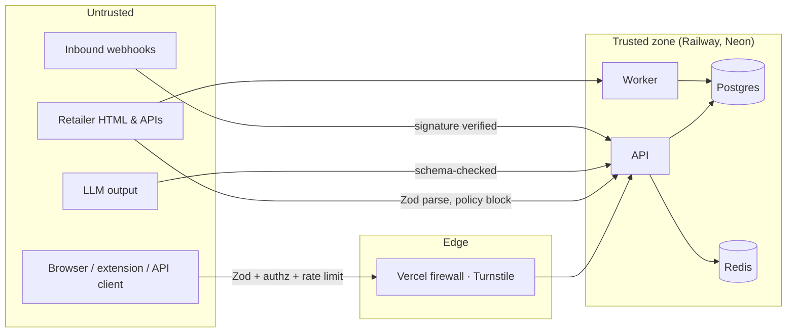

# Before You Buy — Security Documentation

| Field | Value |
|---|---|
| Version | 1.0 |
| Standard | OWASP ASVS (current release, 5.0) **Level 2** from the first release |
| Owner | Zean & Dagger (security owner until a dedicated owner exists) |
| Related | [02-ARCHITECTURE §11](02-ARCHITECTURE.md#11-security-architecture-summary) · [03-TECHNICAL-REQUIREMENTS](03-TECHNICAL-REQUIREMENTS.md) · [04-BACKEND-SCHEMA](04-BACKEND-SCHEMA.md) · [08-REVIEW-ITEMS](08-REVIEW-ITEMS.md) |

> **The biggest risk is financial, not data theft.** Signup-less search (CW-10) means anyone can make the system spend money on BrightData and the LLM. Every uncached live search must pass a guard. Second is **legal/terms exposure** from retailer data handling, which is enforced in code by provider policy blocks. Third is ordinary web-app security.

Controls carry IDs `SEC-NN`. Each is verified by a test (§14) or a checklist item (§16).

---

## 1. Scope and principles

- **Default deny.** No route, query or job runs without an explicit authorization decision.
- **Validate at every boundary.** Browser, API, worker, provider responses and LLM output are all untrusted until parsed by a Zod schema.
- **Minimize data.** Email is the only personal data collected (CW-8). No raw IPs, no payment data, no review text stored.
- **Fail safe on cost.** When a dependency for abuse control is down (Redis, Turnstile), anonymous live searches **fail closed**; cache hits continue.
- **Retailer terms are security controls.** Display age, retention, AI use and attribution live in provider policy blocks and are tested like any other control.

---

## 2. Assets and threat model

### 2.1 Assets

| Asset | Why it matters |
|---|---|
| BrightData / backup unblocker budget, LLM budget | Direct financial loss; spend cap is the last line |
| Provider credentials (BrightData, eBay, Best Buy, LLM, Stripe, Resend) | Abuse, account suspension, financial loss |
| eBay / Best Buy API standing | Loss of two of three platforms if terms are breached |
| Amazon Associates / eBay Partner Network / Best Buy affiliate accounts | Revenue; termination risk (LEGAL-01/02) |
| User emails, alerts, sessions | Personal data; account takeover |
| API keys (v4.5) and credit balances | Customer financial exposure |
| Credit ledger integrity | Billing correctness |
| Brand trust | Wrong or manipulated results destroy the product's premise |

### 2.2 Threats

| ID | Threat | Likelihood | Impact | Primary controls |
|---|---|---|---|---|
| T1 | Bots run uncached anonymous searches to burn budget | High | High | SEC-30…SEC-36 |
| T2 | Competitor/scraper harvests our results at scale | High | Medium | SEC-31, SEC-32, SEC-36 |
| T3 | SSRF via pasted URL | Medium | High | SEC-40, SEC-41 |
| T4 | Stored XSS via scraped titles/reviews or seller names | Medium | High | SEC-43, SEC-50 |
| T5 | Prompt injection in retailer content manipulates matching/trust | Medium | Medium | SEC-44…SEC-46 |
| T6 | Account takeover (magic-link interception, session theft) | Medium | Medium | SEC-10…SEC-17 |
| T7 | API key leakage by customers | Medium | Medium | SEC-22…SEC-26 |
| T8 | Cross-tenant data access (IDOR) | Low | High | SEC-18…SEC-21 |
| T9 | Webhook spoofing (Stripe, Resend) | Low | High | SEC-70 |
| T10 | Open redirect via `/go/` | Medium | Medium | SEC-42 |
| T11 | Email bombing via magic-link / alert sign-up | Medium | Low | SEC-13, SEC-34 |
| T12 | Supply-chain compromise (npm package) | Medium | High | SEC-80…SEC-85 |
| T13 | Secret leak in repo, logs, client bundle | Medium | High | SEC-60…SEC-64, SEC-90 |
| T14 | Affiliate click fraud attributed to us | Low | Medium | SEC-37 |
| T15 | Retailer-terms breach (retention, AI use) | Medium | High | SEC-47, SEC-48 |
| T16 | Ledger tampering / double charging | Low | High | SEC-27, SEC-28 |

### 2.3 Trust boundaries

---

## 3. Input validation and untrusted data

| ID | Control | Where | Verify |
|---|---|---|---|
| SEC-01 | Every request body, query string, path param, header we rely on and cookie value is parsed with a **strict** Zod schema (unknown keys rejected, max lengths, enums, numeric bounds). | `packages/schemas`, Hono validators | Unit + route tests |
| SEC-02 | Request body size limit 32 KB on `/web/*` and `/v1/*` (except future CSV upload); query ≤ 200 chars (TR-INT). | Hono middleware | Integration |
| SEC-03 | Provider responses (HTML parse output, JSON) pass Zod before use; failures are logged by payload hash and dropped. | `packages/providers` | Contract tests |
| SEC-04 | LLM output passes a Zod schema; on failure the candidate is treated as `unsure` — never trusted partially. | `packages/ai` | Unit |
| SEC-05 | Environment variables validated at boot; process exits on invalid config. | `packages/config/env.ts` | Unit |

---

## 4. Authentication

| ID | Control | Verify |
|---|---|---|
| SEC-10 | Consumer sign-in: **magic link** (15-minute expiry, single use, token stored hashed) and **passkeys**. No consumer passwords. | E2E |
| SEC-11 | Optional Google sign-in behind a flag; email from the IdP must be verified. | E2E |
| SEC-12 | Business sign-in (v4.5): password (Better Auth hashing; min 12 chars; breached-password check) + **TOTP 2FA required for owner/admin/billing roles**. SAML SSO + SCIM for Enterprise (v6.0). | E2E |
| SEC-13 | Magic-link and alert sign-up requests: Turnstile + rate limits (3 per email per 15 min, 10 per IP per 15 min). Responses never reveal whether an email exists. | Integration |
| SEC-14 | Email links use a fixed, configured origin (never the request `Host` header). | Unit |
| SEC-15 | Sign-in, sign-out, passkey add/remove, email change and account deletion are written to `audit_log` for the personal org. | Integration |

## 5. Sessions and CSRF

| ID | Control | Verify |
|---|---|---|
| SEC-16 | Session cookies: `__Secure-` prefix, `HttpOnly`, `Secure`, `SameSite=Lax`, `Domain=.<domain>`, `Path=/`. Session ID rotated on sign-in and privilege change. 30-day lifetime, refreshed daily on use; sign-out revokes server-side. | Integration |
| SEC-17 | **CSRF:** every state-changing cookie-authenticated request must carry an `Origin` header exactly equal to `WEB_ORIGIN`; otherwise 403. CORS on `/web/*` and `/api/auth/*` allows only `WEB_ORIGIN` with credentials. `/v1/*` never reads cookies. | Integration |

## 6. Authorization and tenant isolation

### 6.1 Policy model

One function decides: `can(actor, action, resource) → boolean` in `packages/auth-policy`. Every handler calls it (or a route-level guard that does) before touching data. A test enumerates all routes and fails if any route lacks a declared policy.

| Action ↓ / Role → | owner | admin | member | billing | API key (scope) |
|---|---|---|---|---|---|
| `search.run` | ✓ | ✓ | ✓ | ✗ | `search:read` |
| `history.read` | ✓ | ✓ | ✓ | ✗ | `history:read` |
| `alerts.manage_own` | ✓ | ✓ | ✓ | ✗ | `alerts:write` |
| `alerts.manage_all` | ✓ | ✓ | ✗ | ✗ | ✗ |
| `usage.view` | ✓ | ✓ | ✓ | ✓ | `usage:read` |
| `api_keys.view` | ✓ | ✓ | ✓ (prefix only) | ✗ | ✗ |
| `api_keys.create` / `revoke` | ✓ | ✓ | ✗ | ✗ | ✗ |
| `members.invite` / `remove` / `change_role` | ✓ | ✓ (not owners) | ✗ | ✗ | ✗ |
| `billing.view` | ✓ | ✓ | ✗ | ✓ | ✗ |
| `billing.manage` | ✓ | ✗ | ✗ | ✓ | ✗ |
| `org.update` | ✓ | ✓ | ✗ | ✗ | ✗ |
| `org.delete` / `ownership.transfer` | ✓ | ✗ | ✗ | ✗ | ✗ |
| `audit.view` | ✓ | ✓ | ✗ | ✗ | ✗ |

### 6.2 Controls

| ID | Control | Verify |
|---|---|---|
| SEC-18 | Default deny: a missing policy entry denies. | Route-enumeration test |
| SEC-19 | Repositories require an `OrgScope` (from the authenticated actor) or an explicit `SystemScope` (workers only); IDs from the client are always re-checked against scope (no IDOR). | Integration |
| SEC-20 | Postgres **RLS** on `alerts`, `credit_ledger`, `subscriptions`, `audit_log`, `api_keys` as a second wall ([04-BACKEND-SCHEMA §13](04-BACKEND-SCHEMA.md#13-row-level-security)). | Cross-tenant tests per table |
| SEC-21 | Object IDs are unguessable (`uuidv7`) and share slugs are 10-char random base62 — but authorization never relies on unguessability. | Unit |

## 7. API keys (v4.5) and ledger integrity

| ID | Control | Verify |
|---|---|---|
| SEC-22 | Format `byb_live_<43 chars base62 of 32 random bytes>` (`byb_test_` for test keys). Recognisable prefix enables GitHub secret scanning partner registration later. | Unit |
| SEC-23 | Stored as **HMAC-SHA-256(API_KEY_PEPPER, key)** with `pepper_version`; raw key shown once. Visible prefix (first 8 chars after the type prefix) for identification. | Unit |
| SEC-24 | Keys are org-owned, scoped, revocable, optional expiry; per-key sub-rate-limit. `last_used_at` updated at most once per minute. | Integration |
| SEC-25 | Keys are rejected if sent in query strings; only `Authorization: Bearer`. Keys never appear in logs (redaction) or error messages. | Integration |
| SEC-26 | Creating/revoking a key writes `audit_log`; owners are emailed when a key is created. | Integration |
| SEC-27 | `credit_ledger` is append-only (trigger) with unique idempotency keys; charges for a search are written exactly once. | Integration |
| SEC-28 | Stripe usage reporting is idempotent per ledger entry; reconciliation job compares Stripe meter totals with ledger sums daily. | Integration |

---

## 8. Abuse and cost protection

| ID | Control | Verify |
|---|---|---|
| SEC-30 | **Turnstile** required for anonymous uncached searches, magic-link requests and alert sign-up. A pass is cached for the anon ID for 30 min. Tokens verified server-side (single use, hostname check). | Integration |
| SEC-31 | Rate limits per [03-TECHNICAL-REQUIREMENTS §16.2](03-TECHNICAL-REQUIREMENTS.md#162-rate-limits): anonymous by **both** IP hash and anon ID; signed-in by org; keys by key and org. | Integration |
| SEC-32 | Anonymous **daily live-search cap** per anon ID and per IP hash (DECIDE-02); beyond it, cache-only results + sign-in prompt. | Integration |
| SEC-33 | **Daily spend cap** on paid providers; at 100% switch to cache-only mode; alerts at 50/80/100%. | Integration |
| SEC-34 | **Single-flight** for identical uncached searches (TR-SRCH-04) removes cost amplification from parallel duplicates. | Integration |
| SEC-35 | **Kill switches** for live search, each provider, anonymous search, sign-ups and alert sending (TR-CRED-22), flippable without deploy. | Runbook drill |
| SEC-36 | Vercel firewall rules: block known-bad ASNs/user agents on `/web/search*` if abuse appears; challenge mode for spikes; bot protection on the web app. Autocomplete and product pages are cached to absorb scraping cheaply. | Runbook |
| SEC-37 | `/go/` redirects record clicks without IP; bursts per anon ID are rate-limited so automated clicking can't generate affiliate fraud attributed to us. | Integration |

---

## 9. Privacy and data protection

### 9.1 Data inventory

| Data | Where | Purpose | Retention | Notes |
|---|---|---|---|---|
| Email | `users`, Resend | Sign-in, alerts | Until account deletion (+ ≤ 30 days) | Only personal data collected |
| ZIP code | Cookie `byb_zip`; `alerts.zip`; `users.default_zip` | Landed cost | Cookie 1 year; alert lifetime | `searches` stores only ZIP3 |
| IP address | Never stored raw | Rate limiting, abuse | Redis counters (minutes); `ip_hash` 30 days | Salted SHA-256 with daily-rotating salt |
| Anonymous ID | Cookie `byb_anon` | Rate limits, return-rate metric | 1 year | Random, not derived from device |
| Search queries | `searches` | Metering, analytics, pre-crawl | 13 months | Normalized, ≤ 200 chars |
| Click events | `click_events` | Affiliate reconciliation | 13 months | No IP |
| Payment data | Stripe only | Billing | Stripe's policy | We store customer/subscription IDs |
| Analytics | PostHog | Product metrics | Per PostHog project setting (13 months) | No email/IP/raw query linked (TR-ANL-05) |

### 9.2 Controls

| ID | Control | Verify |
|---|---|---|
| SEC-50 | Scraped and API text (titles, seller names, review snippets) is rendered as **text** via React; `dangerouslySetInnerHTML` is banned by lint rule. | Lint + E2E |
| SEC-51 | Logs and Sentry scrub emails, IPs, cookies, tokens, API keys, `Authorization` headers. | Unit (redaction tests) |
| SEC-52 | Self-serve **account deletion** (TR-AUTH-06) and **data export** of the user's alerts and account data (JSON). | E2E |
| SEC-53 | Email: alert and quota emails include one-click unsubscribe (RFC 8058) and a postal address; suppression list honoured (CAN-SPAM; LEGAL-08). | Integration |
| SEC-54 | Privacy Policy and Terms published before any email is collected (M0). Content reviewed under LEGAL-08/09. | Checklist |
| SEC-55 | Data at rest encrypted by providers (Neon, Railway, Vercel); TLS everywhere in transit; Better Auth encrypts OAuth tokens and 2FA secrets. | Checklist |

---

## 10. SSRF, injection, XSS, prompt injection and retailer terms

| ID | Control | Verify |
|---|---|---|
| SEC-40 | Pasted URLs are **parsed, never fetched**. Host exact-match allowlist; IDs extracted by regex; canonical URL rebuilt server-side (TR-INT-02…05). | Unit (fuzz) |
| SEC-41 | Outbound HTTP from API/worker goes only to configured provider base URLs (allowlisted in an HTTP client wrapper); redirects are not followed to other hosts. | Unit |
| SEC-42 | `/go/{token}`: HMAC-signed token; target built from the listing record only — **no open redirect**. | Unit + integration |
| SEC-43 | SQL only through Drizzle parameterized queries; raw SQL (partitions, RLS) only in migrations or reviewed repository functions using `sql` template tags. | Lint + review |
| SEC-44 | **Prompt injection:** retailer titles/reviews go to the LLM inside clearly delimited data blocks (JSON fields), with instructions to treat them as data only. | Unit (adversarial fixtures) |
| SEC-45 | The LLM has **no tools, no browsing, no write access**; its output can only select among provided candidate IDs and fill a fixed schema. Candidate IDs not in the input are rejected. | Unit |
| SEC-46 | Trust scoring is deterministic; the LLM only extracts bounded text signals, so injected text can shift one signal at most by its configured weight. | Unit |
| SEC-47 | Provider policy blocks are the only path for storing/displaying retailer data; a test asserts every provider has a policy and every persisted price has `retain_until`. | Unit |
| SEC-48 | Data from providers with `aiUseAllowed: false` is never passed to `packages/ai` (enforced by type: `AiSafeCandidate` can only be constructed from allowed providers). | Unit |

---

## 11. Transport, headers and CSP

| ID | Control | Verify |
|---|---|---|
| SEC-56 | HTTPS only; HSTS `max-age=63072000; includeSubDomains; preload` (submit once domain is final). | Header test |
| SEC-57 | **Content-Security-Policy** (nonce-based, set in the Next.js proxy, formerly middleware): `default-src 'self'; script-src 'self' 'nonce-{n}' 'strict-dynamic' https://challenges.cloudflare.com; frame-src https://challenges.cloudflare.com; connect-src 'self' https://api.<domain> {posthog} {sentry}; img-src 'self' data: blob: {retailer image hosts as permitted}; style-src 'self' 'unsafe-inline'; font-src 'self'; object-src 'none'; base-uri 'none'; form-action 'self'; frame-ancestors 'none'; upgrade-insecure-requests`. | Header test + CSP report-only for one week before enforcing |
| SEC-58 | `X-Content-Type-Options: nosniff`, `Referrer-Policy: strict-origin-when-cross-origin`, `Permissions-Policy` denying camera, microphone, geolocation, payment (except Stripe-hosted pages). | Header test |
| SEC-59 | API responses: `Cache-Control: no-store` on authenticated routes; `X-Content-Type-Options: nosniff`; no `X-Powered-By`. | Header test |

---

## 12. Secrets and configuration

| ID | Control | Verify |
|---|---|---|
| SEC-60 | Secrets live only in Vercel and Railway secret stores (and GitHub Actions secrets for CI). Never in the repo, `.env` committed files, or the client bundle. | Secret scanning |
| SEC-61 | Nothing secret uses `NEXT_PUBLIC_`; a build check fails if a server-only variable name appears in client bundles. | CI |
| SEC-62 | Separate credentials per environment; previews use sandbox/test credentials and **cannot** call paid providers unless explicitly enabled (flag + low spend cap). | Config test |
| SEC-63 | Rotatable secrets with versioning: `API_KEY_PEPPER` (by `pepper_version`), `LINK_SIGNING_SECRET` (accept current + previous), `BETTER_AUTH_SECRET`, `IP_HASH_SALT_SEED`. | Runbook |
| SEC-64 | Least privilege for vendor credentials: BrightData zones restricted to the products used; Stripe restricted keys where possible; Resend sending-only key. | Checklist |

---

## 13. Supply chain and CI

| ID | Control | Verify |
|---|---|---|
| SEC-80 | Renovate with grouped updates; **critical security patches merged within 48 h** (Next.js/React advisories especially — see the Sep 2026 RSC fix and 16.3.8). | Renovate dashboard |
| SEC-81 | pnpm `minimumReleaseAge` (e.g. 3 days) so freshly published packages aren't installed immediately; exceptions documented for security patches. | Config |
| SEC-82 | Lockfile committed; CI installs with `--frozen-lockfile`; lifecycle scripts restricted to an allowlist (`onlyBuiltDependencies`). | CI |
| SEC-83 | CodeQL and GitHub secret scanning + push protection enabled; dependency audit on PRs. | CI |
| SEC-84 | GitHub: branch protection on `main`, required reviews and checks, signed commits recommended, Actions pinned to commit SHAs, `permissions: read-all` by default. | Repo settings |
| SEC-85 | Docker images built from pinned base images; non-root user; minimal OS packages. | CI |

---

## 14. Security testing

| Test | Tooling | When |
|---|---|---|
| Route authorization matrix | Vitest: every route × role × scope, including cross-org IDs | Every PR |
| RLS isolation | Vitest integration on each RLS table | Every PR |
| Input fuzzing for URL parser and schemas | fast-check | Every PR |
| Prompt-injection fixtures | Adversarial titles/reviews in eval set | PRs touching `packages/ai` |
| Header/CSP checks | Playwright | Every PR |
| Dependency and code scanning | CodeQL, audit | Every PR |
| DAST baseline | OWASP ZAP baseline against preview | Weekly + before releases |
| Cost-abuse drill | Script simulating bot traffic against preview with Turnstile test keys | Before v4.0 launch |
| External penetration test | Third party | Before v4.5 (public API + billing) |

---

## 15. Logging, monitoring and incident response

| ID | Control |
|---|---|
| SEC-90 | Security-relevant events logged: auth events, authorization denials, rate-limit trips, Turnstile failures, key creation/revocation, webhook signature failures, kill-switch changes, spend-cap transitions. |
| SEC-91 | Alerts on: spend 80/100%; anonymous search rate > 5× baseline; authz denials spike; webhook signature failures; new admin/owner added; Amazon block-page rate > 10%. |
| SEC-92 | **Runbooks** in `docs/runbooks/` (created in M17): cost spike / bot attack; provider outage or ban; leaked secret / key rotation; data deletion request; webhook outage; Amazon cease-and-desist (switch `provider.amazon` off, preserve logs, notify counsel). |
| SEC-93 | Incident process: detect → contain (kill switch) → assess → notify (users/regulators if personal data affected, per LEGAL-08) → fix → post-mortem in `docs/incidents/`. |

### 15.1 Inbound webhooks and email authentication

| ID | Control |
|---|---|
| SEC-70 | Stripe webhooks verified with the signing secret and timestamp tolerance; Resend webhooks verified with their signature scheme; both idempotent by event ID; raw body used for verification. |
| SEC-71 | Sending domain configured with SPF, DKIM and DMARC (`p=quarantine` → `reject` after monitoring). |

---

## 16. Checklists

### 16.1 Every pull request

- [ ] New/changed inputs have strict Zod schemas (SEC-01).
- [ ] New routes declare a policy in `packages/auth-policy`; route-matrix test updated (SEC-18).
- [ ] New queries go through scoped repositories; RLS tables tested cross-tenant if touched (SEC-19/20).
- [ ] No secrets, tokens or emails logged; redaction tests still pass (SEC-51).
- [ ] Retailer data stored/displayed only via provider policy (SEC-47/48).
- [ ] No `dangerouslySetInnerHTML`; external text rendered as text (SEC-50).
- [ ] New outbound hosts added to the HTTP allowlist intentionally (SEC-41).
- [ ] New dependencies justified; no install scripts unless allowlisted (SEC-82).

### 16.2 Before v4.0 launch (M17)

- [ ] ASVS L2 self-assessment completed and gaps triaged.
- [ ] Cost-abuse drill passed; spend cap and kill switches verified in production.
- [ ] CSP enforced (after report-only period); HSTS live.
- [ ] Restore drill from Neon PITR completed.
- [ ] Runbooks written and dry-run once.
- [ ] Privacy Policy, Terms, affiliate disclosure live and reviewed (LEGAL-05/08/09).
- [ ] **Legal review of retailer terms complete (LEGAL-01…04)** — launch blocker.

### 16.3 Before v4.5 launch (M21)

- [ ] External penetration test; high/critical findings fixed.
- [ ] API key lifecycle tested end to end; secret-scanning partner registration considered.
- [ ] Stripe webhook handling and reconciliation verified with test clocks.
- [ ] 2FA enforced for business owner/admin/billing roles.
