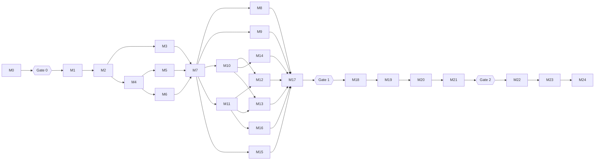

# Before You Buy — Implementation Plan (Milestones)

| Field | Value |
|---|---|
| Version | 1.0 |
| Scope | Gate 0 (M0) and v4.0 + v4.5 in full detail (M1–M21); v5.0–v6.0 outlined (M22–M24) |
| Related | [01-PRD §11–12](01-PRD.md#11-roadmap) · [02-ARCHITECTURE §18](02-ARCHITECTURE.md#18-build-order) · [03-TECHNICAL-REQUIREMENTS](03-TECHNICAL-REQUIREMENTS.md) · [08-REVIEW-ITEMS](08-REVIEW-ITEMS.md) |

Build in order of risk: **demand, then quality, then revenue.** Each phase starts once the gate above it passes. Every milestone is a vertical slice that ends merged to `main`, tested, and demoable.

---

## 1. How to use this plan

### 1.1 Rules

1. **One milestone at a time, in dependency order.** Parallel work is allowed only where §3 says so.
2. **Branch per milestone:** `m07-search-sse`. Small PRs per task are better than one large PR.
3. **Read before building:** [CLAUDE.md](../CLAUDE.md), the milestone section here, and every TR/SEC/schema section the milestone links.
4. **Check blockers** in [08-REVIEW-ITEMS](08-REVIEW-ITEMS.md). Most open items have a *default to build with*; use it, keep it behind config, and note it. Items marked **hard blocker** stop the milestone's exit, not its start.
5. **Keep the docs true.** If implementation changes a contract, schema, or behavior, update the doc in the same PR and add a `DEC-*` entry to [09-CHANGE-MANAGEMENT](09-CHANGE-MANAGEMENT.md).
6. **Tick tasks** (`- [x]`) and update the status board (§2) as work lands.

### 1.2 Prompt template for Claude Code

```text
We're working on milestone M<N> — <name>.
1. Read CLAUDE.md, the M<N> section of docs/06-IMPLEMENTATION-PLAN.md, and every doc section it links.
2. Check docs/08-REVIEW-ITEMS.md for items affecting M<N>. Use each item's "default to build with" and tell me which ones you relied on.
3. Use plan mode: list the files you'll create/change, the schemas and tests, and the order of tasks M<N>.1 … M<N>.k. Wait for my approval.
4. Implement one task at a time. After each: pnpm lint && pnpm typecheck && pnpm test (plus integration/e2e if touched). Commit as `<type>(<scope>): <summary> (M<N>.<k>)`.
5. At the end: tick the task checkboxes, update the status board, verify every acceptance criterion with evidence (test names or commands), and list any deviations for docs/09-CHANGE-MANAGEMENT.md.
```

### 1.3 Definition of Done (every milestone)

- [ ] All tasks ticked; every acceptance criterion demonstrated by a named test, command output or screenshot.
- [ ] CI green (lint, typecheck, unit, integration, build; E2E/perf/evals where relevant).
- [ ] Code and tests reference requirement IDs (`CW-*`, `AR-*`, `TR-*`, `SEC-*`).
- [ ] Security PR checklist ([05-SECURITY §16.1](05-SECURITY.md#161-every-pull-request)) satisfied.
- [ ] UI work: mobile (375 px), tablet (768/1024 px) and desktop checked; axe clean; keyboard path works.
- [ ] Unfinished user-visible features are behind a flag.
- [ ] Docs updated; decision log entries added for deviations.
- [ ] `.env.example` updated for any new variable.

---

## 2. Status board

Status values: `todo` · `in-progress` · `done` · `blocked`. Size: S (≤ 3 days), M (≤ 1.5 weeks), L (≤ 3 weeks) for one developer working with Claude Code.

| ID | Milestone | Phase | Depends on | Watch items (08) | Size | Status |
|---|---|---|---|---|---|---|
| M0 | Gate 0 demand test | Pre-build | — | DECIDE-09, DECIDE-15, LEGAL-08/09/10 | M | todo |
| — | **Gate 0 decision** | — | M0 | — | — | todo |
| M1 | Platform foundations | v4.0 | Gate 0 | DECIDE-16 | M | todo |
| M2 | Database schema and data layer | v4.0 | M1 | DECIDE-14 (vector dim) | M | todo |
| M3 | Auth, organizations and policy | v4.0 | M2 | DECIDE-03 | M | todo |
| M4 | Provider framework + eBay and Best Buy | v4.0 | M2 | LEGAL-03/04, DECIDE-08 | M | todo |
| M5 | Amazon adapter, failover, verification, spend | v4.0 | M4 | LEGAL-01/02, DECIDE-04, DECIDE-18 | L | todo |
| M6 | AI layer and matching | v4.0 | M2, M4 | GAP-01, DECIDE-14 | L | todo |
| M7 | Search orchestration and SSE | v4.0 | M3, M4, M5, M6 | DECIDE-01, DECIDE-02, DECIDE-12 | L | todo |
| M8 | Landed cost, condition, ranking | v4.0 | M7 | DECIDE-05, DECIDE-06, DECIDE-20 | L | todo |
| M9 | Review authenticity | v4.0 | M7 | LEGAL-06, GAP-04 | L | todo |
| M10 | Price history | v4.0 | M7 | LEGAL-03/04, DECIDE-19 | M | todo |
| M11 | Consumer search and results UI | v4.0 | M7 (M8–M10 for full cards) | — | L | todo |
| M12 | Product pages, chart, shareable comparisons | v4.0 | M10, M11 | LEGAL-16 | M | todo |
| M13 | Price-drop alerts and email | v4.0 | M3, M10, M11 | DECIDE-03, LEGAL-08 | M | todo |
| M14 | Pre-crawl cache | v4.0 | M7, M10 | DECIDE-08, DECIDE-13 | M | todo |
| M15 | Metering, abuse and cost hardening | v4.0 | M7, M3 | DECIDE-01, DECIDE-02, DECIDE-18 | M | todo |
| M16 | Affiliate links, disclosure, compliance surfaces, PWA | v4.0 | M11 | LEGAL-01…05, LEGAL-14, LEGAL-16 | M | todo |
| M17 | v4.0 launch readiness | v4.0 | M8–M16 | **LEGAL-01…04 hard blockers** | M | todo |
| — | **Gate 1 decision** | — | M17 + live data | — | — | todo |
| M18 | Plans, Stripe Billing and metering | v4.5 | Gate 1 | DECIDE-07, LEGAL-11 | L | todo |
| M19 | Public API v1 | v4.5 | M18 | LEGAL-09 | L | todo |
| M20 | Usage dashboard, teams, business sign-in | v4.5 | M18, M19 | — | M | todo |
| M21 | v4.5 launch readiness | v4.5 | M18–M20 | LEGAL-09, LEGAL-11 | M | todo |
| — | **Gate 2 decision** | — | M21 + months 3/6 data | — | — | todo |
| M22 | Browser extension | v5.0 | Gate 2 | LEGAL-01/02 | — | outline |
| M23 | Reseller tooling | v5.5 | M22 | — | — | outline |
| M24 | Scale: retailers, AU, white-label, SSO | v6.0 | M23 | — | — | outline |

---

## 3. Critical path and parallel work



- **Parallel after M2:** M3 and M4 (different packages). M6 can start once M4 provides candidate shapes.
- **Parallel after M7:** M8, M9, M10, M15 are independent services feeding the same events; M11 can start against recorded SSE streams.
- **Start history early:** price history needs calendar time. M5.9 starts daily snapshots of the seed list so launch has real 90-day history.
- **Legal review runs in parallel from M0.** It gates launch (M17), so start it early; see [08-REVIEW-ITEMS](08-REVIEW-ITEMS.md).

---

## 4. Phase 0 — Gate 0 (pre-build demand test)

### M0 — Gate 0 demand test

**Goal.** Test demand in two weeks at near-zero cost with a landing page, a live demo on three real products, email capture and refundable $49 pre-orders — built with the production stack so nothing is thrown away.
**Traces:** PRD §12.1, architecture §18.
**Depends on:** nothing. **Watch:** DECIDE-09 (domain), DECIDE-15 (pre-order terms), LEGAL-08/09/10.

> **Temporary exception (DEC-031):** in M0 only, Next.js route handlers write `waitlist_signups` and `preorders` directly through `packages/db`. M1.9 moves these writes behind the API.

**Tasks**

- [ ] **M0.1** Scaffold the monorepo minimally: pnpm workspaces + Turborepo; `apps/web` (Next.js ≥ 16.3.8, React 19.2, Tailwind v4); `packages/ui` (shadcn/ui init with Base UI primitives, tokens from [07-UI-UX-DESIGN §5](07-UI-UX-DESIGN.md#5-design-tokens)); `packages/db` (Drizzle + Neon driver, only Gate 0 tables from [04-BACKEND-SCHEMA §12](04-BACKEND-SCHEMA.md#12-gate-0-tables-m0)); `packages/schemas`; `packages/config` (env validation); `tooling/` (tsconfig, ESLint, Prettier).
- [ ] **M0.2** Landing page (mobile-first): positioning headline from PRD §3, the three trust questions, "how it works", pricing preview (PRD §8), FAQ, footer with legal links. Copy follows [07-UI-UX-DESIGN §9](07-UI-UX-DESIGN.md#9-content-and-copy-rules).
- [ ] **M0.3** Live demo on three real products: a one-off capture script stores precomputed comparison JSON (landed cost, trust signals, short price history) in `apps/web/content/demo/`; render it with the real result-card components. Each demo shows "Sample captured on {date}". **No affiliate links in the demo.**
- [x] **M0.4** Waitlist: email form with Turnstile → `waitlist_signups` (with `consent_text_version`, source, UTM) → double opt-in confirmation email via Resend.
- [x] **M0.5** Pre-orders: Stripe Checkout one-time payment per DECIDE-15 default; success/cancel pages; webhook → `preorders` (idempotent); refund policy page.
- [x] **M0.6** Legal pages: Privacy Policy, Terms, Pre-order terms, affiliate disclosure placeholder — drafts marked "pending legal review" (LEGAL-08/09/10).
- [x] **M0.7** Analytics: PostHog (pageviews, `waitlist_signed_up`, `preorder_started`, `preorder_paid`, `demo_card_opened`), UTM capture; Gate 0 dashboard.
- [ ] **M0.8** Deploy: Vercel project, Neon production database, domain, Resend sending domain with SPF/DKIM/DMARC; basic security headers.
- [ ] **M0.9** Run the test (Show HN, r/SideProject, 30 DMs). After 2 weeks, record results and the proceed/reconsider decision as a `DEC-*` entry.

**Acceptance criteria**

- Waitlist sign-up → confirmation email → `confirmed_at` set, verified end to end in production.
- Stripe test-mode purchase creates exactly one `preorders` row even if the webhook is delivered twice.
- Lighthouse mobile performance ≥ 90, accessibility ≥ 95 on the landing page.
- Gate 0 dashboard shows signups by source, confirmed signups, pre-orders.
- Gate 0 decision recorded: proceed if 100+ signups, 10+ unprompted "when does it ship" replies, 10+ pre-orders.

**Out of scope:** search engine, providers, auth, API service.

---

## 5. Phase v4.0 — Launch

### M1 — Platform foundations

**Goal.** A clean clone runs web, API and worker locally with one command; CI and deploys work; cross-cutting concerns (config, errors, logging, tracing, headers) exist before features.
**Traces:** architecture §5–6, §15–16; TRD §2–4, §25, §27–29. **Depends on:** Gate 0.

**Tasks**

- [ ] **M1.1** Complete the workspace: `apps/api` (Hono on Node LTS), `apps/worker` (BullMQ bootstrap + health endpoint), packages `core`, `providers`, `ai`, `auth-policy`, `email`, `observability`; ESLint import-boundary rules per [02-ARCHITECTURE §6.1](02-ARCHITECTURE.md#61-dependency-rules).
- [ ] **M1.2** Local dev: `infra/docker-compose.yml` with `pgvector/pgvector:pg18`, `redis:7`, Mailpit (local email capture); `.env.example`; `pnpm dev` runs all apps via Turborepo.
- [ ] **M1.3** `packages/config`: per-app env schemas (TRD §28), plan table, credit prices, provider policy defaults, `flags.isOn()` + kill-switch reader (Redis-backed, 5 s cache).
- [ ] **M1.4** API skeleton: request ID, pino logger with redaction, problem+json error handler, `AppError`, CORS split (`/web/*` + `/api/auth/*` first-party only; `/v1/*` open, no cookies), Origin check on writes, body-size limits, security headers, `/healthz`, `/readyz`.
- [ ] **M1.5** Observability: Sentry in web/api/worker with releases; OpenTelemetry SDK + OTLP exporter; PostHog server client; log/trace correlation.
- [ ] **M1.6** CI (GitHub Actions): install (frozen lockfile), lint, typecheck, unit tests, build; Turborepo remote cache; CodeQL; secret scanning + push protection; Renovate; pnpm `minimumReleaseAge` and `onlyBuiltDependencies`.
- [ ] **M1.7** Deploy: Railway (api, worker, Redis) in US East; Vercel (web); Neon branch per PR in CI; pre-deploy migration hook; preview environments use test credentials and paid providers disabled.
- [ ] **M1.8** Web shell: root layout, tokens, self-hosted variable font, header/footer, legal pages, PWA manifest placeholder; Next.js proxy setting nonce CSP in **report-only** mode.
- [ ] **M1.9** Move Gate 0 writes behind the API: `POST /web/waitlist`, `POST /webhooks/stripe` (pre-orders); remove the M0 exception.

**Acceptance criteria**

- From a clean clone: `pnpm i && docker compose -f infra/docker-compose.yml up -d && pnpm dev` serves web, API and worker; `/readyz` reports DB + Redis OK.
- CI is green and required on `main`; a PR gets a Vercel preview and a Neon branch.
- An unknown route returns problem+json with `requestId`; logs show the same `requestId` and a trace ID.
- Importing `packages/db` from `apps/web` fails lint.
- No secret appears in the client bundle (CI check).

---

### M2 — Database schema and data layer

**Goal.** Every v4.0 table, index, partition, trigger and RLS policy exists via migrations, behind a scoped repository layer.
**Traces:** [04-BACKEND-SCHEMA](04-BACKEND-SCHEMA.md); SEC-19, SEC-20, SEC-27. **Depends on:** M1. **Watch:** DECIDE-14 (embedding dimension; default 768).

**Tasks**

- [ ] **M2.1** Drizzle schema for all v4.0 tables and enums (schema doc §3–§12).
- [ ] **M2.2** Custom SQL migrations: extensions; partitioned `price_observations` + first partitions; `credit_ledger` guard trigger; DB roles (`byb_migrator`, `byb_app`, `byb_worker`); RLS policies; `auth_find_api_key()` security-definer function; owner-count constraint trigger.
- [ ] **M2.3** Repository layer: `OrgScope` / `SystemScope`, transaction helper that sets `app.org_id`, typed repositories per domain.
- [ ] **M2.4** `packages/core` money and credits primitives (cents, ranges, millicredits, half-up rounding) with property-based tests.
- [ ] **M2.5** Worker jobs: `partition-maintenance` (3 months ahead) and `retention-purge` skeleton driven by `retain_until` and the retention table (schema doc §14).
- [ ] **M2.6** Seeds: plans, Gate 0 demo products, small tax-rate sample, shipping-rule placeholders.
- [ ] **M2.7** CI: apply migrations to a fresh Neon branch + drift check; integration-test harness (Postgres 18 + Redis services).
- [ ] **M2.8** Cross-tenant tests for each RLS table; ledger immutability tests.

**Acceptance criteria**

- Migrations apply on an empty database and on a Neon branch with zero drift.
- `UPDATE`/`DELETE` on `credit_ledger` (other than Stripe columns) raises.
- In org A's scope, reads/writes of org B's rows on every RLS table fail (tests).
- Next three monthly partitions exist after the maintenance job runs.

---

### M3 — Auth, organizations and policy

**Goal.** Passwordless sign-in, personal organizations, anonymous identity and one authorization model used by every route.
**Traces:** TR-AUTH-01…06; SEC-10…SEC-21. **Depends on:** M2. **Watch:** DECIDE-03.

**Tasks**

- [ ] **M3.1** Better Auth on the API at `/api/auth/*` with the Drizzle adapter, plural snake_case tables, DB-generated `uuidv7` IDs, cross-subdomain cookies, IP tracking disabled.
- [ ] **M3.2** Magic link (15 min, single use) with a React Email template; passkeys; Google sign-in behind a flag.
- [ ] **M3.3** User-creation hook: personal org (`owner`, plan `free`) + initial `grant_plan` ledger entry in one transaction.
- [ ] **M3.4** Anonymous ID: signed `byb_anon` cookie middleware; linking helper used later by M7.
- [ ] **M3.5** `packages/auth-policy`: roles, actions, key scopes, `can()`; route guard; route-enumeration test that fails on routes without a policy.
- [ ] **M3.6** Turnstile + rate limits on magic-link requests; enumeration-safe responses.
- [ ] **M3.7** Web: sign-in sheet, passkey enrollment prompt after first sign-in, account page (email, passkeys, sessions, sign out everywhere).
- [ ] **M3.8** Account deletion and data export (TR-AUTH-06, SEC-52); audit-log writes for auth events.

**Acceptance criteria**

- E2E: magic link via Mailpit signs in; Playwright virtual authenticator registers and uses a passkey.
- New user has exactly one personal org with `owner` role and a ledger grant.
- Cookie flags match SEC-16; a cross-origin POST is rejected (SEC-17).
- Deleting an account revokes sessions immediately and removes alerts; ledger rows remain de-linked.

---

### M4 — Provider framework, eBay and Best Buy adapters

**Goal.** A uniform, policy-enforcing adapter layer with the two official-API retailers working against recorded fixtures and live sandboxes.
**Traces:** AR-2; TR-PROV-01…05, 10…13, 20…22; SEC-41, SEC-47. **Depends on:** M2. **Watch:** LEGAL-03/04 (policy flags), DECIDE-08.

**Tasks**

- [ ] **M4.1** `ProviderAdapter` interface, registry, HTTP client wrapper with host allowlist and `AbortSignal` timeouts, Redis token-bucket limiter, circuit breaker.
- [ ] **M4.2** Provider policy config with defaults from [02-ARCHITECTURE §8](02-ARCHITECTURE.md#8-provider-adapters-and-retailer-policy) (eBay/Best Buy `aiUseAllowed: false`, `historyAllowed: false` until legal clears).
- [ ] **M4.3** eBay adapter: OAuth client credentials, search (fixed price, `EBAY_US`, exclude for-parts, ZIP-aware shipping), batched item lookups, condition/seller/returns mapping, daily call budget, attribution metadata.
- [ ] **M4.4** Best Buy adapter: keyword/UPC/SKU search with explicit fields, condition and warranty mapping, shipping, 5 req/s + daily limiter, 403 → breaker, logo attribution metadata.
- [ ] **M4.5** Recorded fixtures + contract tests; `pnpm fixtures:refresh --provider <id>` script (secrets stripped).
- [ ] **M4.6** Listing upsert and observation write path that always sets `retain_until` from policy.
- [ ] **M4.7** Dev CLI `pnpm search:debug "<query>"` printing normalized candidates per provider.
- [ ] **M4.8** Ops: confirm eBay quota; apply for Application Growth Check if pre-crawl needs more (DECIDE-08).

**Acceptance criteria**

- Contract tests pass for both adapters; parse failures are counted, not thrown to callers.
- Breaker opens after configured failures and half-opens after cooldown (test).
- Every persisted listing/observation has `retain_until`; a test asserts it per provider.
- eBay daily budget and Best Buy rate limits are enforced in integration tests.

---

### M5 — Amazon adapter, failover, verification and spend controls

**Goal.** Amazon discovery via Web Unlocker with a second transport for failover, phase-2 verification, health checks and hard spend limits.
**Traces:** AR-3, AR-4, PRD §6.2, §10.3; TR-PROV-30…36; TR-CRED-20…22; SEC-33, SEC-35. **Depends on:** M4. **Watch:** LEGAL-01/02, DECIDE-04, DECIDE-18.

**Tasks**

- [ ] **M5.1** BrightData Web Unlocker transport (request API returning HTML).
- [ ] **M5.2** Pure HTML parsers (search results, product page) with Zod output and fixtures: new, Renewed, multi-variant, out of stock, unavailable, block/robot page.
- [ ] **M5.3** Backup unblocker transport (DECIDE-04 default: evaluate two vendors, implement the cheaper that passes fixtures) + failover rules; transport recorded per observation.
- [ ] **M5.4** Phase-2 verification: Web Scraper API client; `amazon-verify` job; mismatch → `unverified` + `patch`.
- [ ] **M5.5** Spend accounting per billable unit; `DAILY_SPEND_CAP_CENTS`; cache-only mode switch; ops alerts at 50/80/100%.
- [ ] **M5.6** `amazon-health` job every 30 min over 10 fixed ASINs; `provider_health_checks`; alert rules.
- [ ] **M5.7** Kill switches `provider.amazon`, `search.live` wired into adapters.
- [ ] **M5.8** Amazon display policy in config: timestamp, disclaimer text, `maxDisplayAgeSec ≤ 24 h` (LEGAL-02 may change this).
- [ ] **M5.9** **Start history early:** a daily job snapshots the pre-crawl seed list on Amazon (budget-capped) so real history accrues before launch.

**Acceptance criteria**

- Parser fixture suite passes; a block page is detected and triggers failover in a test.
- With the primary transport returning 5xx, searches succeed via backup and record `source = backup_unblocker`.
- Integration test: spend counter reaches the cap → cache-only mode → Amazon `platform_error: CACHE_ONLY_MODE`, eBay/Best Buy still live.
- Health job writes rows and raises an alert on simulated drift.

---

### M6 — AI layer and matching

**Goal.** A provider-agnostic AI layer and a measurable matching engine for name and URL searches.
**Traces:** AR-1, PRD §3, Gate 1 match accuracy; TR-MATCH-01…19; SEC-44…46, SEC-48. **Depends on:** M2, M4. **Watch:** GAP-01, DECIDE-14.

**Tasks**

- [ ] **M6.1** `packages/ai` interface on the Vercel AI SDK: `match`, `resolveQuery`, `embed`, `classifyReviewText`; models from config; timeouts; token/cost accounting; schema-validated output; `AiSafeCandidate` type gate.
- [ ] **M6.2** Prompts v1 (`match-name`, `match-url`, `resolve-query`) with delimited data blocks; adversarial prompt-injection fixtures.
- [ ] **M6.3** Deterministic matching: GTIN-14 normalization, brand + MPN; variant attribute vocabulary and normalizers.
- [ ] **M6.4** Embeddings: product and candidate titles; pgvector retrieval; `embedding-backfill` job.
- [ ] **M6.5** Confidence combination, sanity checks (accessories, price outliers, bundles), thresholds in config.
- [ ] **M6.6** Query classification (`exact_model` / `vague`) and catalog resolution (trigram + full-text + vector).
- [ ] **M6.7** Evaluation set v1 (≥ 150 cases now, ≥ 300 by M17) + runner reporting match accuracy, recall, wrong-variant rate; CI job on fixtures; nightly live job with budget.
- [ ] **M6.8** When GAP-01 is resolved, reconcile with v3 FR-M1–M7 and the confidence model; record changes.

**Acceptance criteria**

- Eval runner outputs a baseline report committed to `packages/ai/evals/reports/`.
- CI fails when match accuracy drops > 1 point vs `main`.
- A grep/lint test confirms no model IDs in application code.
- Adversarial fixtures cannot make the LLM select an ID that was not in its input.

---

### M7 — Search orchestration and SSE

**Goal.** The end-to-end search: validate, guard, cache, single-flight, fan out, match, persist and stream — with a minimal dev page to watch it.
**Traces:** CW-1, CW-2, CW-12, AR-1, AR-5; TR-INT-*, TR-SRCH-*; SEC-30, SEC-34, SEC-40. **Depends on:** M3, M4, M5, M6. **Watch:** DECIDE-01, DECIDE-02, DECIDE-12.

**Tasks**

- [ ] **M7.1** Schemas: `SearchRequest`, all SSE event payloads, `ResultListing`, `Ranking`, `PriceHistory90d`, `ReviewAuthenticity` in `packages/schemas` (TRD §5.1, §6.3–6.4).
- [ ] **M7.2** URL parsing and query normalization (TR-INT-02…09) with fuzz tests.
- [ ] **M7.3** `POST /web/search`: guard chain (kill switch → rate limit → Turnstile → quota → spend), search registration, cache status.
- [ ] **M7.4** Cache lookup: Redis → Postgres freshness per policy; `hit` / `partial` / `miss`.
- [ ] **M7.5** Single-flight lock; followers attach to the leader's event buffer and are charged as cache hits.
- [ ] **M7.6** Fan-out orchestrator: per-provider timeouts, matching, persistence in one transaction, `amazon-verify` enqueue, `patch` via Redis pub/sub.
- [ ] **M7.7** `GET /web/search/stream`: Hono SSE, Redis Stream buffer, event IDs, `Last-Event-ID` replay, 15 s heartbeat, 60 s cap.
- [ ] **M7.8** Disambiguation path for vague/ambiguous queries (0 credits).
- [ ] **M7.9** `searches` row metrics; anonymous-search linking on sign-in.
- [ ] **M7.10** Synchronous search service entry point (used by `/v1` in M19); k6 scripts for cache-hit latency and first-event time.
- [ ] **M7.11** Minimal dev results page (flagged) to observe events.

**Acceptance criteria**

- Integration tests: cache hit (all events < 400 ms), partial, miss; one provider timing out still yields `done` with `complete: true` for the others plus `platform_error`.
- Two concurrent identical uncached searches trigger exactly one fan-out.
- Reconnecting with `Last-Event-ID` replays only missed events.
- k6 on a production-like environment: cache hit p95 < 400 ms; first event p95 < 2 s; all results p95 < 12 s.
- A pasted URL is never fetched (test asserts no outbound call to the pasted host).

---

### M8 — Landed cost, condition and ranking

**Goal.** The compared number is the delivered price, honest about uncertainty, and the top three are ranked with factual reasons.
**Traces:** CW-3, CW-4, CW-5, AR-6, PRD §5.1, §10; TR-LC-*, TR-COND-*, TR-RANK-*. **Depends on:** M7. **Watch:** DECIDE-05, DECIDE-06, DECIDE-20.

**Tasks**

- [ ] **M8.1** Choose the tax data source (DECIDE-05); import script into `tax_rates` (ppm); ZIP → rate ranges.
- [ ] **M8.2** ZIP resolution (request → cookie → IP header → none) and `zip` in `meta` (DECIDE-06).
- [ ] **M8.3** Shipping: provider ZIP-aware values, `shipping_rules` table with verified values, ranges when unknown.
- [ ] **M8.4** `packages/core/landed-cost.ts` pure function; property-based tests for ranges and rounding.
- [ ] **M8.5** Condition, warranty and returns normalization per provider; standard-policy defaults with source notes.
- [ ] **M8.6** Ranking + deterministic reason templates; `cheaperAlternative`; affiliate-invariance test.
- [ ] **M8.7** Wire into the pipeline: `result` events carry landed fields; `ranking` event after all platforms settle.
- [ ] **M8.8** Landed-cost QA procedure (`docs/runbooks/landed-cost-qa.md`) and first sample batch in `qa_landed_cost_samples`.

**Acceptance criteria**

- Unit/property tests for landed cost pass; incomplete results report `uncertainComponents` and ranges.
- Toggling `isAffiliate` on any listing never changes ranking (test).
- First QA batch (≥ 30 samples) recorded with the within-$2 rate.

---

### M9 — Review authenticity

**Goal.** A per-listing trust score with the signals that produced it, measured against labelled data.
**Traces:** CW-6, AR-7, PRD §3; TR-TRUST-*; SEC-46. **Depends on:** M7. **Watch:** LEGAL-06, GAP-04.

**Tasks**

- [ ] **M9.1** Signal extractors (TRD §11.2) per platform; LLM only for text-level signals.
- [ ] **M9.2** Review data acquisition within spend caps (Amazon sample caps; Best Buy and eBay via APIs as permitted).
- [ ] **M9.3** Deterministic scorer v1 with weights in config; bands; insufficient-data rules; `modelVersion`.
- [ ] **M9.4** `trust-score` job, 7-day cache, recompute on review-count change.
- [ ] **M9.5** Labelled set ≥ 200 listings; precision in the eval runner.
- [ ] **M9.6** Copy and wording rules applied (TR-TRUST-05); signal labels in plain language.
- [ ] **M9.7** Wire `reviewAuthenticity` into results; late scores arrive as `patch`.

**Acceptance criteria**

- Precision report on the labelled set (target > 85%; record actual).
- Every stored score has signals and `modelVersion`; no review text stored.
- UI/API text never uses "fake" or "fraud" (lint test on copy files).

---

### M10 — Price history

**Goal.** 90-day history per product with min, max, median and current percentile.
**Traces:** CW-7, AR-8; TR-HIST-*. **Depends on:** M7. **Watch:** LEGAL-03/04, DECIDE-19.

**Tasks**

- [ ] **M10.1** `snapshot` job writes observations from live searches and pre-crawl; history filtered by `historyAllowed`.
- [ ] **M10.2** `price_stats_daily` incremental upsert; nightly `stats-median` job.
- [ ] **M10.3** Percentile and labels in `packages/core`; insufficient-data handling.
- [ ] **M10.4** `history` SSE event; `GET /web/products/{id}/history` (series).
- [ ] **M10.5** Verify the M5.9 seed snapshots are flowing into stats.

**Acceptance criteria**

- Percentile matches hand-computed fixtures; labels follow TR-HIST-03.
- Stats read p95 ≤ 20 ms (load test).
- Providers with `historyAllowed: false` contribute nothing to stats (test).

---

### M11 — Consumer search and results UI

**Goal.** The mobile-first experience: search with autocomplete, streaming results, top three with reasoning, honest cards.
**Traces:** CW-1…CW-6, CW-9, CW-10, CW-12, CW-14; [07-UI-UX-DESIGN](07-UI-UX-DESIGN.md). **Depends on:** M7 (M8–M10 for complete cards).

**Tasks**

- [ ] **M11.1** Home: search combobox with autocomplete, URL-paste detection, recent searches (local only), ZIP chip.
- [ ] **M11.2** `GET /web/autocomplete` (TR-INT-10…12) with Redis and CDN caching.
- [ ] **M11.3** Results page: server shell + client list on `EventSource` (reconnect), fixed-size skeletons per platform, `platform_error` states, cache-only banner.
- [ ] **M11.4** Result card per [07 §7.3](07-UI-UX-DESIGN.md#73-result-card): landed price + breakdown sheet, ranges, condition badge, warranty/returns, trust band + signals sheet, history indicator, "checked X ago", affiliate marker, attribution, outbound button.
- [ ] **M11.5** Top three with reasons; "Other options we checked"; cheaper-alternative callout.
- [ ] **M11.6** Disambiguation picker.
- [ ] **M11.7** Challenge (Turnstile), rate-limit and quota-exhausted states.
- [ ] **M11.8** Accessibility: polite live-region announcements per platform, focus management, keyboard; axe in E2E; layouts at 375 / 768 / 1024 / 1440 px.
- [ ] **M11.9** Analytics events (TR-ANL-02).

**Acceptance criteria**

- E2E on a mobile viewport: anonymous search → first card visible < 2 s on cache hit and on a streamed miss (mocked providers).
- Lighthouse CI budgets met (LCP ≤ 2.5 s, CLS ≤ 0.1, JS ≤ 150 KB per route).
- axe reports no serious/critical violations.
- No result is shown without condition, landed price (or range) and checked-time.

---

### M12 — Product pages, history chart and shareable comparisons

**Goal.** Fast, indexable product pages and permanent share links that always show fresh, policy-compliant data.
**Traces:** CW-7, CW-13; TR-WEB-*; architecture §12. **Depends on:** M10, M11. **Watch:** LEGAL-16.

**Tasks**

- [ ] **M12.1** `/p/{slug}` ISR pages tagged `product:{id}`; secured on-demand revalidation endpoint.
- [ ] **M12.2** 90-day chart (shadcn chart / Recharts), lazy-loaded, with an accessible data-table alternative.
- [ ] **M12.3** Share: `POST /web/comparisons`, `/c/{slug}` renders fresh data and "first compared on"; native share sheet with copy-link fallback.
- [ ] **M12.4** SEO: metadata, `sitemap.xml`, `robots.txt`, `noindex` rules, static Open Graph template.

**Acceptance criteria**

- Product page meets LCP budget from the CDN; revalidates after a price change.
- A share link opened after the eBay display window shows refreshed data, never stale stored prices.

---

### M13 — Price-drop alerts and email

**Goal.** The retention mechanism: alerts with the only email request in the product, delivered reliably and easy to stop.
**Traces:** CW-8, PRD §12.4; TR-ALRT-*; SEC-53. **Depends on:** M3, M10, M11. **Watch:** DECIDE-03, LEGAL-08.

**Tasks**

- [ ] **M13.1** Alert API + plan limits; anonymous flow: email → magic link "Confirm your price alert" → account + alert active (DECIDE-03 default).
- [ ] **M13.2** `alert-check` after snapshots; trigger and dedupe rules; 12 h refresh for alerted products (tracked spend).
- [ ] **M13.3** Outbox + `outbox-dispatch` + Resend; React Email templates: confirm alert, price dropped, still want this?
- [ ] **M13.4** One-click unsubscribe (RFC 8058), pause, delete; suppression list; Resend webhook.
- [ ] **M13.5** Alerts management page.
- [ ] **M13.6** Expiry (180 days) + reminder job.

**Acceptance criteria**

- E2E: anonymous user creates an alert, confirms via Mailpit, receives a triggered email with correct landed numbers after a simulated price drop.
- One-click unsubscribe works without sign-in; suppressed addresses receive nothing.
- Duplicate triggers within 24 h send one email.

---

### M14 — Pre-crawl cache

**Goal.** Most searches never trigger a live scrape (> 70% cache hit).
**Traces:** CW-15, PRD §5.2, §7.3; TR-CACHE-*. **Depends on:** M7, M10. **Watch:** DECIDE-08, DECIDE-13.

**Tasks**

- [ ] **M14.1** Populate `crawl_targets` from seed list, search volume, alerts and page traffic; priority function.
- [ ] **M14.2** Scheduler with per-provider budgets and exponential backoff.
- [ ] **M14.3** `next_due_at` aligned to freshness windows; product-page revalidation on refresh.
- [ ] **M14.4** Seed list ≥ 500 products with category coverage; documented growth process.
- [ ] **M14.5** Cache-hit dashboard and alerts.

**Acceptance criteria**

- A simulated 24 h run respects eBay share of daily quota, Best Buy rate, and Amazon spend share.
- Cache-hit rate is reported daily; seed products are always servable within policy windows.

---

### M15 — Metering, abuse and cost hardening

**Goal.** Credits are recorded exactly once, quotas and rate limits hold, and bots cannot spend real money.
**Traces:** AR-9, CW-10, PRD §8–9; TR-CRED-*; SEC-30…37. **Depends on:** M3, M7. **Watch:** DECIDE-01, DECIDE-02, DECIDE-18.

**Tasks**

- [ ] **M15.1** Credit ledger write per search (idempotent); period grants; Redis mirror; hourly reconciliation.
- [ ] **M15.2** Free-tier quota enforcement (cache-only fallback) and usage display on the account page.
- [ ] **M15.3** Rate limits for every actor with headers; autocomplete bucket separate.
- [ ] **M15.4** Anonymous daily live-search cap (DECIDE-02 default: 10/day).
- [ ] **M15.5** Fail-closed behavior for anonymous live searches when Redis or Turnstile is unavailable.
- [ ] **M15.6** Kill-switch admin CLI; Vercel firewall rules; cost-abuse drill script.
- [ ] **M15.7** IP hashing with daily-rotating salt; `ip_hash` purge after 30 days.

**Acceptance criteria**

- Replaying a completed search's charge is a no-op (idempotency test).
- Drill: scripted bot traffic cannot exceed the anonymous cap or the daily spend cap.
- With Redis down, anonymous uncached searches are refused; cached results still served.

---

### M16 — Affiliate links, disclosure, compliance surfaces and PWA

**Goal.** Monetisation that keeps trust: signed outbound links, visible disclosure, retailer attribution, legal pages, installable app.
**Traces:** CW-11, CW-14, PRD §3.1, §10.4; TR-AFF-*; SEC-42. **Depends on:** M11. **Watch:** LEGAL-01…05, LEGAL-14, LEGAL-16, LEGAL-17.

**Tasks**

- [ ] **M16.1** Ops: affiliate program applications (Amazon Associates, eBay Partner Network, Best Buy) and terms review (LEGAL-17).
- [ ] **M16.2** Link builders per platform; `GET /go/{token}` signed redirect; click logging.
- [ ] **M16.3** Disclosure components (page banner, per-card marker, email footer); Amazon price timestamp + disclaimer; eBay/Best Buy attribution.
- [ ] **M16.4** Dead-link detection; dead listings never offered as outbound targets.
- [ ] **M16.5** Final legal/info pages: Privacy, Terms, Affiliate disclosure, How we rank, How trust scores work.
- [ ] **M16.6** PWA: manifest, icons, offline shell, install prompt.

**Acceptance criteria**

- No outbound retailer link bypasses `/go/` (E2E crawl of rendered pages).
- Open-redirect tests pass; tampered tokens 404.
- Disclosure present on every results, product and comparison page and in every alert email (E2E).

---

### M17 — v4.0 launch readiness

**Goal.** Prove quality (Gate 1 inputs), security, operability and legal clearance, then launch.
**Traces:** PRD §12.2; [05-SECURITY §16.2](05-SECURITY.md#162-before-v40-launch-m17). **Depends on:** M8–M16. **Hard blockers:** LEGAL-01…04.

**Tasks**

- [ ] **M17.1** Performance: k6 and Lighthouse on production; fix regressions.
- [ ] **M17.2** Security: ASVS L2 self-assessment; enforce CSP; HSTS; ZAP baseline; production cost drill.
- [ ] **M17.3** Legal sign-off on LEGAL-01…04 (and 05–09 published); implement any required changes.
- [ ] **M17.4** Dashboards (latency, cache hit, spend, provider health, queues, return rate) and alert routing; synthetic first-result check every 5 min.
- [ ] **M17.5** Runbooks (`docs/runbooks/`), Neon restore drill, kill-switch drill.
- [ ] **M17.6** Eval set ≥ 300 match cases and ≥ 200 trust labels; Gate 1 report (`docs/reports/gate-1.md`).
- [ ] **M17.7** Invite confirmed waitlist; honor pre-orders (DECIDE-15).
- [ ] **M17.8** Go/no-go checklist and launch.

**Acceptance criteria:** every item in [05-SECURITY §16.2](05-SECURITY.md#162-before-v40-launch-m17) ticked; Gate 1 report produced; no open hard blockers.

**Gate 1 (after launch data):** match accuracy > 92%, landed within $2 > 90%, review precision > 85%, first result < 2 s, cache hit > 70%, dead/wrong-variant links < 1%. Record the decision as a `DEC-*` entry.

---

## 6. Phase v4.5 — Monetise

### M18 — Plans, Stripe Billing and metering

**Goal.** Paid tiers live, credits billed through usage meters, overage instead of hard stops.
**Traces:** AR-9, AR-10, PRD §8–9; TR-BILL-*; SEC-28, SEC-70. **Depends on:** Gate 1. **Watch:** DECIDE-07, LEGAL-11.

**Tasks**

- [ ] **M18.1** Resolve DECIDE-07; Stripe products, prices and the `byb_credits` meter defined as code (setup script).
- [ ] **M18.2** `subscriptions`, `stripe_events` in use; Checkout and Customer Portal endpoints; pricing page.
- [ ] **M18.3** Idempotent webhook handler for the subscription lifecycle; plan changes update limits and grants.
- [ ] **M18.4** `usage-report` job → meter events; daily ledger ↔ Stripe reconciliation.
- [ ] **M18.5** Overage (no 402), 80% quota email, failed-payment grace and downgrade.
- [ ] **M18.6** Billing settings UI.

**Acceptance criteria:** Stripe test clocks simulate period rollover, overage and failed payment correctly; reconciliation shows zero difference.

---

### M19 — Public API v1

**Goal.** Developers search by name or URL with API keys, documented by OpenAPI generated from the same schemas.
**Traces:** AR-1…AR-10, PRD §6.1; TR-API-*; SEC-22…26. **Depends on:** M18. **Watch:** LEGAL-09.

**Tasks**

- [ ] **M19.1** API keys: create/list/revoke endpoints and UI; HMAC + pepper; scopes; audit log; owner email on creation.
- [ ] **M19.2** `/v1` router with `@hono/zod-openapi`; key-only auth; open CORS; no cookies.
- [ ] **M19.3** `POST /v1/search` (sync + async), `GET /v1/search/stream`, `GET /v1/searches/{id}`, products, history, usage.
- [ ] **M19.4** `Idempotency-Key`, rate-limit and credit headers; per-key sub-limits.
- [ ] **M19.5** Docs page: quickstart, auth, errors, SSE, credits, examples (curl, TypeScript).
- [ ] **M19.6** Contract tests from the OpenAPI spec; deprecation header support.

**Acceptance criteria:** E2E — create key → sync search → credits charged → `/v1/usage` reflects it; sync path p95 ≤ 45 s under load; keys never appear in logs.

---

### M20 — Usage dashboard, teams and business sign-in

**Goal.** Organizations behave like B2B accounts: members, roles, 2FA, usage visibility.
**Traces:** PRD §11 v4.5; TR-AUTH-07; SEC-12. **Depends on:** M18, M19.

**Tasks**

- [ ] **M20.1** Usage dashboard: credits by day, cache vs live, by key, quota bar.
- [ ] **M20.2** Org management: rename, invite, change roles, remove, transfer ownership, personal → team.
- [ ] **M20.3** Business sign-in: password + TOTP 2FA required for owner/admin/billing.
- [ ] **M20.4** Audit-log viewer.

**Acceptance criteria:** role-matrix E2E passes; dashboard totals equal ledger sums; 2FA enforced for privileged roles.

---

### M21 — v4.5 launch readiness

**Tasks**

- [ ] **M21.1** External penetration test; fix high/critical findings.
- [ ] **M21.2** Developer/API terms and final pricing page (LEGAL-09); sales-tax setup (LEGAL-11).
- [ ] **M21.3** API load test at Scale-tier rate (1,000/min) and sync-path latency.
- [ ] **M21.4** Gate 2 dashboard: MRR, paying customers, churn, affiliate revenue, Amazon API qualification, blended margin, 30-day return rate.
- [ ] **M21.5** Launch.

**Acceptance criteria:** [05-SECURITY §16.3](05-SECURITY.md#163-before-v45-launch-m21) ticked; Gate 2 dashboard live.

**Gate 2:** month 3 — $1,500 MRR, 20 paying, affiliate $300, churn < 7%, return rate ≥ 15%; month 6 — $8,000 MRR, 60 paying, affiliate $1,500, margin > 85%, churn < 4%.

---

## 7. Phase v5.0+ — outline (detail when the phase is approved)

These scopes are expected to change; expand each into full milestones only after Gate 2, following [09-CHANGE-MANAGEMENT](09-CHANGE-MANAGEMENT.md).

| ID | Phase | Scope outline | Notes |
|---|---|---|---|
| M22 | v5.0 Extension | `apps/extension` with WXT; detect product pages on Amazon/eBay/Best Buy; call `/v1` with a user-scoped token; overlay reusing `packages/ui`; store listings | Could move earlier if Amazon API access is satisfied another way (PRD §11). Store policies and LEGAL-01/02 apply to in-page display |
| M23 | v5.5 Reseller tooling | Bulk search queue + CSV upload (object storage, progress over SSE); margin calculator vs supplier cost; saved watchlists; signed webhooks from the outbox (HMAC, retries, delivery log) | Targets the revenue segment (PRD §3.2) |
| M24 | v6.0 Scale | New retailer adapters; AU region (Amazon AU, AUD, GST) as a new environment; white-label API (tenant branding/domains); SAML SSO, SCIM, IP allowlist, audit export | Region and currency already in config |
