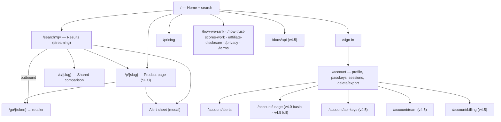
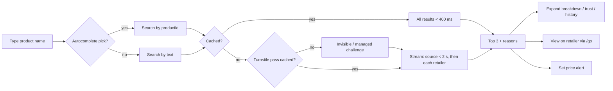
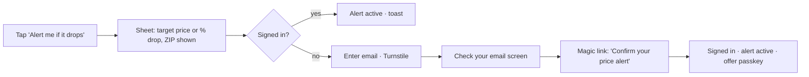

# Before You Buy — UI/UX Design Document

| Field | Value |
|---|---|
| Version | 1.0 |
| Design system | shadcn/ui (Base UI primitives) on Tailwind CSS v4, tokens in `@theme`, Lucide icons |
| Accessibility target | WCAG 2.2 AA |
| Related | [01-PRD §3, §5](01-PRD.md#5-consumer-web-requirements) · [02-ARCHITECTURE §12–13](02-ARCHITECTURE.md#13-frontend-and-design-system-summary) · [03-TECHNICAL-REQUIREMENTS](03-TECHNICAL-REQUIREMENTS.md) |

> The launch design is deliberately plain and fast. A later custom brand is a **token and component edit, not a rewrite** — keep all visual decisions in tokens (§5) and `packages/ui`.

---

## 1. Design principles

1. **Show the working.** Three options with reasons, never one hidden verdict (CW-5). Every number can be expanded to see where it came from.
2. **The delivered price is the price.** Landed cost is the biggest number on the card (CW-3); listed price is secondary.
3. **Honest about uncertainty.** When shipping or tax is unknown, show a range and say which part is uncertain. Never fake precision.
4. **Trust signals, not accusations.** Review authenticity is described as observed patterns with plain-language signals, never "fake" (TR-TRUST-05).
5. **Phone first.** Most sessions are on phones (CW-9): one column, thumb-reachable actions, 44 px targets, nothing that needs hover.
6. **Value before identity.** No sign-up before the first result (CW-10). Email is asked for once, only to set an alert (CW-8).
7. **Fast feels trustworthy.** Something meaningful in under 2 s (CW-2); skeletons that hold their final size; results stream in.
8. **Disclose money.** Affiliate relationships are visible on every result page (CW-14) and never change the order (TR-RANK-03).
9. **Plain language.** "Checked 3 minutes ago", not timestamps (CW-12). No jargon (no "ASIN", "SKU", "SSE", "scraped").

---

## 2. Users and their jobs

| Segment (PRD §3.2) | Job to be done | Design implication |
|---|---|---|
| Considered-purchase consumer (launch focus for UX) | "I'm about to spend $200+; is this the right listing at the right price, and can I trust it?" | Mobile results page, trust signals, history, alerts |
| Reseller / arbitrage buyer (revenue) | "Check many products fast and see my margin." | Dense desktop layout, keyboard-friendly search, later bulk tools (v5.5), API (v4.5) |
| Developer (v4.5) | "Get matched, landed, trust-scored results via API." | Clear docs, key management, usage dashboard |

---

## 3. Information architecture



Global header: logo (home), search (collapsed to icon on scroll on phones), account/sign-in. Global footer: disclosure link, info pages, legal pages.

---

## 4. Core flows

### 4.1 First search (anonymous)



### 4.2 URL paste

Pasting a retailer link into the search box shows an inline chip "Amazon product link detected" and searches by URL. Short links show: *"Short links can't be checked. Open the product and copy the full link from the address bar."*

### 4.3 Vague query → disambiguation

"wireless earbuds" → a picker titled **"Which one do you mean?"** with up to 6 product tiles (image, name, typical price) and a "Search exactly '{query}'" fallback link. Picking one starts a comparison. No credits are charged for the picker.

### 4.4 Price alert (the only email request)



### 4.5 Share

Share button → native share sheet (Web Share API) with the `/c/{slug}` URL; fallback "Copy link" with toast. Shared pages show "First compared on {date} · prices checked {relative time}".

### 4.6 Upgrade and API key (v4.5)

Quota bar at 80% → banner "You've used 80% of this month's searches" → `/pricing` → Stripe Checkout → back to `/account/billing` with success state → `/account/api-keys` → "Create key" → key shown once with copy button and warning.

---

## 5. Design tokens

Tokens live in `packages/ui/src/styles/tokens.css` and are exposed through Tailwind v4 `@theme`. Components use **semantic** tokens only (never raw palette values). Values below are the starting palette; **verify text contrast ≥ 4.5:1 (≥ 3:1 for large text and UI boundaries) during M1.8** and adjust lightness, not hue.

### 5.1 Color

| Token | Light | Dark | Use |
|---|---|---|---|
| `--background` | `oklch(0.99 0.003 95)` | `oklch(0.17 0.01 260)` | Page |
| `--foreground` | `oklch(0.21 0.02 260)` | `oklch(0.95 0.005 95)` | Body text |
| `--card` | `oklch(1 0 0)` | `oklch(0.21 0.012 260)` | Cards, sheets |
| `--muted` | `oklch(0.96 0.006 95)` | `oklch(0.25 0.012 260)` | Subtle fills |
| `--muted-foreground` | `oklch(0.48 0.02 260)` | `oklch(0.72 0.01 260)` | Secondary text |
| `--border` | `oklch(0.90 0.008 95)` | `oklch(0.32 0.012 260)` | Dividers, inputs |
| `--primary` | `oklch(0.45 0.09 195)` | `oklch(0.75 0.10 195)` | Primary actions (teal) |
| `--primary-foreground` | `oklch(0.98 0.01 195)` | `oklch(0.18 0.02 195)` | Text on primary |
| `--ring` | `oklch(0.55 0.12 195)` | `oklch(0.75 0.10 195)` | Focus ring |
| `--trust-good` / `-bg` | `oklch(0.47 0.11 155)` / `oklch(0.95 0.04 155)` | `oklch(0.78 0.12 155)` / `oklch(0.28 0.05 155)` | "Reviews look consistent", good-price |
| `--trust-mixed` / `-bg` | `oklch(0.50 0.11 70)` / `oklch(0.96 0.05 85)` | `oklch(0.82 0.12 80)` / `oklch(0.30 0.05 75)` | "Some concerns", typical price |
| `--trust-poor` / `-bg` | `oklch(0.50 0.16 30)` / `oklch(0.95 0.04 30)` | `oklch(0.75 0.14 30)` / `oklch(0.30 0.06 30)` | "Strong concerns", high price |
| `--trust-unknown` | = `--muted-foreground` | = `--muted-foreground` | "Not enough data" |
| `--destructive` | `oklch(0.55 0.20 27)` | `oklch(0.70 0.17 27)` | Destructive actions only |

Color is never the only carrier of meaning: trust and price states always pair color with an **icon and a text label**.

### 5.2 Typography

| Token | Value |
|---|---|
| Font | One self-hosted variable sans (Inter or Geist) via `next/font`; system fallback stack |
| Numbers | `font-variant-numeric: tabular-nums` on all prices and stats |
| Scale (px) | 12 · 14 · **16 (base)** · 18 · 20 · 24 · 30 · 36 |
| Price (landed) | 24 mobile / 30 desktop, weight 650 |
| Line height | 1.5 body, 1.2 headings |
| Inputs | ≥ 16 px (prevents iOS zoom) |

### 5.3 Space, radius, elevation, motion

| Token | Value |
|---|---|
| Spacing | 4 px base: 4, 8, 12, 16, 20, 24, 32, 40, 48, 64 |
| Radius | `--radius: 0.75rem` (cards), `0.5rem` (inputs/buttons), full (chips) |
| Elevation | Cards: 1 px border + `shadow-sm`; sheets/dialogs: `shadow-lg` |
| Motion | 150–200 ms ease-out for expand/collapse; new cards fade in 120 ms; **all motion disabled under `prefers-reduced-motion`** |
| Touch target | ≥ 44 × 44 px |

### 5.4 Breakpoints and test widths

Tailwind defaults (`sm 640`, `md 768`, `lg 1024`, `xl 1280`) plus container queries on cards. Test at **375** (iPhone SE), **390/430** (modern phones), **768** and **1024** (iPad portrait/landscape), **1440** (desktop).

```css
/* packages/ui/src/styles/tokens.css (excerpt) */
@import "tailwindcss";

@theme {
  --color-background: var(--background);
  --color-foreground: var(--foreground);
  --color-primary: var(--primary);
  --color-trust-good: var(--trust-good);
  --color-trust-mixed: var(--trust-mixed);
  --color-trust-poor: var(--trust-poor);
  --radius-card: 0.75rem;
  --font-sans: var(--font-inter), ui-sans-serif, system-ui, sans-serif;
}

:root { --background: oklch(0.99 0.003 95); --foreground: oklch(0.21 0.02 260); /* … */ }
.dark { --background: oklch(0.17 0.01 260); --foreground: oklch(0.95 0.005 95); /* … */ }
```

---

## 6. Layout and responsive behavior

| Region | Phone (< 768) | Tablet (768–1023) | Desktop (≥ 1024) |
|---|---|---|---|
| Search | Full-width, sticky top; collapses to icon on scroll down | Full-width sticky | Centered max 720 px in header |
| Controls (ZIP, condition) | Chips row under search, horizontally scrollable | Chips row | Inline with header |
| Top three | Single column, stacked | Two columns (#1 full width, #2/#3 side by side) | Three columns side by side, equal height |
| Product summary + history | Above top three (compact) | Above top three | Left rail (sticky) or above, per content length |
| Alert CTA | Sticky bottom bar | Inline button | Inline button |
| Sheets (breakdown, trust, alert) | Bottom sheet (drawer) | Bottom sheet | Side panel / dialog |

Max content width 1200 px. Cards use container queries so the same component works in one, two or three columns.

---

## 7. Screen specifications

### 7.1 Home `/`

- Headline: **"Before you buy, check if it's the right listing at the right price."** Sub: "We compare Amazon, eBay and Best Buy on delivered price, review signals and 90-day price history."
- Search combobox (autocomplete after 2 chars, ≤ 8 suggestions with thumbnail, name, typical price). Placeholder: "Search a product, or paste an Amazon, eBay or Best Buy link".
- ZIP chip: "Delivering to 10001 · Change" (from IP guess; editable).
- Below the fold: three trust questions (reviews real? discount real? same unit under different names?), popular products (links to product pages), how we make money (disclosure summary).

### 7.2 Results `/search`

```
┌──────────────────────────────────────────┐
│ ←  [ sony wh-1000xm5                 ✕ ] │
│ [pin] 10001 ▾   New only ▾                │
│ We may earn a commission · How we rank › │
├──────────────────────────────────────────┤
│ [img] Sony WH-1000XM5 · Black            │
│       Checking Amazon ✓ eBay ✓ Best Buy … │
├──────────────────────────────────────────┤
│ ▌#1 card (see 7.3)                        │
│ ▌#2 card                                  │
│ ▌#3 card (skeleton while streaming)       │
├──────────────────────────────────────────┤
│ [tip] $41 less if you accept Renewed ›    │
│ Price history: Near its 90-day low  ›     │
│ Other options we checked (4)  ▾           │
├──────────────────────────────────────────┤
│ [ [bell] Alert me if it drops ] (sticky)  │
└──────────────────────────────────────────┘
```

(`[pin]`, `[tip]`, `[bell]` and similar markers stand for Lucide icons.)

**Behavior**

- The page shell (header, controls, disclosure) renders on the server; the results list is a client component on `EventSource`.
- On `meta`: show the query, ZIP and platform progress ("Checking Amazon · eBay · Best Buy").
- On `source`: render the product header (< 2 s target).
- On each `result`: replace that platform's skeleton; re-order only when `ranking` arrives (avoid cards jumping while the user reads; a subtle "Updated ranking" note if order changes).
- On `platform_error`: platform row shows a short reason and, if `retryable`, a "Try again" link (new search for that platform).
- On `done`: progress line becomes "Checked 3 retailers · just now"; show Share.
- Skeletons are exactly card-sized (CLS ≤ 0.1).

### 7.3 Result card

```
┌─────────────────────────────────────────┐
│ #1 · Lowest delivered price             │
│ Amazon · New · Sold by Amazon           │
│ Sony WH-1000XM5 Wireless … (Black)      │
│                                         │
│ $328.41  delivered to 10001        (i)  │
│ $299.99 item · Free shipping · ~$28.42 tax │
│                                         │
│ ◉ Reviews look consistent          ›    │
│ ↓ Near its 90-day low              ›    │
│ 30-day returns · 1-year maker warranty  │
│                                         │
│ Why #1: $12 less delivered than #2;     │
│ free returns.                           │
│                                         │
│ [  View on Amazon  ↗ ]                  │
│ Affiliate link · Checked 3 minutes ago  │
└─────────────────────────────────────────┘
```

| Element | Rule | Source |
|---|---|---|
| Rank label | "#1 · Lowest delivered price", "#2 · Best returns", etc. from ranking labels | TR-RANK-04 |
| Retailer line | Retailer name (Best Buy logo where required), condition badge, seller | CW-4, TR-PROV-22 |
| Title | Plain text, 2 lines max, variant attributes as chips | CW-11 |
| Landed price | Largest text. Complete: "$328.41 delivered to 10001". Incomplete: "$312–$327 delivered" + "(tax depends on exact address)" or "(eBay shows shipping at checkout)" | CW-3, TR-LC-05 |
| Breakdown line | Item · shipping · tax; tap (i) opens the breakdown sheet | CW-3 |
| Trust row | Band icon + label; opens signals sheet | CW-6 |
| History row | Label from percentile; opens history | CW-7 |
| Terms row | Returns + warranty; "Not stated" when unknown | CW-4 |
| Reasons | 1–3 short factual reasons | CW-5 |
| CTA | "View on {Retailer}" → `/go/{token}`; full-width on phones | CW-11, TR-AFF-01 |
| Footer | "Affiliate link" marker when applicable; "Checked X ago"; "Price verified" tick for verified Amazon prices; Amazon disclaimer link when Amazon | CW-12, CW-14, LEGAL-02 |
| Possible match | Amber outline + "Possible match — check the model and color before buying" | TR-MATCH-05 |

### 7.4 Breakdown sheet (CW-3)

Rows: Item price · Shipping to {ZIP} · Estimated sales tax ({rate}% for {ZIP}) · **Delivered total**. Uncertain components show a range and one sentence why. Footer: "Retailers set the final price at checkout. We check often but can't guarantee it." Link: "Change ZIP".

### 7.5 Trust signals sheet (CW-6)

- Header: band icon + label + score ("72/100") + "Based on {n} reviews · analyzed {relative}".
- Up to 6 signals, each with an icon showing direction (raises/lowers) and one plain sentence, e.g. "A burst of 340 five-star reviews arrived in two weeks in March".
- Footer: "These are patterns, not proof. How trust scores work ›".
- `insufficient_data`: "Not enough reviews to judge (fewer than 20)."

### 7.6 Price history (CW-7)

- Inline indicator on cards and summary: "Near its 90-day low" (good), "Typical price" (mixed), "Higher than usual" (poor), "Not enough history yet" (unknown).
- Expanded: 90-day line chart (daily minimum, per retailer toggles where allowed), min/median/max labels, current price marker, sentence: "Cheaper than on 85% of the last 90 days."
- Accessible alternative: a "View as table" toggle showing weekly min/median/max.
- If history is Amazon-only due to retailer terms: caption "History shown for Amazon only."

### 7.7 Disambiguation picker

Grid of up to 6 tiles (2 columns on phones, 3 on tablet+), each with image, name, typical price; a "None of these — search exactly '{query}'" link.

### 7.8 Alert sheet (CW-8)

- Options: "When the delivered price drops below $[ ]" (prefilled 5% below current) or "When it drops by [10]%".
- Condition (New / Any), retailers (all by default), ZIP shown.
- Signed out: email field + "We'll email you only about this alert. Unsubscribe anytime." + Turnstile.
- Limits: Free shows "1 of 3 alerts used".

### 7.9 Product page `/p/{slug}`

Server-rendered and cached. Product header, latest comparison (same cards, data age shown), history chart, trust summary per retailer, FAQ-style answers ("Is $X a good price for {product}?"), alert CTA. Indexable.

### 7.10 Shared comparison `/c/{slug}`

Same as results, with banner "First compared on {date}. Prices refreshed {relative}." Not indexable.

### 7.11 Account

`/account`: email, passkeys (add/remove), sessions (sign out everywhere), data export, delete account (typed confirmation). `/account/alerts`: list with product, target, current price, status; pause/edit/delete. `/account/usage` (v4.0): searches this month vs quota.

### 7.12 Pricing `/pricing` (live at v4.5; preview at Gate 0)

Four columns (Free, Starter, Growth, Scale) + Enterprise row, values from `packages/config/plans.ts` (never hard-coded in the page). Emphasize "Every plan includes review authenticity and price history." FAQ: credits, cache hits, overage.

### 7.13 Developer area (v4.5)

`/account/api-keys`: list (name, prefix, scopes, last used, created), create dialog (name, scopes), show-once screen with copy + warning. `/account/usage`: credits by day (bar chart), cache vs live split, by key, quota bar. `/account/team`, `/account/billing`, `/docs/api`.

### 7.14 Gate 0 landing (M0)

Hero (positioning claim), three questions, three demo comparisons (real result cards with "Sample captured on {date}"), email capture, pre-order card ($49 offer per DECIDE-15, "Fully refundable"), FAQ, legal footer.

---

## 8. States and feedback

| State | UI | Copy |
|---|---|---|
| Streaming | Platform progress row; skeleton per pending platform | "Checking Best Buy…" |
| Cache hit | Everything at once | "Checked 12 minutes ago · Refresh" (refresh = forced refresh; signed-in only; warns it uses credits) |
| Platform failed | Inline row in place of card | "Best Buy didn't respond in time. Try again" |
| No match on a platform | Inline row | "No matching listing on eBay right now." |
| No results at all | Empty state with suggestions | "We couldn't find that product. Try the model number, or paste a product link." |
| Possible matches only | Amber notice above cards | "These look close but may be a different model or color. Check before buying." |
| Challenge | Turnstile widget inline (managed) | "Quick check that you're human — then we'll search." |
| Rate limited | Inline notice with countdown | "You're searching fast. Try again in 20 seconds." |
| Anonymous daily cap | Card with sign-in CTA | "You've used today's free live checks. Sign in to keep going — cached results still work." |
| Free quota used | Banner | "You've used this month's 100 searches. Results now come from our recent checks." |
| Cache-only mode (spend cap) | Site banner | "Live Amazon checks are paused for a while. Showing our most recent prices." |
| Offline (PWA) | Offline shell | "You're offline. Recent comparisons are available when you reconnect." |
| Error (unexpected) | Inline with request ID | "Something went wrong on our side. Reference: {requestId}." |

---

## 9. Content and copy rules

### 9.1 Voice

Plain, specific, calm. Short sentences. Numbers over adjectives. Say what we know and what we don't.

### 9.2 Rules

| Rule | Do | Don't |
|---|---|---|
| Delivered price | "$328.41 delivered to 10001" | "Best price!" |
| Uncertainty | "$312–$327 delivered · tax depends on exact address" | "$312*" |
| Time | "Checked 3 minutes ago" | "scrapedAt 2026-10-05T08:03Z" |
| Trust | "Some concerns: unusual burst of 5-star reviews" | "Fake reviews", "Scam seller" |
| Price claims | "Cheaper than on 85% of the last 90 days" | "Lowest price ever", "Huge discount" |
| Accuracy | "We check often; retailers set the final price at checkout." | "100% accurate", "Guaranteed" |
| Verification | "Price verified 2 minutes ago" (Amazon phase 2 only) | "Verified" for anything else |
| Data source | "From Best Buy" + logo where required | Hidden sources |

**Forbidden words in UI and marketing copy** (lint-checked in copy files): *fake, fraud, scam, guaranteed, 100%, lowest price ever, best price guaranteed, scraped*.

### 9.3 Standard copy blocks (final wording subject to LEGAL-02/05)

- **Page disclosure (CW-14):** "We may earn a commission when you buy through links on this page. It never changes the order of results — options that earn us nothing are shown when they're better. How we rank ›"
- **Per-card marker:** "Affiliate link".
- **Amazon price note (LEGAL-02):** "Price and availability accurate as of {time} and subject to change. The price on Amazon at the time of purchase applies."
- **Trust footer:** "These are patterns in public reviews, not proof. How trust scores work ›"

---

## 10. Components

| Component | Base | Notes |
|---|---|---|
| `SearchCombobox` | shadcn Command / Combobox | Debounced 150 ms; keyboard and screen-reader friendly; URL detection |
| `ZipChip` | Popover + Input | 5-digit validation; writes cookie |
| `ResultCard` | Card | Container-query layout; all states in §8 |
| `ResultSkeleton` | Skeleton | Exact card dimensions |
| `PlatformProgress` | custom | Per-platform status with icons + text |
| `LandedPrice` | custom | Formats money/ranges; tabular numbers |
| `BreakdownSheet` | Drawer (phone) / Dialog (desktop) | |
| `TrustBadge` + `TrustSheet` | Badge + Drawer | Icon + text + color |
| `HistoryIndicator` + `HistoryChart` | Badge + shadcn Chart (Recharts) | Chart lazy-loaded; table alternative |
| `ReasonList` | custom | 1–3 reasons |
| `DisambiguationGrid` | Card grid | |
| `AlertSheet` | Drawer / Dialog + Form (React Hook Form + Zod) | Same schema as API |
| `DisclosureBanner` | Alert | On every results/product/comparison page |
| `TurnstileWidget` | custom | Managed mode; accessible label |
| `ShareButton` | Button | Web Share API + copy fallback |
| `Toaster` | Sonner | Non-critical confirmations only |

No tooltips for essential information (they don't work on touch); use popovers or inline text.

---

## 11. Accessibility (WCAG 2.2 AA)

- **Streaming announcements:** one polite live region announces platform completions ("eBay: 2 options found"; "Ranking updated"). Cards themselves are not live regions. Focus never moves on its own.
- **Busy states:** results list has `aria-busy="true"` until `done`.
- **Keyboard:** every action reachable; visible focus ring (`--ring`); sheets/dialogs trap focus and return it on close; `Esc` closes.
- **Targets:** ≥ 44 × 44 px (exceeds WCAG 2.2 target-size minimum).
- **Color:** trust/price states always have icon + text; contrast verified per §5.
- **Charts:** text summary sentence + data table alternative.
- **Forms:** labels always visible; errors announced and linked with `aria-describedby`; no placeholder-only labels.
- **Motion:** respect `prefers-reduced-motion`.
- **Language and structure:** `lang="en-US"`, one `h1` per page, landmark regions, skip link.
- **Testing:** axe in Playwright on every page type; manual VoiceOver (iOS) and NVDA/TalkBack passes per UI milestone.

---

## 12. Performance UX

- Server-render everything except the streaming list, sheets and chart.
- Skeletons sized to the final card; images have explicit dimensions; fonts via `next/font` with `display: swap` and size-adjusted fallback.
- Chart and sheets are dynamic imports; route JS ≤ 150 KB gzipped.
- Prefetch the product page on autocomplete hover/focus (desktop) only.
- Budgets: LCP ≤ 2.5 s (mid-range phone, 4G), INP ≤ 200 ms, CLS ≤ 0.1.

---

## 13. Analytics mapping

| UI moment | Event (TR-ANL-02) |
|---|---|
| Submit search | `search_submitted` |
| First meaningful event rendered | `search_first_event` |
| Done | `search_completed` |
| Picker shown / picked | `disambiguation_shown` / `disambiguation_picked` |
| Open breakdown / trust / history | `landed_breakdown_opened` / `trust_signals_opened` / `price_history_viewed` |
| Click "View on …" | `outbound_click` |
| Alert started / confirmed | `alert_started` / `alert_confirmed` |
| Share created / opened | `share_created` / `share_opened` |
| Change ZIP | `zip_changed` |

---

## 14. Path to the custom design

1. Change token values in `tokens.css` (color, radius, font) — every component follows.
2. Restyle components inside `packages/ui` without changing their props.
3. Add brand assets (logo, illustrations) as separate components.
4. Never put raw colors, font sizes or radii in app code; lint for arbitrary Tailwind values in `apps/web`.
