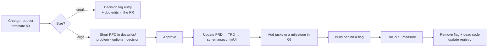

# Before You Buy — Change Management, Feature Registry and Decision Log

| Field | Value |
|---|---|
| Version | 1.0 |
| Owner | Zean & Dagger |
| Purpose | How features are added, removed or upgraded without the docs and the code drifting apart; the record of every decision |

The PRD says features will move (the extension may come forward, US-only may end, models will change). This file keeps those moves deliberate and traceable.

---

## 1. Which document owns what

| Document | Owns | Changes when |
|---|---|---|
| [01-PRD](01-PRD.md) | What and why: requirements (`CW-*`, `AR-*`), pricing, gates, roadmap | Scope, pricing or priorities change |
| [02-ARCHITECTURE](02-ARCHITECTURE.md) | Components, stack, principles, provider policy model | A component, vendor or principle changes |
| [03-TECHNICAL-REQUIREMENTS](03-TECHNICAL-REQUIREMENTS.md) | Contracts, algorithms, budgets (`TR-*`, `NFR-*`) | Behavior or an interface changes |
| [04-BACKEND-SCHEMA](04-BACKEND-SCHEMA.md) | Tables, keys, queues, retention | Any migration |
| [05-SECURITY](05-SECURITY.md) | Threats and controls (`SEC-*`) | New surface, data type, actor or vendor |
| [06-IMPLEMENTATION-PLAN](06-IMPLEMENTATION-PLAN.md) | Milestones, tasks, status | Work is added, re-ordered or completed |
| [07-UI-UX-DESIGN](07-UI-UX-DESIGN.md) | Flows, screens, tokens, copy rules | Any user-visible change |
| [08-REVIEW-ITEMS](08-REVIEW-ITEMS.md) | Open legal items, decisions, gaps | An item opens or resolves |
| **09 (this file)** | Process, feature registry, decision log, doc changelog | Every change above |
| [CLAUDE.md](../CLAUDE.md) | Working rules for Claude Code; current milestone pointer | Rules or the active milestone change |

**Precedence when documents disagree:** PRD → this decision log → architecture → TRD → schema/security/UI. Fix the lower document in the same PR.

**Doc versioning:** each doc's header `Version` follows `major.minor`. Bump **minor** for clarifications and additions; **major** for scope changes or removed requirements. Record every bump in §8.

---

## 2. Change types and the docs each one touches

| Change | PRD | Arch | TRD | Schema | Security | UI | Plan | Review | Decision log |
|---|---|---|---|---|---|---|---|---|---|
| **Add a feature** | ✓ new ID | if new component | ✓ new `TR-*` | if data | if new surface | if visible | ✓ new tasks/milestone | if legal/decision | ✓ |
| **Remove a feature** | ✓ mark *Removed* (keep ID) | if component goes | ✓ mark removed | ✓ contract migration | ✓ remove/retire controls | ✓ | ✓ removal tasks | — | ✓ |
| **Upgrade / modify a feature** | if behavior promise changes | if structure changes | ✓ | if data | if risk changes | if visible | ✓ tasks | if legal | ✓ |
| **Swap a vendor or model** | — | ✓ | ✓ config | if data shape | ✓ vendor review | — | ✓ tasks | LEGAL review | ✓ |
| **Change pricing/credits/quotas** | ✓ | — | ✓ §16 | — | — | ✓ pricing page | ✓ | — | ✓ |
| **Resolve a review item** | if scope changes | if design changes | if behavior changes | if retention changes | if control changes | if copy changes | if tasks change | ✓ resolve | ✓ |
| **Dependency patch / bugfix** | — | — | — | — | — | — | — | — | — (commit message only) |

Requirement IDs are **never reused**. A removed requirement keeps its ID with status *Removed (DEC-xxx)*.

---

## 3. Process



1. **Write the change request** (§9). Large = new milestone, new vendor, schema change on a hot table, pricing change, or anything touching legal items.
2. **Decide** and add a `DEC-*` entry (§7) with context, decision and consequences.
3. **Update docs top-down** in one PR (PRD first). Claude Code should be given the change request and asked to propose the doc diff before code.
4. **Plan the work** as tasks in an existing milestone or a new milestone (`M25`, …) in [06](06-IMPLEMENTATION-PLAN.md).
5. **Build behind a feature flag** (§4) when user-visible.
6. **Roll out**, watch the metrics named in the change request.
7. **Clean up:** remove the flag within two releases of 100% rollout; update the registry (§6).

---

## 4. Feature flags

- Names: `area.feature` in kebab-case, e.g. `alerts.percent-drop`, `amazon.affiliate-links`, `search.forced-refresh`.
- Defined in `packages/config/flags.ts` with owner, default, description and expiry date. Unknown flags evaluate to off.
- Runtime values from PostHog feature flags (user-targeted) or Redis (`flag:*`, global/kill switches).
- **Kill switches** (TR-CRED-22) are permanent flags and never expire.
- A flag past its expiry fails CI with a warning until removed or extended with a reason.

---

## 5. Removing or upgrading safely

### 5.1 Removing a feature

1. Mark the PRD requirement *Deprecated* with the removal date.
2. Hide entry points in the UI behind a flag; keep read paths working.
3. **Public API:** announce with `Deprecation` and `Sunset` headers and docs; ≥ 90 days' notice for `/v1` fields/endpoints; breaking changes go to `/v2`.
4. **Database:** expand/contract — stop writing → stop reading → drop columns/tables in a later release; respect retention obligations before dropping data.
5. Remove code, tests, flags; mark the requirement *Removed (DEC-xxx)*.

### 5.2 Upgrading the LLM or embedding model

1. Change the model ID in config on a branch; run the full eval suite (match accuracy, trust precision) and a cost comparison against `main`.
2. Accept only if quality ≥ baseline − 0.5 points and cost per search is within the PRD's assumptions (re-cost if not, PRD §7).
3. Embedding model change: new column + index, `embedding-backfill`, switch reads, drop old column (schema doc §5.1).
4. Record the model and eval results in a `DEC-*` entry.

### 5.3 Adding a retailer

1. Legal review of the retailer's terms → policy block values (`maxDisplayAgeSec`, `maxRetainSec`, `aiUseAllowed`, `historyAllowed`, attribution).
2. Extend the `platform` enum (add value), implement `ProviderAdapter`, fixtures and contract tests.
3. Update credit pricing if platform count affects credits (PRD §9), UI attribution, affiliate link builder.
4. Add to the registry and the eval set.

### 5.4 Framework and dependency upgrades

Renovate opens PRs; security patches within 48 h (SEC-80). Major upgrades (Next.js, React, Better Auth, Drizzle, Zod) get their own PR with release notes reviewed and a note here if behavior changed.

---

## 6. Feature registry

Status: `planned` · `building` · `beta` (flagged) · `live` · `deprecated` · `removed`.

| ID | Feature | Phase | Milestone | Flag | Status |
|---|---|---|---|---|---|
| CW-1 | Name search + autocomplete; URL paste | v4.0 | M7, M11 | — | planned |
| CW-2 | Source < 2 s; SSE streaming | v4.0 | M7, M11 | — | planned |
| CW-3 | Landed cost with breakdown | v4.0 | M8, M11 | — | planned |
| CW-4 | Condition, warranty, returns | v4.0 | M8, M11 | — | planned |
| CW-5 | Top 3 with reasoning | v4.0 | M8, M11 | — | planned |
| CW-6 | Review authenticity score + signals | v4.0 | M9, M11 | `trust.scores` | planned |
| CW-7 | 90-day price history | v4.0 | M10, M12 | — | planned |
| CW-8 | Price-drop alerts by email | v4.0 | M13 | `alerts.enabled` | planned |
| CW-9 | Mobile-first layout | v4.0 | M11 | — | planned |
| CW-10 | No signup before first result | v4.0 | M7, M15 | `search.anonymous` (kill switch) | planned |
| CW-11 | Exact-variant deep links | v4.0 | M6, M16 | — | planned |
| CW-12 | Plain-language freshness | v4.0 | M11 | — | planned |
| CW-13 | Shareable comparison URL | v4.0 | M12 | `share.enabled` | planned |
| CW-14 | Affiliate disclosure | v4.0 | M16 | — | planned |
| CW-15 | Pre-crawl cache | v4.0 | M14 | — | planned |
| AR-1…AR-8 | Search API contract changes | v4.0 internal / v4.5 public | M7–M10, M19 | — | planned |
| AR-9 | Credit metering | v4.0 internal / v4.5 billed | M15, M18 | — | planned |
| AR-10 | Overage instead of 402 | v4.5 | M18 | — | planned |
| — | Gate 0 landing, waitlist, pre-orders | Pre-build | M0 | — | planned |
| — | Paid tiers + Stripe meters | v4.5 | M18 | `billing.enabled` | planned |
| — | Public API `/v1` + keys + OpenAPI | v4.5 | M19 | `api.public` | planned |
| — | Usage dashboard, teams, 2FA | v4.5 | M20 | — | planned |
| — | Amazon affiliate links | v4.0 | M16 | `amazon.affiliate-links` (default off, LEGAL-02) | planned |
| — | Browser extension | v5.0 | M22 | — | planned |
| — | Bulk search, CSV, margin calculator, watchlists, webhooks | v5.5 | M23 | — | planned |
| — | New retailers, AU region, white-label, SSO/SCIM | v6.0 | M24 | — | planned |

---

## 7. Decision log

Format: **DEC-NNN — Title** · date · status (`accepted` / `superseded by DEC-xxx`) · context → decision → consequences. Newest at the bottom. Entries 001–013 restate the architecture document's choices so they are traceable.

| ID | Date | Decision | Context / consequences | Status |
|---|---|---|---|---|
| DEC-001 | 2026-10-04 | TypeScript end to end | One schema system; extension shares code. Revisit if a custom-trained review model needs Python (add one service) | accepted (pending DECIDE-16 confirmation) |
| DEC-002 | 2026-10-04 | pnpm workspaces + Turborepo monorepo | Shared packages across apps | accepted |
| DEC-003 | 2026-10-04 | Next.js 16 (≥ 16.3.8) on Vercel for the web app | SSR/ISR, small phone JS, SEO pages | accepted |
| DEC-004 | 2026-10-04 | shadcn/ui on Tailwind v4 with Base UI primitives | Owned components; rebrand via tokens | accepted |
| DEC-005 | 2026-10-04 | Hono API on Node LTS in Railway containers | SSE and 45 s calls off serverless | accepted |
| DEC-006 | 2026-10-04 | Zod 4 as the single schema language | Forms, API, providers, LLM output, OpenAPI | accepted |
| DEC-007 | 2026-10-04 | PostgreSQL 18 on Neon via Drizzle; Postgres-first (pgvector, pg_trgm, partitions) | No extra search/vector/time-series DB until volume demands | accepted |
| DEC-008 | 2026-10-04 | Redis + BullMQ for cache, limits, jobs | Redis holds only rebuildable state | accepted |
| DEC-009 | 2026-10-04 | Better Auth (magic link, passkeys, organizations) | Users in our DB; SSO later via plugins | accepted |
| DEC-010 | 2026-10-04 | Vercel AI SDK; Gemini first; model behind interface | PRD §11.1 drops a named model | accepted |
| DEC-011 | 2026-10-04 | Stripe Billing with usage meters | Paddle alternative pending DECIDE-07 | accepted |
| DEC-012 | 2026-10-04 | Resend + React Email | Alerts and quota emails | accepted |
| DEC-013 | 2026-10-04 | Turnstile + Vercel firewall; Sentry, OpenTelemetry, PostHog | Cost abuse defence; return-rate metric | accepted |
| DEC-014 | 2026-10-05 | Public API under `/v1` (`POST /v1/search`, `GET /v1/search/stream` = PRD `/api/search`, `/api/search/stream`); first-party web routes under `/web/*`; Better Auth at `/api/auth/*` | Cookie routes first-party only; key routes never read cookies (GAP-06) | accepted |
| DEC-015 | 2026-10-05 | SSE per-platform failure event named `platform_error` (not `error`) | `EventSource` reserves `error` (GAP-07) | accepted |
| DEC-016 | 2026-10-05 | Money as integer cents; credits as integer millicredits; tax rates in ppm | Exact sums; 0.5-credit hits; 8.875% exact | accepted |
| DEC-017 | 2026-10-05 | `uuidv7()` primary keys; 10-char random base62 share slugs | Time-sortable, unguessable | accepted |
| DEC-018 | 2026-10-05 | `organization_id` on every customer-owned row; personal org per signup; append-only credit ledger with DB trigger | B2B as configuration | accepted |
| DEC-019 | 2026-10-04 | Hybrid hosting, single US East region | Move containers if bill > ~$1,000/mo | accepted |
| DEC-020 | 2026-10-03 | eBay and Best Buy via official APIs; Amazon via Web Unlocker + backup unblocker + Web Scraper verify | PRD changes 1 and 3; dependency risk | accepted |
| DEC-021 | 2026-10-03 | Landed cost is the compared number; ranges when uncertain | PRD change 4, CW-3 | accepted |
| DEC-022 | 2026-10-05 | Ranking is affiliate-blind, enforced by input types and a test | PRD §3.1 credibility | accepted |
| DEC-023 | 2026-10-05 | Ranking reasons are deterministic templates from facts, not free-form LLM text | No hallucinated claims; cheaper; testable | accepted |
| DEC-024 | 2026-10-05 | Web reads data through the API; API and worker are the only DB writers (except DEC-031) | Single owner of business logic | accepted |
| DEC-025 | 2026-10-05 | API keys stored as HMAC-SHA-256 with a versioned server pepper (strengthens the architecture's SHA-256) | DB leak alone doesn't allow offline key checks | accepted |
| DEC-026 | 2026-10-05 | Errors use RFC 9457 problem+json with stable `code` | Consistent client handling | accepted |
| DEC-027 | 2026-10-05 | Testing: Vitest, Playwright (+axe), MSW, fast-check, k6, Lighthouse CI; eval suite as Gate 1 arbiter | TRD §26 | accepted |
| DEC-028 | 2026-10-05 | ESLint flat config + Prettier | Widely known; import-boundary rules | accepted |
| DEC-029 | 2026-10-05 | Local dev via Docker Compose: `pgvector/pgvector:pg18`, `redis:7`, Mailpit | Parity with production engines | accepted |
| DEC-030 | 2026-10-05 | Share links store listing references, not prices; pages re-render current policy-compliant data | eBay 6 h / Best Buy 72 h terms | accepted |
| DEC-031 | 2026-10-05 | Temporary M0 exception: Next.js route handlers write `waitlist_signups`/`preorders`; removed in M1.9 | Gate 0 needs no API service | accepted |
| DEC-032 | 2026-10-05 | Added `packages/core`, `email`, `config`, `observability`, `tooling/`, `infra/` to the repo layout | Pure domain logic and one config source | accepted |
| DEC-033 | 2026-10-05 | Provider policy gains `historyAllowed`; eBay/Best Buy default `aiUseAllowed=false`, `historyAllowed=false` until LEGAL-03/04 | Terms may forbid AI use and price modelling | accepted |
| DEC-034 | 2026-10-05 | Amazon affiliate links behind `amazon.affiliate-links`, default off until LEGAL-02 | Associates price-display rules vs scraped prices | accepted |
| DEC-035 | 2026-10-07 | `demoComparisonSchema.product` gains an optional `image` (`src`, `alt`, `source`, `license`); M0.3 demo products ship with original neutral SVG illustrations, not retailer photos | LEGAL-16 forbids retailer listing images; `source`/`license` record provenance so a manufacturer press image can replace the illustration later without a silent swap | accepted |
| DEC-036 | 2026-10-07 | M0.4 adds `waitlist_confirmed` to the TR-ANL-02 analytics event set and a console-only `track()` adapter in `apps/web/lib/analytics.ts`, ahead of M0.7's PostHog wiring | The double opt-in needed a confirmation signal now; M0.7 swaps the adapter body for the real PostHog transport without changing call sites or the event schema | accepted |
| DEC-037 | 2026-10-07 | M0.5 pre-orders: `PaymentProvider` lives in `apps/web/lib/payments/` (mock + stripe, selected by `PAYMENTS_PROVIDER`); the mock webhook signature reuses `LINK_SIGNING_SECRET` rather than a new secret; `stripeProvider.parseWebhook` only maps `checkout.session.completed`, everything else is `ignored` (TR-BILL-07 puts Stripe refunds in the dashboard, not a webhook); `pnpm preorder:refund <id>` operates on the `preorders` row id, not the Stripe/mock session id | Keeps the M0 local-only Stripe account unnecessary while leaving the real provider ready to select; no new env var for a local-only signing need | accepted |

### 7.1 Decision entry template

```markdown
### DEC-NNN — <title>
- Date: YYYY-MM-DD · Status: accepted
- Context: <what forced the decision; link review item / PR>
- Options considered: <a, b, c>
- Decision: <what we chose>
- Consequences: <docs updated, migrations, flags, risks, what to revisit and when>
```

---

## 8. Documentation changelog

| Date | Docs | Version | Change |
|---|---|---|---|
| 2026-10-05 | All (`CLAUDE.md`, 01–09) | 1.0 | Initial repo documentation set created from PRD v4.0 and Architecture & Stack (Oct 4, 2026). Added editor's notes for the Amazon Creators API change, review register, milestone plan and decision log. |
| 2026-10-07 | 07-UI-UX-DESIGN | 1.1 | M0.3 polish: documented the demo product-image header (DEC-035) and the ranking-reason honesty rules (ties, "Best returns" eligibility, "No returns" wording). |

---

## 9. Change request template

Copy into an issue or `docs/rfcs/NNNN-title.md`.

```markdown
## Change request: <title>
- Type: add | remove | upgrade | vendor/model swap | pricing
- Requested by / date:
- Affected requirement IDs: CW-…, AR-…, TR-…
- Problem / opportunity (with data if available):
- Proposal:
- Alternatives considered:
- User-visible impact (screens, copy, emails):
- Data impact (tables, migrations, retention):
- Security / legal impact (new data, vendors, terms):
- Cost impact (per search, infra):
- Metrics to watch and success criteria:
- Rollout: flag name, stages, rollback plan
- Docs to update (tick): [ ] PRD [ ] Arch [ ] TRD [ ] Schema [ ] Security [ ] UI [ ] Plan [ ] Review items [ ] Decision log
```
